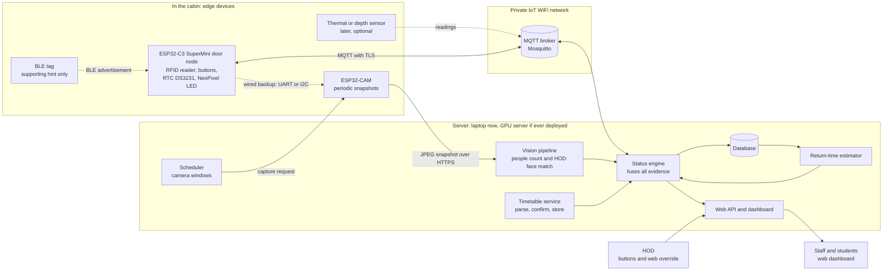
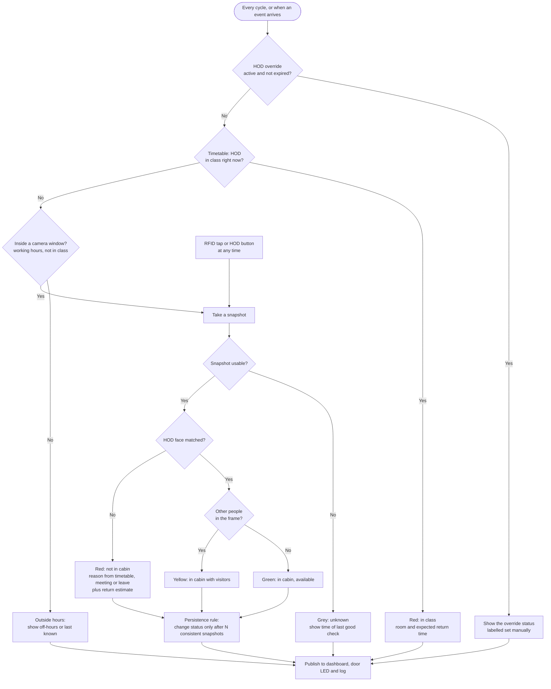
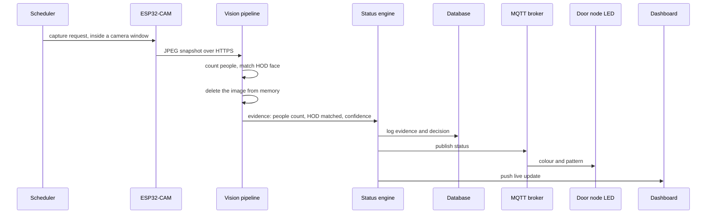

# Smart Cabin

**Timetable-aware faculty availability monitoring using privacy-preserving IoT vision**

| | |
|---|---|
| Project type | M.Tech Data Science, yearly project and report (6 to 8 months) |
| Document status | Iteration 0 done. Demo web dashboard with 839 Presidency University faculty (laptop), face recognition prototypes (laptop + Raspberry Pi Zero 2W). Version 0.3, 21 October 2026 |
| Day-by-day log | See [timeline.md](timeline.md) |
| Prototype scope | Demo/prototype. No deployment planned. A university GPU server could be used if it is ever deployed |

**Status keys used in this document**

- **Decided**: you have agreed to it.
- **Proposed**: my suggestion, waiting for your confirmation.
- **Open**: not decided yet.

---

## Current scope

> **24 Oct 2026: the real product is in [`pi board codes/smart cabin system/`](pi%20board%20codes/smart%20cabin%20system/README.md).**
> - It has a laptop server (FastAPI + SQLite) and a Raspberry Pi cabin app (camera, RFID, Bluetooth, buttons, NeoPixel).
> - Its plan, with every step and check, is in [BUILD_PLAN.md](pi%20board%20codes/smart%20cabin%20system/BUILD_PLAN.md).
> - The documents, charts and the animated "vs existing work" presentation are in its `docs/`.
> - The demo parts below are kept as the earlier prototypes.

As of 21 October 2026, the project has three working parts. The full design below stays as the long-term plan.

1. **Web dashboard (laptop):** shows the status of all 839 Presidency University faculty. It uses **demo statuses** for now, because it is not yet connected to a camera.
2. **Face recognition on the laptop** (`laptop codes/face recoginition/`): webcam, MTCNN + FaceNet (PyTorch). Register, recognise and delete people.
3. **Face recognition on the Raspberry Pi Zero 2W** (`pi board codes/`): one self-installing file with OpenCV YuNet + SFace (light enough for 512 MB RAM) and its own web page. **Not yet run on the real Pi.**

### Folder layout

The code is split by which hardware it needs:

| Folder | What is in it |
|---|---|
| `laptop codes/` | Needs **only the laptop**: web dashboard (`code/`, `web/`, `data/`), webcam headcount (`code/headcount.py`, `code/camera.py`, `yolov8n.pt`), laptop face recognition (`face recoginition/`) |
| `pi board codes/` | Needs a **Raspberry Pi** (with or without the laptop): code that runs on the Pi, plus the laptop side of the Pi link (`pi_receiver.py`, `compare_benchmarks.py`) |
| `Documents/`, `research/` | Review slides, reference papers, paper summaries. `Documents/Archive - ESP32 (dropped)/` keeps the old ESP32-CAM code for the documentation only |

**The ESP32 idea was dropped on 25 Oct 2026.** The Raspberry Pi does the camera, RFID, Bluetooth and light work, and runs face recognition on the device. The ESP32 parts further down this README are kept as the history of the design. Code is kept simple: small files of plain functions plus one main file.

| Review | Dates | What is expected |
|---|---|---|
| Review 0 | 29 Sept – 2 Oct 2026 | Topic, problem, literature survey, objectives (done) |
| Review 1 | 3 – 6 Nov 2026 | Working prototype, model implementation, experimental setup |
| Review 2 | 8 – 11 Dec 2026 | Results and discussion, final report, research paper (IEEE/Springer venue, to be chosen) |

### Running the demo

Needs Python 3 only (standard library, nothing to install).

```
cd "laptop codes/code"
python main.py
```

For the camera and headcount part (not needed for the web demo), install the libraries once:

```
cd "laptop codes/code"
python install_requirements.py
```

All the paths in the two tables below are inside `laptop codes/`.

`python main.py` reads the people and timetables from `data/`, writes `web/data.js` and opens `web/index.html` in your browser. Every 10 seconds 5 random people's statuses change (demo data). Press Ctrl+C to stop. You can also double-click `web/index.html` to open it without Python.

The system supports many HODs and faculty across departments. To add or change people, edit `data/people.csv` and `data/timetable.csv` (Excel works).

| File | What is in it |
|---|---|
| `data/people.csv` | One row per faculty member: id, name, designation, role (Dean / HOD / Faculty), school, department, cabin. Currently 839 Presidency University faculty from the university website |
| `data/programs.csv` | One row per programme: school, program, degree (B.Tech, M.Tech, MBA, Ph.D, ...), level (Bachelor's / Master's / Doctoral / Diploma), duration (114 programmes) |
| `data/timetable.csv` | One row per class or meeting: person_id, day, start, end, activity. **Currently a made-up demo timetable** |
| `code/fetch_presidency_data.py` | Downloads the faculty and programme lists from presidencyuniversity.in into `data/`, and makes the demo timetable. Re-run it to refresh |
| `code/config.py` | Settings (folders, site title, timings) |
| `code/people.py` | Reads the CSV files, finds a person's timetable and current class |
| `code/demo_data.py` | Fake statuses and the sensor list for the demo |
| `code/webpage.py` | `build_site_data()`, `write_status()` (writes `web/data.js`) and `open_dashboard()` |
| `code/main.py` | Main program that calls the modules above |
| `code/install_requirements.py` | Installs everything in `code/requirements.txt` and checks each library imports |

| Web page | What it shows |
|---|---|
| `web/index.html` | Home: starts empty. Pick a school, then a department, then (optionally) one name from a list to see the faculty cards. Keyword search and Role buttons (Everyone / Deans / HODs / Faculty) filter within the chosen department. Step-by-step explanation in [web/README.md](laptop%20codes/web/README.md) |
| `web/programs.html` | All programmes grouped by degree (B.Tech, M.Tech, MBA, ...), with quick select buttons for level (Bachelor's / Master's / Ph.D / Diploma) and degree, plus search |
| `web/person.html?id=f001` | One person: big status, reason, expected return, today's timetable, how we know |
| `web/staff.html` | Staff login (pick your name, demo password `staff123`, not secure): set my status, edit my timetable, my history |
| `web/system.html` | System health, sensors (planned ones greyed out), demo controls, recent changes |
| `web/common.js` | Helpers shared by all pages (also fills in the header title) |

Every page has the same header, which stays at the top while scrolling, with links to Faculty status, Programmes, Staff login and System. Every page also has the same footer. School and department names are the official ones from the university website.

### Face recognition

| File | What it does |
|---|---|
| `laptop codes/face recoginition/face_app.py` | Laptop webcam face recognition: detect (MTCNN) → embed (FaceNet, 512 numbers) → match (cosine similarity). Keys: R register, D delete, Q quit. Faces saved in `known_faces.pkl` |
| `laptop codes/face recoginition/system_check.py` | Read-only check of Python, libraries and versions before running `face_app.py` |
| `pi board codes/smartcabin_pi.py` | Raspberry Pi version in **one file** (paste it into `nano` over SSH). Detect (YuNet) → embed (SFace, 128 numbers) → match. Installs missing libraries and downloads the models on first run. Web page on port 8000 with live video, who is "In cabin" (seen in the last 15 s), Register and Delete, plus `/status.json` |

Run on the Pi:

```
python3 smartcabin_pi.py
```

Then open `http://<pi-ip>:8000`, or use an SSH tunnel (`ssh -L 8000:localhost:8000 ...`) and open `http://localhost:8000`.

Faces registered on the laptop don't carry over to the Pi, because they use different models. Register again on the Pi.

### Research

Paper summaries, relevance to Smart Cabin, a comparison table and the draft research gap are in [research/papers.md](research/papers.md).

---

## 1. Problem and aim

Students and staff often walk to the HOD's cabin and find it empty. Paper signs go stale, and nobody knows whether he is in class, in a meeting, on leave, or about to return.

**Aim:** design and evaluate an IoT system that shows, on a simple website and a door light, whether the HOD is available in his cabin, and when he will be back if he is not, without recording anyone.

**Objectives**

1. Detect the HOD's presence reliably without continuous recording.
2. Combine timetable context with sensor evidence (camera, RFID, BLE, buttons) into one clear status.
3. Estimate the return time when he is away.
4. Present the status on a web dashboard and a NeoPixel light that non-technical users understand at a glance.
5. Evaluate accuracy, delay and privacy behaviour with measurements.
6. Build in iterations, and document every technology choice, its alternatives and its security.

---

## 2. Design principles

| Principle | What it means in practice |
|---|---|
| Status, not footage | Only a status and a timestamp leave the cabin. Nobody, including staff, can see camera images. |
| Snapshots, not video | The camera takes a picture only inside timetable windows when the HOD could plausibly be there. |
| The server decides | Boards sense and report. One status engine on the server makes every decision, so logic lives in one place and is easy to test. |
| Evidence, not trust | No single signal can make the status "available" on its own. BLE in particular is only a hint. |
| Say "unknown" honestly | When data is old or the camera fails, the system shows grey/unknown, not a confident wrong colour. |
| Iterate | Each iteration adds a feature. Earlier work is kept, not redone. |

---

## 3. System design



### Node roles

| Node | Does | Does not do |
|---|---|---|
| ESP32-CAM | Takes a snapshot when asked, uploads it | No decisions, no storage of images |
| Door node (ESP32-C3) | Reads RFID and buttons, shows status on the NeoPixel, keeps time with the RTC, listens for the BLE tag | No status logic |
| MQTT broker | Carries small messages between nodes and server | Does not carry images |
| Server | Vision, timetable, status engine, return-time estimate, database, web | Never exposes images to users |

### Why MQTT as the main link with a wired backup

Pairing the two is a good idea: MQTT over WiFi is the normal path, and a wire is the fallback for boards in the same cabin.

- **I2C** is designed for short distances (on a board or within a few tens of centimetres). **UART** tolerates longer cables, so UART is the better backup if the camera sits across the room.
- The backup needs clear rules, or it becomes a source of bugs: what travels over the wire (small status messages only), which link wins when both work, and what the LED shows when both fail (grey/unknown).
- Build the backup in a later iteration, after the MQTT path works.

---

## 4. Status model

| Colour | Status | Meaning |
|---|---|---|
| Green | In cabin, available | HOD matched on camera, nobody else in frame, or set by HOD |
| Yellow | In cabin with visitors | HOD matched on camera and other people are present, or set by HOD |
| Red | Not in cabin | Reason shown: in class (room), meeting, leave, or off hours, plus expected return |
| Grey | Unknown | Data too old or the camera could not confirm. The time of the last good check is shown |
| Blue | Reserved | Meaning to be decided later (candidates: in class, override active) |

Colour is never the only signal. The dashboard always shows text, and the LED pairs colours with patterns (steady, slow breathing, blink) for colour-blind users.

### Status logic (draft v0.1, to be refined in a dedicated session)



**Why a persistence rule:** a student dropping off notes or a one-off bad frame should not flip the status. Requiring N consistent snapshots (and a smaller number to turn green) stops flicker. N is tuned during evaluation.

### One snapshot cycle



---

## 5. Technology register

This register is updated whenever we choose something. Each row says what we chose, why, and what else we could have used.

### 5.1 Edge devices

| Layer | Choice | Status | Why this choice | Alternatives |
|---|---|---|---|---|
| Camera node | ESP32-CAM (AI-Thinker, OV2640) | Decided | Cheap, WiFi built in, JPEG snapshots are enough for periodic checks | ESP32-S3 camera board (on-device AI, costs more); Raspberry Pi with camera (more compute, more admin) |
| Control node | ESP32-C3 SuperMini | Decided | Small, cheap, WiFi and BLE 5, well supported | ESP32 DevKit (more pins); ESP32-S3; Raspberry Pi Pico W |
| Identity tap | RFID reader (RC522, 13.56 MHz) | Proposed, pending card check | Cheap, common, easy SPI library | PN532 (more card types); 125 kHz EM4100 readers if the cards are low-frequency |
| Clock | DS3231 RTC plus NTP | Decided (RTC needed) | Accurate and temperature-compensated, keeps time through WiFi or power loss, so the schedule keeps working | ESP32 internal RTC (drifts); NTP only (needs the network); DS1307 (less accurate) |
| Status light | WS2812B NeoPixel | Decided | One data pin, any colour, supports patterns | Plain RGB LED; LED matrix as in the Benin thesis; e-paper display |
| BLE tag | Paired phones / laptops (0 – 5 per user), with a dedicated BLE tag or ESP32 beacon as backup | Being tested (24 Oct 2026, `9_bluetooth_presence.py`) | Phones randomise their address only while *advertising*. Pairing once gives the fixed classic address (and the IRK key), so no typing is needed. The device is not trusted and is disconnected after pairing, then checked by l2ping | Dedicated BLE tag; phone app broadcasting a fixed ID; smartwatch |
| Liveness sensor | mmWave radar (HLK-LD2410, about ₹300–500), favoured over thermal (MLX90640, AMG8833) or multizone ToF | Open, later | Senses breathing-level movement, so it sees a person sitting still. Reports moving and still targets with distance, so the doorway can be ignored. Not affected by sunlight or warm air, and not fooled by a photo or a video on a screen. UART or one OUT pin | Thermal array (₹2,000–5,000, warm body shape); multizone ToF (real depth); software liveness across snapshots (built: stillness check and ignore zones in `7_people_count_snapshot.py`); depth camera (costly) |

**Considered and rejected:** PIR and door/hall sensors (passersby trigger them and cannot be told apart from the HOD), continuous video (privacy), phone MAC address presence (address randomisation, and the phone can be in range outside the cabin).

**PIR in detail (24 Oct 2026):** a PIR senses a *change* in heat, not a person. It reads "empty" when someone sits still at a desk (the worst failure here), and "someone" from sunlight, AC or heater air, warm devices or people passing an open door. The Benin base thesis uses PIR, so this is a point of difference to explain. PIR is only useful as a *wake-up trigger* (for example, take pictures faster after motion), not as the presence decision.

**Photos and videos of people (24 Oct 2026):** a camera can't tell a real person from a photo, poster or screen.
- Built: the stillness check (catches photos and posters) and ignore zones (catches anything fixed, including a wall TV), in `7_people_count_snapshot.py`.
- Not caught yet: a video on a phone or laptop held up to the camera.
- Idea, not built: a "screen check". YOLOv8n already finds `tv`, `laptop` and `cell phone`, and MobileNet-SSD finds `tvmonitor`. Ignore person boxes mostly inside a screen box.
- Hardware fix: the mmWave radar above. Identity still comes from RFID / BLE / face, so a video can only add one to the headcount, not fake the HOD.

### 5.2 Communication

| Layer | Choice | Status | Why this choice | Alternatives |
|---|---|---|---|---|
| Main link | MQTT over WiFi, Mosquitto broker | Decided | Publish/subscribe keeps nodes independent, it is an industry-standard IoT pattern, and it is easy to simulate for testing | HTTP polling; WebSockets; CoAP |
| Backup link | UART (or I2C) wire between cabin boards | Decided as backup, later | Works if WiFi or the broker is down | ESP-NOW; BLE mesh |
| Local wireless option | ESP-NOW | Proposed, optional | No router needed, and the Benin thesis used it successfully. Payloads are small (about 250 bytes in the classic version), so no images | MQTT for everything |
| Image upload | HTTPS POST from the ESP32-CAM | Proposed | MQTT is not designed for large payloads | MQTT with chunking; WebSocket |

### 5.3 Server and software

| Layer | Choice | Status | Why this choice | Alternatives |
|---|---|---|---|---|
| Language and framework | Python with FastAPI | Proposed | The AI libraries are in Python, FastAPI is asynchronous and generates API documentation automatically | Flask (simpler, less structure); Django (batteries included, heavier); Node.js (two languages needed because the AI code is Python) |
| Database | SQLite first, PostgreSQL later | Proposed | No setup to start, and the move to PostgreSQL is straightforward | MySQL; MongoDB; TimescaleDB or InfluxDB for sensor time series |
| Scheduler | APScheduler | Proposed | Runs inside the app, handles camera windows and timetable events | Celery with Redis (heavier); cron |
| Dashboard | Server-rendered pages with live updates (SSE or WebSocket) | Proposed | Simple, mobile friendly, no front-end build chain | React with Vite (more work); Streamlit (fast, but weak for a public status page); Grafana (for operators, not visitors) |
| Packaging | Docker Compose for broker, API and database | Proposed | One command starts everything, the same on any machine | Manual installs; systemd services |
| Testing | pytest, simulated sensors, sample images | Proposed | The status logic can be tested without hardware, which saves debugging time | Manual testing only |
| Firmware tooling | Arduino framework with PlatformIO | Proposed | Familiar, large library support, PlatformIO adds project structure | ESP-IDF (more control, steeper); MicroPython |

### 5.4 AI and data components

| Layer | Choice | Status | Why this choice | Alternatives |
|---|---|---|---|---|
| Face detection and HOD match | Face embeddings with InsightFace (ArcFace), compared with dlib `face_recognition` and DeepFace | Proposed | Accurate and widely used. Comparing two or three is useful for the report | Cloud APIs (privacy and cost issues) |
| People count | Person or face detector (YOLO nano family, MediaPipe, RetinaFace) | Open, to be compared | Person detectors work when people face away. Face detectors need a frontal view | Head or upper-body detectors |
| Timetable extraction | Table parser for digital PDFs, OCR for images (PaddleOCR, EasyOCR, Tesseract), human confirmation step | Open until a sample timetable is seen | The layout of the real timetable decides the method | Vision-language models as a fallback |
| Status engine | Rule-based state machine with persistence first, then probabilistic (Bayesian update or HMM) | Proposed | Rules are easy to explain and test, and the probabilistic version is a data-science upgrade | Pure machine-learning classifier (needs lots of labelled data) |
| Return-time estimate | Baseline of class end plus walking time, then a model trained on logged arrivals | Proposed | The camera gives free ground-truth arrival times | Fixed rules only |

---

## 6. Security and privacy

### 6.1 Privacy rules

1. Snapshots only, and only in timetable windows. No video, no audio, no live feed.
2. Each frame is deleted right after counting and matching. Only a count, a match result, a confidence and a timestamp are kept.
3. Only the HOD's face is enrolled. Other faces are detected for the headcount but never matched or stored.
4. Face embeddings are biometric personal data. Store them encrypted, restrict access, and get the HOD's written consent. Check the university's policy and India's Digital Personal Data Protection Act, 2023.
5. A notice at the cabin door says that a presence camera is active.
6. The dashboard shows a status, never an image.

### 6.2 Security by technology

| Technology | Built-in security | Known weaknesses | Plan |
|---|---|---|---|
| WiFi | WPA2 or WPA3 personal. The ESP32 can also join WPA2-Enterprise (check with the university IT team) | A shared password is a shared secret | Put devices on a separate IoT network or VLAN |
| MQTT | Username and password, per-topic permissions (ACLs), TLS on port 8883, optional client certificates | Without TLS, passwords and messages travel in clear text | Mosquitto with TLS, a username per device, ACLs limiting each device to its own topics |
| HTTPS image upload | TLS | TLS costs memory and time on an ESP32-CAM | Device token plus TLS. For a prototype on a private network, token-only is a clearly documented compromise |
| ESP-NOW | Optional encryption with a primary key and a per-peer key, with limits on how many peers can be encrypted | The Benin thesis pairs only by MAC address, and MAC addresses can be spoofed | Enable encryption if ESP-NOW is used |
| I2C and UART | None | Anyone with physical access can read or inject | Keep inside an enclosure, send only small status messages, never secrets |
| RFID | UID check | UIDs can be cloned, and the cipher in MIFARE Classic cards is broken | Never trust a tap alone. Fuse with the camera. Stronger cards (DESFire) are an optional upgrade |
| BLE | Pairing and encryption exist for connections | Advertisements are unauthenticated and can be copied | Hint only, never decisive. A rotating-ID beacon is an optional upgrade |
| Face recognition | Not applicable | Photos or screens can fool a plain camera | Fuse with RFID and timetable. Add liveness (thermal or depth) only if the threat is real |
| Web application | HTTPS, login, hashed passwords (argon2 or bcrypt), roles | Override abuse, weak passwords, file-upload attacks on the timetable | Role-based access (HOD can override, others view), rate limiting, an audit log of every override, validated and size-limited uploads |
| Database | Access control, encryption at rest through disk encryption | Backups often leak | Least-privilege database user, encrypted backups |
| Firmware | ESP32 flash encryption, secure boot, signed OTA updates | Secrets in source code, unsigned updates | Keep WiFi and MQTT credentials out of the source code. Enable flash encryption and signed updates only in a deployment |

### 6.3 Two security levels

| Level | Controls |
|---|---|
| Prototype (planned) | Private WiFi, MQTT with passwords and ACLs, upload token, no frame retention, no secrets in Git |
| Deployment (documented, not built) | TLS everywhere, certificates, university login, flash encryption, secure boot, signed updates |

---

## 7. Iteration roadmap

| Iteration | Deliverable | What you will learn |
|---|---|---|
| 0 | ESP32-CAM snapshot to a laptop headcount. Start with a laptop webcam so model problems are separate from hardware problems | HTTP, image handling, object detection basics |
| 1 | Status logic, web dashboard, HOD buttons, NeoPixel | State machines, REST, live updates, MQTT |
| 2 | Timetable ingestion and camera windows | OCR and table extraction, scheduling |
| 3 | Return-time estimate | Regression, quantile models, survival analysis |
| 4 | HOD face recognition | Embeddings, thresholds, ROC curves |
| 5 | RFID quick login on a second node | SPI, multi-node messaging |
| 6 | Overrides with warnings, privacy hardening, wired backup | Authentication, roles, TLS |
| 7 | BLE hint signal | BLE advertising, signal noise |
| 8 | Liveness: thermal or depth (optional) | Sensor fusion, anti-spoofing |
| 9 | Evaluation and report | Experiment design, metrics |

If time runs short, iterations 7 and 8 are cut first. Iterations 0 to 6 already make a complete project.

---

## 8. Evaluation plan

| Metric | How it is measured |
|---|---|
| Headcount accuracy | Snapshots against a manual count, across lighting and times of day |
| HOD recognition | True-match and false-match rates, with visitors present and different head angles |
| Status accuracy | System status against a ground-truth log kept during a trial period |
| False-green rate | How often "available" is shown when he is not. This is the costliest error |
| Update delay | Time from a change in the cabin to the dashboard |
| Return-time error | Median error, and how often the true time falls inside the range shown |
| Override rate | How often a human had to correct the system. Every override is also labelled error data |

---

## 9. References

Please read each source in full and verify titles, authors and years before citing.

1. G. O. Osemwengie, *Design and Implementation of a Real-Time Occupancy Detection and Interactive Staff Availability Display System for Smart Offices*, M.Eng thesis, Department of Computer Engineering, University of Benin, January 2026. Chosen as the base work for now. PIR detection, status buttons and an ESP-NOW door display. Its future-work list names web interface, calendar integration, RFID, data logging and MQTT. https://repository.uniben.edu/sites/default/files/2026-05/GIDEON.pdf
2. Za'bah and Mohamad (2021), *A Mobile Application Monitoring System Using Internet of Things (IoT) and Firebase*, Journal of Information Systems and Digital Technologies 3(1), 16–30. DOI 10.31436/jisdt.v3i1.168. A lecturer IN/OUT system using a proximity sensor, Raspberry Pi and Firebase (title confirmed 21 Oct 2026; full author names to check). https://journals.iium.edu.my/kict/index.php/jisdt/article/view/168
3. *Anyone here? Smart embedded low-resolution omnidirectional video sensor to measure room occupancy*, arXiv:2007.04934. https://arxiv.org/pdf/2007.04934
4. An ESP32 thermal-array people counter that processes data on the device (title to be confirmed). https://www.synapsesocial.com/papers/69a75c25c6e9836116a24abf
5. Found through the Benin thesis's references, to be checked: K. Stone and J. Spies (2015), *Design and Implementation of an Automatic Staff Availability Tracking System*, ICCCS; A. Mannino et al. (2019), *Office building occupancy monitoring through image recognition sensors*, Int. J. of Safety and Security Engineering, 9(4).
6. N. Mohamad Nor, S. Zubir, M. S. Shahrudin (2024), *Leveraging IoT to Enhance Real-Time Lecturer Accessibility in Higher Education*, IJARBSS 14(10), 2990–2999. DOI 10.6007/IJARBSS/v14-i10/22959. Manual lecturer availability with ESP32 (SILA).
7. K. Soppari et al. (2025), *Faculty presence detection and alert system*, Int. J. of Science and Research Archive 14(1), 1244–1251. DOI 10.30574/ijsra.2025.14.1.0203. Webcam + OpenCV Haar face recognition + Flask.
8. *Design and Implementation of an IoT-Based Faculty Tracking System Using RFID and Mobile Application* (2026), IJSRED 9(2), 2544–2559 (authors to confirm from PDF). RFID + ESP32 + Flutter app.
9. S. Saxena, S. Saxena, P. Chauhan (2024), *RFID-Based Tracking System For Real-Time Monitoring Of Students And Professors*, Educational Administration: Theory and Practice 30(6). DOI 10.53555/kuey.v30i6(S).5370.
10. F. O. Busola et al. (2026), *A Mobile Application for Campus Navigation and Lecturer Availability System (CNLAS)*, Int. J. of Computer Techniques 13(4), 287–291. Weak source (placeholder-looking references).

Summaries and relevance for papers 6–10 are in [research/papers.md](research/papers.md).

---

## 10. Decision log and open questions

**Decided so far**

- Face recognition of the HOD only, other people counted but not identified (in scope, built in iteration 4).
- Camera snapshots in timetable windows, no continuous recording, no live feed.
- ESP32-CAM with laptop processing to start.
- MQTT over WiFi as the main link, wired backup later.
- RTC for schedule timekeeping.
- RFID, BLE and buttons as supporting signals. PIR and hall sensors rejected.
- Camera is the ground truth when it disagrees with the timetable.
- University of Benin thesis as the base work for now.
- (21 Oct 2026) Laptop-only prototype for now (laptop webcam). ESP32 and Pi set aside until later. Pi Zero 2W was tried, but remote sessions were troublesome.
- (21 Oct 2026) Web UI in plain HTML/CSS/JS, opened and fed by the Python code through `web/data.js`. No server needed for the demo.
- (21 Oct 2026) Scope widened from one HOD to many HODs and faculty across departments. People and timetables are kept in CSV files (`data/`).
- (21 Oct 2026) Presidency University, Bengaluru is the target institution. The faculty (839) and programme (114) lists come from the university website. Cabin numbers and timetables are not on the website, so cabins are empty and the timetable is demo data until the real ones are available. The flat UI style is kept as it is.
- (21 Oct 2026) RFID, fingerprint and other biometrics shown in the UI as planned optional sensors.
- (21 Oct 2026) Hardware buttons (Available / Busy / Back soon) may be added later. They would do the same job as the HOD panel override buttons, and are shown in the UI as planned.
- (21 Oct 2026, later) **Raspberry Pi Zero 2W back in use** over SSH for face recognition. The code is one self-installing file pasted into `nano`. It uses OpenCV YuNet + SFace instead of PyTorch, which is too heavy for 512 MB RAM. Status matters more than video, and 1–10 FPS is enough.
- (21 Oct 2026) Research papers limited to faculty availability, cabin/door status displays, faculty presence by face recognition, and timetable-based availability, 2020 or newer. Earlier building-occupancy papers were removed as not related.

**Deferred (decide after Review 1)**

- Standalone compact device: ESP32-S3 / ESP32-CAM vs Raspberry Pi, and which detector can run on it (YOLOv8n is too heavy for a plain ESP32). The Pi Zero 2W face recognition test will feed into this decision.

**Open**

- Meaning of the blue LED state.
- Whether the HOD's ID card is RFID-readable, and which type.
- Format of the real timetable (sample to be provided).
- Camera placement and distance from the HOD's chair.
- Whether liveness stays in the plan (the concern is fraud prevention). If it does, the mmWave radar (HLK-LD2410) is favoured, and a bare test script would be written once one is bought. The software "screen check" is a free first step (see 5.1).
- If a class is cancelled and the HOD taps in, how long should that event-triggered result hold before the timetable overrides it?
- Final choice of software stack (backend, database, dashboard).
