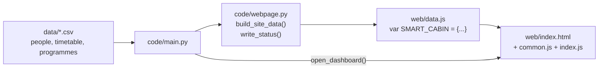
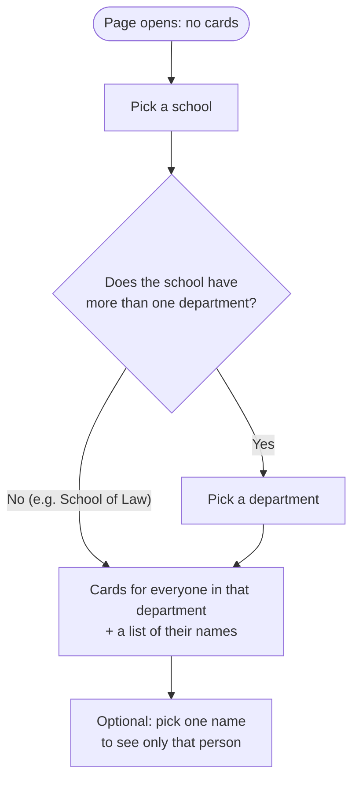

# Smart Cabin web pages: how it works

The web pages are plain HTML, CSS and JavaScript. No web server is needed. Python writes the data and the browser shows it.

All paths below (`code/`, `web/`, `data/`) are inside the `laptop codes/` folder.

## 1. From Python to the browser

1. `python main.py` (in `code/`) reads the people, timetable and programmes from the CSV files in `data/`.
2. It gives everyone a starting status (demo data for now, from `demo_data.py`).
3. `webpage.write_status()` saves everything into `web/data.js` as one JavaScript variable, `SMART_CABIN`.
4. `webpage.open_dashboard()` opens `web/index.html` in the default browser.
5. Every 10 seconds `main.py` changes a few statuses and writes `data.js` again.
6. The page reloads `data.js` on its own (`startAutoRefresh()` in `common.js`), so new statuses show up without pressing refresh. What you picked on the page stays picked.

## 2. Faculty status page (`index.html`): choosing who to see

The page starts **empty**. You narrow it down step by step:

| Step | What you see |
|---|---|
| Nothing picked | "Pick a school above to see its faculty." |
| School picked | Department buttons for that school, and "Now pick a department." |
| Department picked | Cards for that department, and a drop-down: "All faculty in this department" plus each name |
| Name picked | Only that person's card |

- A school with only one department skips the department step and goes straight to the cards.
- Picking a new school clears the department and name. Picking a new department clears the name.
- The **role buttons** (Everyone / Deans / HODs / Faculty) and the **search box** filter what is shown inside the chosen department. The name list follows the role buttons.
- Click a card to open `person.html` with that person's full status and today's timetable.

## 3. Files

| File | What it does |
|---|---|
| `data.js` | Written by Python. Do not edit by hand |
| `common.js` | Helpers used by every page: reading `data.js`, status colours and icons, buttons, auto refresh |
| `index.html` / `index.js` | Faculty status page: school → department → faculty, search, cards |
| `person.html` / `person.js` | One person's status, reason, expected return and timetable |
| `programs.html` / `programs.js` | All programmes, grouped by degree |
| `staff.html` / `staff.js` | Staff login (demo): set my status, edit my timetable |
| `system.html` / `system.js` | System health, sensors and recent changes |
| `style.css` | Look of all pages |

### Main functions in `index.js`

| Function | What it does |
|---|---|
| `showButtons()` | Draws the role and school buttons, then the department buttons and the name list |
| `departmentsOf(school)` | Lists each department in a school once |
| `showDepartmentButtons()` | Draws the department buttons. Picks the department by itself if there is only one |
| `showFacultyList()` | Fills the name drop-down for the chosen department |
| `pickFaculty(id)` | Runs when a name is picked in the drop-down |
| `showCards()` | Shows the matching cards, grouped by department, or a hint if a step is still missing |
| `showPage()` | Redraws everything. Called at start and after every data refresh |
