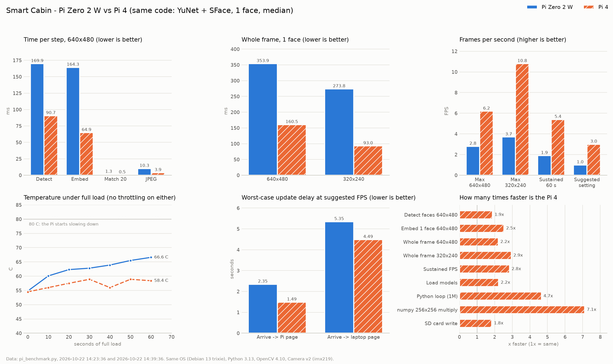

# Benchmark results – Smart Cabin Pis

Measured with `pi_benchmark.py`. It times the real project code (YuNet + SFace face pipeline from `smartcabin_pi.py`, the sender from `pi_sender.py`). Board details are in `board_specs.md`.

| Board | Run | Status |
|---|---|---|
| Raspberry Pi Zero 2 W Rev 1.0 | 2026-10-22 14:23, full run (60 s sustained), code `smartcabin_pi2.py`, desktop running | Done; network test skipped (laptop not found) |
| Raspberry Pi 4 Model B Rev 1.5 | 2026-10-22 14:39, full run (60 s sustained), code `smartcabin_pi2.py`, desktop running, ~45 s after boot | Done; network test skipped (laptop not found) |
| Windows laptop (reference) | 2026-10-22 13:13, quick run, no Pi camera | Done |

Both Pis: trixie 64-bit, Python 3.13.5, OpenCV 4.10.0, numpy 2.2.4, Camera v2 (imx219).

The graph is made by `compare_benchmarks.py` from `benchmarks/benchmark_pi_zero2w_20261022_1423.json` and `benchmarks/benchmark_pi4_20261022_1441.json`.

## Summary

| Measure | Pi Zero 2 W | Pi 4 | Pi 4 vs Zero | Laptop (reference) |
|---|---|---|---|---|
| Camera 640x480 | 30.2 pictures/s | 30.0 pictures/s | same | no Pi camera |
| Camera 320x240 | 30.0 pictures/s | 30.0 pictures/s | same | – |
| Detect faces (YuNet), 640x480 | 169.9 ms | 90.7 ms | 1.9× faster | 8.8 ms |
| Embed 1 face (SFace), 640x480 | 164.3 ms | 64.9 ms | 2.5× faster | 6.6 ms |
| Match vs 20 people | 1.3 ms | 0.5 ms | 2.6× faster | 0.0 ms |
| JPEG for video, 640x480 | 10.3 ms | 3.9 ms | 2.6× faster | 0.5 ms |
| **Whole frame, 1 face, 640x480** | **353.9 ms (max 2.8 FPS)** | **160.5 ms (max 6.2 FPS)** | **2.2× faster** | 16.0 ms (62.5 FPS) |
| Detect faces, 320x240 | 72.2 ms | 25.4 ms | 2.8× faster | 2.4 ms |
| Embed 1 face, 320x240 | 202.9 ms | 67.1 ms | 3.0× faster | 5.4 ms |
| Whole frame, 1 face, 320x240 | 273.8 ms (max 3.7 FPS) | 93.0 ms (max 10.8 FPS) | 2.9× faster | 7.3 ms (137 FPS) |
| **Sustained FPS (60 s, camera + face, 640x480)** | **1.9** | **5.4** | **2.8× faster** | 73.3 (no camera) |
| Temperature start / max / end | 54.8 / 66.6 / 64.5 °C (still rising) | 54.5 / 58.9 / 57.5 °C (steady) | – | – |
| Throttled after | 0x0 (none) | 0x0 (none) | – | – |
| Load models | 2.58 s | 1.16 s | 2.2× faster | 0.18 s |
| RAM for models | 42.6 MB | 49.6 MB | – | – |
| Whole benchmark program | 64.3 MB | 292.2 MB | – | – |
| RAM still free | 113.3 MB | 3194.6 MB | – | – |
| Python loop (1 million) | 933.3 ms | 200.6 ms | 4.7× faster | 54.7 ms |
| numpy 256x256 multiply | 204.9 ms | 28.8 ms | 7.1× faster | 0.5 ms |
| SD card write | 18.4 MB/s | 33.8 MB/s | 1.8× faster | – |
| Send to laptop | skipped | skipped | – | 4.8 ms |
| **Suggested FPS** (70 % of sustained) | **1** | **3** | – | 10 |
| Arrive → Pi page (worst case) | 2.35 s | 1.49 s | – | 1.12 s |
| Arrive → laptop page (worst case) | 5.35 s | 4.49 s | – | 4.12 s |
| Leave → any page | + 15 s (`PRESENT_SECONDS`, by design) | + 15 s | – | + 15 s |

Median values are shown. The full numbers (mean, p95) are in the JSON files on each Pi: `~/benchmarks/benchmark_pi_*.json`.

## What the results mean

1. **The face check is the bottleneck on both boards, not the camera.**
   - Both cameras give 30 pictures/s at either size.
   - One 640x480 frame takes 354 ms on the Zero and 160 ms on the Pi 4.
   - Matching against 20 people costs only 0.5–1.3 ms, so a whole department can be enrolled without slowing it down.
2. **The Pi 4 is about 2–3× faster than the Zero 2W**: 2.2× per frame and 2.8× sustained (5.4 vs 1.9 FPS).
   - The laptop is still about 10× faster than the Pi 4.
3. **Suggested settings in `smartcabin_pi.py`** (the benchmark suggests 70 % of sustained FPS, leaving CPU for the web server, RFID, Bluetooth and `pi_sender.py`):

   | Board | `FPS` | Notes |
   |---|---|---|
   | Pi Zero 2 W | **1** | The current default of 6 would keep the CPU at 100 % |
   | Pi 4 | **3** | The current default of 6 is above its sustained 5.4, so the loop never rests. 4 is the most it can take with some headroom |

4. **320x240 helps the Pi 4 much more than the Zero.**
   - Finding faces at 320x240 is 2.4× (Zero) to 3.6× (Pi 4) faster.
   - Turning a face into numbers (SFace) does not get faster, because it always works on a 112x112 face crop.
   - On the Pi 4, detection is the larger share of the time, so the whole frame drops from 160 to 93 ms (max 6.2 → 10.8 FPS). On the Zero it only drops from 354 to 274 ms.
   - Trade-off: faces far from the camera are smaller at 320x240 and may be missed. Test at the real cabin distance before choosing.
5. **Update delay is fine for a door status on both boards.**
   - Worst case: a person arriving shows on the Pi page in 1.5 s (Pi 4) or 2.4 s (Zero), and on the laptop page in 4.5 s or 5.4 s.
   - Most of the laptop delay is the 2 s send interval and the 2 s page refresh. Shortening those would help more than a faster board.
   - Leaving takes 15 s more on purpose (`PRESENT_SECONDS`), so one missed frame doesn't flip the status.
6. **Heat:**
   - The Pi 4 stayed steady at 55–59 °C under full load.
   - The Zero 2W climbed from 55 to 67 °C in 60 s and was still rising.
   - Neither throttled (0x0). The Zero needs a longer run and a heatsink.
7. **Memory:**
   - The models need about 43–50 MB on both boards.
   - On the Zero, 113 MB was left with the desktop running. It fits, but booting to the console is still recommended.
   - The Pi 4's program used 292 MB in total vs 64 MB on the Zero. It probably reserves bigger buffers and more threads when memory is plentiful. Either way, 3.2 GB was still free.
8. **For the report:**
   - Both boards can run the system. The Pi 4 updates faster and runs cooler.
   - The Zero 2W is cheaper and smaller, and is still fast enough for a door status at 1 FPS.
   - This gives the "experimental setup" and first "results" numbers for the reviews.

## Still to measure

- [ ] **Network test on both boards.** It was skipped twice because the laptop wasn't found in 8 s.
  - Start `python pi_receiver.py` (in `pi board codes/`) on the laptop first.
  - If it's running and still not found, Windows Firewall may be blocking mDNS (UDP 5353) or port 8500. Allow Python on Private networks.
- [ ] **Zero 2W, 10-minute sustained run:** to see where the temperature settles.
- [ ] **Zero 2W without the desktop:** boot to the console, run again, and compare FPS and free RAM.
- [ ] **320x240 sustained run on both boards:** the sustained test only uses 640x480 now. The Pi 4 might reach about 9 FPS.
- [ ] **Recognition at the real cabin distance**, at 640x480 vs 320x240 (accuracy, not speed).

## Note for running

The camera library prints many `INFO` lines (`libcamera ...`). They're harmless and can be ignored. Running with `LIBCAMERA_LOG_LEVELS=*:WARN python3 pi_benchmark.py` hides them.
