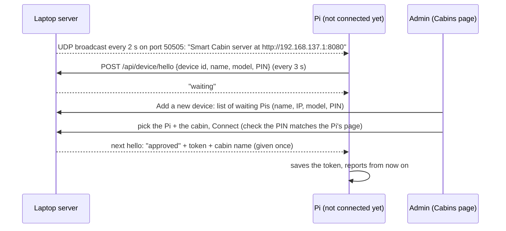

# Smart Cabin – build plan (the real product)

Written **before** coding, on 24 Oct 2026. Every step says **what**, **why** and the **expected outcome**, and has a checkbox. Tick it only after checking it yourself. Changes to the plan are added at the bottom under *Change log*, never silently.

The test scripts in `pi board codes/hardware test code/` and the demo pages in `laptop codes/web/` are **not** changed. This folder (`pi board codes/smart cabin system/`) is the actual product, built fresh. It reuses their ideas and the look of the demo pages.

---

## 1. What the product does

One faculty member per cabin (more cabins can be added later, the database already allows it).

1. **Presence:** did the faculty member come back to their cabin?
2. **Headcount:** how many people are in the cabin, including the faculty member.
3. **Availability:** combine sensors, the timetable and manual buttons into one status, shown to everyone on a public web page and on the NeoPixel in front of the faculty member.

| Light / page | Status | Rule |
|---|---|---|
| 🟢 Green | **Available** | Faculty member in the cabin, nobody else (headcount 1) |
| 🟡 Yellow | **In a meeting** | Faculty member in the cabin with others (headcount 2 or more) |
| 🔴 Red | **Not available** | Faculty member not in the cabin (others may be there). Shows where: in class (room), break, meeting outside, leave |
| ⚪ Grey | **Unknown** | The cabin device has sent nothing for 60 s. Shown honestly instead of a guess |

The public page shows **only**: name, designation, department, cabin, status, where (if away) and until when. It never shows tap times, pictures, phone names or history. So no login is needed to view it.

**Logged-in staff** (any faculty member, Dean or HOD with an account) see more about the others: the full weekly timetable, today's plan, the expected return time and the next free slot. They can also press **"Notify me when available"** on a person.

- **Notifications:** while any page of the site is open, the browser checks every 15 s. When a watched person turns green, it shows a banner, plays a sound and (where the browser allows it) shows a system notification.
- A watch ends once it has fired, or at the end of the day.
- **Limit:** real push notifications to a locked phone with the page closed need HTTPS and a push service, which the hotspot prototype doesn't have. That's listed for later.

**No old data:** nothing is taken from the demo CSV files. People exist only once the admin registers them.

---

## 2. Decisions (agreed 24 Oct 2026)

| Topic | Decision | Why |
|---|---|---|
| Server | **Laptop**, Python **FastAPI** + **Jinja2** templates, run with **uvicorn** | One server for both browsers (pages) and Pi devices (JSON). Checks the Pi's data automatically. Free `/docs` test page. Jinja2 is Flask's template system too |
| Database | **SQLite**, one file `laptop/smart_cabin.db`, plain SQL with Python's `sqlite3` (no ORM) | Built into Python, safe writes, real SQL. Moves to PostgreSQL later if ever deployed |
| CSV | Only for **export** (event log, for analysis and the report) | CSV is unsafe for several writers at once, and for passwords |
| Edge device | **Raspberry Pi** (Zero 2W or 4) does the sensing itself: camera (people + face), RFID, Bluetooth, buttons, NeoPixel. Its own small setup page uses Python's built-in web server | Images never leave the cabin. Only small status messages go to the laptop |
| Who decides the status | **The server** (one place for the rules). The Pi sends *evidence*. The server replies with the status, and the Pi shows it on the LED | Matches the README principle "the server decides" |
| Pi offline | If the laptop can't be reached, the Pi shows a **local fallback** on the LED (faculty seen → green or yellow by headcount, else red) and keeps trying | The cabin light keeps working |
| Face data | **Only on the Pi.** The server only knows "face registered: yes, 10 photos" | Biometric data never travels over the network |
| Passwords | Hashed with `hashlib.pbkdf2_hmac` (salt, 200 000 rounds), never stored as text | Standard safe practice, no extra library |
| Logins | Own `sessions` table and a random token in an HttpOnly cookie | Easy to read and explain. No extra library |
| Pi ↔ laptop | HTTP JSON with a **device token** (header `X-Device-Token`). The Pi gets the token by typing a 6-digit code from the admin page | A random laptop on the Wi-Fi can't send fake statuses |
| Laptop address | `SERVER_URL` in `pi zero 2w/config.py`, default `http://192.168.137.1:8080` (the Windows Mobile Hotspot address of the laptop) | The hotspot gateway address never changes |
| Code style | Small files with plain functions, one `main.py` each, short comments. No classes or ORM | Easy to read and present |
| Folders | `pi board codes/smart cabin system/` holds this plan plus two folders: **`laptop/`** (the server, runs on the laptop) and **`pi zero 2w/`** (copied to the Pi). Nothing else is needed on either side | Requested 24 Oct 2026 |
| Installing | **Automatic.** Each `main.py` installs what is missing the first time (laptop: `pip install fastapi uvicorn jinja2`; Pi: `apt` packages, `pip` packages, turns SPI on, downloads the models). **No database software is needed**: SQLite is part of Python | A non-technical person only runs `python main.py` (laptop) or `sudo python3 main.py` (Pi) |
| Running | One **`main.py`** per side starts every part as a **thread**. Laptop: web server + status timer. Pi: camera, RFID, Bluetooth, buttons, LED, server link, setup page. `sudo python3 main.py --autostart` makes the Pi start it at every boot (systemd service) | No separate programs to start by hand |
| Pages | Look of the demo pages (`laptop codes/web/style.css`), simplified. **Mobile first.** On a laptop, sections sit side by side. On a phone, one section fills the screen and you **slide left / right**, with tabs in the top bar | Requested 24 Oct 2026 |

---

## 2b. Timetable (added 24 Oct 2026)

How university timetables work here:
- **Week:** Monday – Friday, plus Saturday for some (a "Saturday is a working day" switch).
- **Day templates:** every day has the same times, in one of two layouts. **Lunch counts as an hour**, so there are **8 hours**:
  - **Template A:** Hour 1, Hour 2, Tea, Hour 3, Hour 4, **Hour 5 = Lunch**, Hour 6, Tea, Hour 7, Hour 8
  - **Template B:** Hour 1, Hour 2, Tea, Hour 3, **Hour 4 = Lunch**, Hour 5, Hour 6, Tea, Hour 7, Hour 8
- **Lengths:** an hour is **50 min** (the lunch hour too), tea is **10 min** (changeable).
- **The lunch hour** starts as *Lunch break*, but can be filled in like any hour, because another school's timetable may have a class then.
- **A lab takes 2 hours in a row by number** (1–2, 3–4, 4–5, 6–7, …). Tea isn't counted, but the lunch hour is, so a lab can run into the lunch hour.
  - Each of the two hours is saved as its own entry.
  - A tea break *between* the two lab hours (e.g. hours 6–7 in template A) is left out, because the lab goes on. The first lab hour runs on until the second one starts, so the page says "In the lab, back around …" the whole time, not "On a tea break".
- **Locations:** **Block** (letters A – T), **floor**, then **Room** or **Lab** number. Example: *J block, 4th floor, Room 3*, or *D block, 3rd floor, Lab 2*.

How it's filled in (page `/timetable`, its own HTML file):
1. **Day times, once:** pick the template and the start time of the first hour. All the times are worked out (50 / 10 min), and each one can still be changed.
2. **The grid:** days across, hours down, like an Excel sheet (on a phone, one day at a time, sliding).
   - Every hour starts as **Free**. Free means available in the cabin.
   - Tap an hour to choose **Class / Lab / Meeting / Office hours / Other**, the class code or name, and the location from drop-downs (block, floor, room or lab number).
   - Breaks are added automatically from the template.
3. **Save.** The server turns the grid into timetable entries that the status rules use ("In class CSE301, J block, 4th floor, Room 3, back around 11:40").

**Several timetables per person** (added 24 Oct 2026). A faculty member may teach for more than one school or branch, and each has its own template and lunch time.
- A person can have any number of **timetables**, each with a name (e.g. "School of Engineering – CSE", "School of CS – BCA"). Each has its own template, day times, Saturday switch and grid. In the editor they are tabs, with **+ Add timetable**, **Rename** and **Delete**.
- For the status, all of them are **merged** into one day:
  - Classes, labs and meetings from every timetable count.
  - A break from one timetable is left out where another timetable has a class at that time (the class wins).
  - Overlapping breaks are kept only once.
- **Clashes:** on save, two busy hours at the same time (from different timetables) are listed as warnings. Saving still works, because the timetable may really be like that.
- In each grid, hours already busy in **another** timetable are shown greyed ("busy: BCA"), so clashes are seen while filling in.

The **admin** can open the same editor for any faculty member (from the registration page), or the faculty member fills it in themselves.

**Later (not in this build):**
- Reading a **photo of a printed timetable** on the server. This needs OCR software (Tesseract, or a vision AI service), and grid photos are hard to read reliably. The plan: the photo goes through OCR, the result is pre-filled into the grid, and the person checks it before saving.
- **Student timetables** (subject, faculty, classroom or lab) are a separate module.

## 3. The sensing rules (edge, `pi zero 2w/presence.py`)

The order the signals usually arrive: **Bluetooth** (phone in range) → **RFID** (tap at the door) → **camera** (face and people).

| Rule | Value | Why |
|---|---|---|
| Camera picture every | **5 s** normally, **1.5 s** for 30 s after anything changes (phone appears, card tap, people count changes) | Saves CPU on the Zero, but reacts fast when something happens |
| **Arrive** | Faculty face matched in **2 pictures in a row**, or a **card tap** (login) | 2 pictures stop one wrong match from flipping the status |
| Card tap needs confirming | After a login tap, the camera or phone must confirm within **120 s**. Otherwise the faculty member is out again | "Make sure it's an actual person": the card alone could be tapped by someone else |
| Card tap while in | **Logout** straight away. After a logout, the phone alone can't bring them back. A face or a new tap is needed | Someone leaving the phone in the cabin |
| Phone (Bluetooth) | **Keeps** presence alive when the camera misses the face (turned away, bent down). **Never creates** an arrival on its own | Phones reach through walls. "Evidence, not trust" |
| **Leave** | No face **and** no phone for **180 s** (or a logout tap) | Leaving needs a longer delay than arriving, so looking away for a moment doesn't flip to red |
| Headcount | People detector, steady after **3 pictures agree**. Stillness check and ignore zones (from test script 7) remove photos and posters | Same tested logic as `7_people_count_snapshot.py` |
| Headcount sent | `max(steady count, 1 if faculty in)` | If the camera misses the faculty member but the phone or card says they're in, they still count |

## 4. The status rules (server, `laptop/status_engine.py`)

Checked in this order, every time a report arrives (and every 10 s for grey):

1. **Manual button active** → show it (labelled "set manually"). Ends:
   - **Available (green):** when the device saw the faculty member *in* and then *out*, or after 60 min.
   - **In a meeting (yellow):** when the headcount was 2 or more and then drops to 1 or less for 20 s, or the faculty member leaves, or after 60 min. *If the camera never saw 2 people (the reason the button was pressed), only leaving or the 60 min end it.*
   - **Not available (red)** with a reason (break / meeting outside / leave / busy) and a duration (30 min, 1 h, 2 h, rest of the day): ends at that time, or on a login card tap, or when **Auto** is pressed.
   - **Auto** clears the button.
2. **Device silent for 60 s** → **grey**, *except* when the timetable says they're in a class, lab, meeting or other activity (then red with it, because that's known). During a **break or office hours** it stays grey, because they may well be in the cabin.
3. **Faculty in** → **yellow** if headcount ≥ 2, else **green**. "Until" = the start of the next timetable item today ("until 11:00, then Class in Room 204"), or "rest of the day".
4. **Not in** → **red**. "Where" = the current timetable item ("In class, Room 204, back around 11:00"), else "Not in cabin" plus the next item, if any.
5. **Buffer:** a new automatic status must stay the same for **10 s** before it's shown. Manual buttons show straight away.

---

## 5. Data (SQLite tables)

| Table | Holds |
|---|---|
| `accounts` | Admin and faculty: username, password hash, role, name, designation, school, department, email |
| `sessions` | Login tokens for browsers (expire after 12 h) |
| `cabins` | Cabin name, owner (faculty), device token hash, 6-digit setup code + expiry, last report time |
| `cards` | Card UID → faculty |
| `bt_devices` | Bluetooth address and name → faculty (0 – 5 each) |
| `timetable_sheets` | One row per timetable of a person (several allowed): name, template (A / B), day times (hours and breaks), Saturday on or off, and the grid as filled in |
| `timetable` | Entries made from the grid: day (Mon – Sat), start, end, activity (Class / Lab / Meeting / Break / Office hours / Other), class code or name, block, floor, room or lab number |
| `overrides` | The active manual button per faculty, with its end rules |
| `cabin_state` | Latest evidence per cabin: faculty in, headcount, phone near, face photos, sensors OK |
| `status_now` | The status being shown, plus the pending one (for the 10 s buffer) |
| `events` | Log of changes: arrive, leave, card login / logout, headcount change, button, status change. Exported to CSV |
| `watches` | Who asked to be notified about whom, and whether it has fired |

---

## 6. Steps

### Step 0 – plan (this file)
- **Why:** agree on everything before coding. Something to check the work against.
- **Outcome:** this file.
- [x] Written before any code (24 Oct 2026)

### Step 1 – server base: database, passwords, logins
- **What:** `laptop/config.py`, `database.py` (create the tables, small query functions), `security.py` (hash and check passwords, sessions, device tokens), `main.py` (FastAPI app).
- **Why:** everything else stores data and needs to know who is logged in.
- **Outcome:** `python main.py` starts the server on port 8080 and creates `smart_cabin.db`. The first visit asks to create the **admin account** (no default password).
- **Check:** [x] server starts [x] first-run admin page appears only once [x] wrong password refused [x] password stored as a hash

### Step 2 – admin pages (two separate pages): faculty registration, cabins
- **What:**
  - `/register` (`register.html`): register faculty (username, password, name, position, designation, school, department, e-mail), plus the list of faculty with edit, reset password, deactivate and **Timetable** (opens the editor for that person).
  - `/admin` (`admin.html`): **Cabins** (add a cabin, pick its faculty member, get a 6-digit device code, see whether its device is online and its sensors work) and **Activity** (recent events, export CSV).
- **Why:** the university admin registers faculty with a username and password, then sets up their cabin.
- **Outcome:** an admin can register a faculty member and a cabin from a phone or a laptop.
- **Starter list: AI School (added 24 Oct 2026).** The faculty list taken from the university website (`laptop codes/data/people.csv`) is used **only** for the **Presidency School of Artificial Intelligence and Advanced Computing**, the primary school for the prototype.
  - **Dean:** Dr. Shakkeera L. The HOD stays as listed (Dr. Sampath A.K.).
  - On the register page, a button **Import AI School list** (admin only) adds them once. Each person gets a username (from the name) and a random temporary password.
  - The usernames and passwords are offered once as a CSV download for the admin to hand out. People already registered are skipped.
  - No other school is imported. Everyone else is registered by hand.
- **Check:** [x] add faculty [x] duplicate username refused [x] cabin + code made [ ] code expires after 15 min *(written, not timed in a test)* [x] faculty can't use the admin API (403) [ ] faculty sent away from the `/register` / `/admin` pages *(written, not tested)* [x] AI School import: Dean = Dr. Shakkeera L, no duplicates on a 2nd import, passwords hashed (136 added)

### Step 3 – faculty pages (two separate pages): my page, timetable editor
- **What:**
  - `/me` (`me.html`): **Status** (Available / In a meeting / Not available + reason + duration / Auto), **My devices** (cards, phones, face: see and remove), **Account** (change password).
  - `/timetable` (`timetable.html`): the editor of section 2b (template → day times → grid). The admin opens it as `/timetable?person=ID`.
- **Why:** manual buttons in case a sensor misses something, and the timetable for "where" and "until when".
- **Outcome:** the faculty member can do everything from their phone.
- **Check:** [x] button sets status [x] template times worked out [x] grid saved, lab takes 2 hours, breaks added [x] several timetables, clash warning, class beats the other's lunch [ ] remove card / phone works *(written, not tested)* [ ] change password works *(written, not tested)*

### Step 4 – Pi ↔ server API and status engine
- **What:** `api_device.py`: claim (code → token), config (faculty name, cards, phones), report (evidence → status), card tap (login / logout / unknown), enrol (faculty login on the Pi → link card, add phone, face count). `status_engine.py` with the rules of section 4. `timetable.py` for the current / next item.
- **Why:** the Pi needs to send evidence and get the status back.
- **Outcome:** every Pi call is listed and testable on `/docs`.
- **Check:** [x] wrong token refused [x] rules of section 4 give the right status in tests [x] 10 s buffer works [x] grey after 60 s

### Step 5 – public status page
- **What:** `/` (search + school / department chips + cards, like the demo, with smarter search) and `/person/{id}` (big status, where, until, today's timetable).
- **Why:** students, faculty and HODs see who is available, with no login.
- **Outcome:** shows only the allowed fields, updates every 10 s.
- **Logged in:** the person page also shows the weekly timetable, the next free slot and a **Notify me when available** button. The bell in the top bar lists your watches. Alerts appear on any open page.
- **Check:** [x] no tap times / devices shown [ ] search works on a phone *(page seen on a phone-sized screen, search not typed in)* [x] grey when the device is off [x] logged-in extra details only when logged in [x] notify fires once when the person turns green

### Step 6 – edge app on the Pi
- **What:** `pi zero 2w/`: `camera.py`, `people.py` (count + stillness + ignore zones), `faces.py` (YuNet + SFace, owner only), `rfid.py`, `bluetooth.py`, `leds.py`, `buttons.py`, `presence.py` (section 3), `server_link.py`, `storage.py`, `web.py` + `page.html` (setup page on port 8000), `main.py`.
- **Why:** the sensing, in the cabin.
- **Outcome:** `sudo python3 main.py` on the Pi. The setup page lets the faculty member link their card, register their face and pair phones, after logging in with their server username and password.
- **Simulation:** on a laptop (not a Pi), the hardware is simulated (picture file or webcam, "tap card" and "phone near" buttons on the page), so the whole system can be tested without a Pi.
- **Check (simulation on the laptop, 24 Oct 2026):** [x] claim with code [x] card logout, unknown card [ ] card login + 120 s confirm *(written, not tested)* [x] face register + arrive (green), 2 people (yellow) [x] phone pairing (simulated) [ ] phone keeps presence [ ] leave after 180 s *(both written, not timed in a test)* [x] LED colour = server status [x] offline fallback
- **Not tested yet: everything on real Pi hardware** (camera, RC522, NeoPixel, buttons, BlueZ pairing, `--autostart`, the installer on Raspberry Pi OS).

### Step 7 – test everything together, document
- **What:** run the server and the edge (simulated) on the laptop. Go through the checks above. Write how to run it in `README.md` in this folder. Log it in `timeline.md`.
- **Outcome:** a working prototype for Review 1, with known limits listed.
- **Check:** [x] end-to-end run (server + simulated Pi, 24 Oct 2026) [x] README [x] timeline

---

### Step 8 – documentation, charts and presentation (requested 24 Oct 2026)
- **What:**
  - **`README.md`** (main, in this folder): what the system does, a flow diagram of the whole workflow, how to install and run it (step by step, for a non-technical person), and links to the module documents.
  - **`docs/` – one document per module**, each with its own diagram:
    - `docs/server.md` – the laptop server: pages, API, database, logins and security.
    - `docs/status-rules.md` – the status rules and buffers, as a flow chart and a state diagram.
    - `docs/timetable.md` – templates, the grid, how entries are made.
    - `docs/edge-device.md` – the Pi app: threads, sensors, presence rules, the offline fallback, setup.
    - `docs/vision.md` – people counting and face recognition: **models** (MobileNet-SSD, YOLOv8n, YuNet, SFace), **algorithms** (detection, embeddings, cosine similarity, steady count, stillness check, ignore zones), **accuracy and benchmarks** (from the measured Pi 4 / Zero 2W runs), a **performance grade**, and alternatives.
    - `docs/sensors.md` – RFID, Bluetooth (l2ping, random addresses), buttons, NeoPixel. Measured results from the hardware tests.
    - `docs/technology-choices.md` – every **library** and tool with *why* and the *alternatives*, and **which board or software is better for what** (Pi Zero 2W vs Pi 4 vs Pi 5 vs ESP32-S3 vs Jetson; SQLite vs PostgreSQL; FastAPI vs Flask; HTTP vs MQTT).
  - **`docs/charts/make_charts.py`**: makes every chart in the documents from the measured numbers (benchmark JSON files and the event-log CSV), so they can be re-made with new data.
  - **Animated presentation** (`docs/presentation/`): for **every paper listed in the project PPTX file**, a slide showing its method, its **drawbacks**, and **how Smart Cabin answers each one**, with entrance animations, plus a summary slide. Each slide stands alone, so it can be copied into your own deck.
- **Why:** for Review 1 / Review 2, the report and the paper.
- **Outcome:** documents that render on GitHub (Mermaid diagrams), a chart script and a `.pptx`.
- **Check:** [x] main README [x] every module document (server, status rules, timetable, edge device, vision, sensors, technology choices) [x] charts script runs (8 charts) [x] presentation covers every listed paper (the 4 in the project PPTX + the 5 in research/papers.md) [x] animations recognised by PowerPoint (2–17 effects per slide) [ ] animations watched playing in a slide show *(not done: needs a person at PowerPoint)*

### Step 9 – automatic device pairing, no code typing (requested 25 Oct 2026)
- **What:** the admin presses **Add a new device** on the Cabins page, sees the Pis that are waiting, picks one and its cabin, and presses **Connect**. The device gets its token by itself. The 6-digit code stays as a fallback.

- **How the Pi finds the laptop:** the server sends a small UDP broadcast every 2 s on every network it is on, each carrying that network's own address (so the Pi on the hotspot hears `192.168.137.1`). If no broadcast is heard, the Pi also tries `SERVER_URL` from `config.py`.
- **Device identity:** a random device id, made once and saved in `data/`, plus a **4-digit PIN** made at each start. The PIN is shown on the Pi's page and in its terminal, and next to the device on the admin page. The admin checks it matches, so the wrong device can't be picked.
- **Security:**
  - Only a logged-in admin can approve.
  - The token is handed over once (on the next hello), then deleted from the request. Only its hash is kept in `cabins`.
  - Requests are forgotten after 60 s without a hello.
  - The prototype still uses plain HTTP on the private hotspot, as before.
- **Why:** no typing on a phone, and no codes that expire. It's the same experience as pairing a Bluetooth device.
- **Firewall:** needs nothing new on the laptop. The broadcast goes *out*, and the hellos come in on port 8080, which is already allowed.
- **Refinement (25 Oct 2026): each cabin is linked to one device ID.**
  - **The device ID** is the Pi's **hardware serial number**. It never changes, not even after a reinstall or a new SD card. In simulation on a laptop, a random id is kept in `data/`.
  - **Each cabin has a `device_id`.** The admin links it once: either pick the Pi from the *Add a new device* list (which links its ID), or type the serial from the label on the box in advance.
  - **Installing becomes "put it in the room and switch it on":** when a Pi says hello with the ID linked to a cabin, the server gives it its token straight away, with no approval needed.
  - **Self-healing:** if the server stops accepting a Pi's token (e.g. after a reset), the Pi forgets the token and says hello again. If its ID is still linked, it reconnects to the same cabin by itself.
  - **The admin only decides "which cabin, and who sits there":** each waiting Pi in the list has a cabin picker (or *new cabin* with a name), the registered faculty member for it, and one **Connect** button. The cabin, the device ID and the owner are linked from then on, and the owner can be changed any time on the cabin card.
  - **Limit:** a serial number is not a secret, so on the same network another computer could claim to be that Pi. This is acceptable on the private hotspot prototype. A deployment would add a device certificate or a secret burned in at setup.
- **Check (25 Oct 2026; automatic server test 102 / 102, plus a live run of the test server and a simulated Pi with real UDP broadcasts):**
  - [x] server broadcasts on each network
  - [x] Pi finds the server from the broadcast (it found `…:8090`, an address not in its config)
  - [x] waiting Pi listed with its PIN, model, IP, ID
  - [x] approve on the real admin page (+ new cabin + owner Dr. Shakkeera L) → Pi connected without typing, ID linked
  - [x] request gone after 60 s, and removed once linked
  - [x] non-admin can't list or approve
  - [x] **linked ID → connected automatically, no approval**
  - [x] **serial typed in advance (any case / spaces) → connected on first power-on**
  - [x] same serial can't be linked to two cabins; unlinking stops auto-connect
  - [x] **key rejected → Pi reconnected by itself in 7 s**
  - [x] old databases get the new columns
  - [x] the 6-digit code still works
  - [x] all 16 Mermaid diagrams in the docs render
  - [ ] on the real Pi: hardware serial read, broadcast heard over the hotspot *(needs the Pi)*
- **Simplification found in testing:** approving only links the cabin and removes the waiting entry. The Pi's key is made on its next hello (the same path as a linked or reset Pi), so no key ever waits in the list.

### Step 10 – data science part: presentation first (requested 25 Oct 2026)
- **What:** an animated deck, `docs/presentation/Smart_Cabin_data_science.pptx`, made by `make_ds_presentation.py` (same style and slide helpers as the "vs existing work" deck). Slides:
  - the data the system already logs
  - the pipeline: log → features → models → results
  - six data-science parts at a glance
  - three core parts in detail: **return-time prediction** (regression + survival analysis), **probabilistic status engine** (Bayesian / HMM vs rules), **sensor ablation**
  - three extras: best time to visit, data-driven tuning, anomaly detection
  - the data plan: snapshot logging, ground truth, synthetic data
  - metrics
  - timeline to Review 2
- **Honesty:** no results exist yet. Example visuals are labelled *illustration, not real data*, and every number shown is either a target or already measured.
- **Why:** the M.Tech Data Science contribution, for Review 1 / Review 2 and the paper.
- **Later (separate steps, after approval):** the `evidence_log` snapshot table, the synthetic data generator, the models and an evaluation notebook.
- **Check:** [ ] deck builds [ ] file validation passes [ ] opens in PowerPoint with animations [ ] no made-up results

## 7. Not in this build (later)

- Many faculty in one cabin, HOD / department views, notifications.
- MQTT, a wired backup link, HTTPS between the Pi and the laptop (plain HTTP on the private hotspot for the prototype).
- mmWave radar, a screen check for videos, a thermal sensor (see README 5.1).
- Importing the 839-faculty CSV: the admin registers real users instead. A CSV import can be added later.
- Real push notifications with the page closed (needs HTTPS + Web Push / VAPID keys), and e-mail alerts.

---

## Change log

- 24 Oct 2026 – plan written.
- 24 Oct 2026 – added: logged-in staff see more about others (weekly timetable, expected return, next free slot), and "Notify me when available" alerts (in-page; real push needs HTTPS, later). No data is taken from the demo CSV files. Python **3.12** is used on the laptop (the code also runs on newer versions).
- 24 Oct 2026 – moved into `pi board codes/smart cabin system/` with the folders `laptop/` and `pi zero 2w/` (was `project/server` and `project/edge`). Everything installs by itself; one threaded `main.py` per side; Pi autostart at boot.
- 24 Oct 2026 – timetable redesigned (section 2b): two day templates, times worked out from the start time, Mon – Sat grid, block / floor / room drop-downs, lab = 2 hours. Pages split into separate HTML files: public status, person, login, **register** (admin), **admin** (cabins), **me** (faculty), **timetable** (editor). Timetable photo reading and student timetables are planned for later.
- 24 Oct 2026 – added Step 8: main README + module documents (diagrams, models, algorithms, libraries with alternatives, benchmarks, accuracy, grades, board comparison), a chart script, and an animated presentation answering the drawbacks of every listed paper. **Working rule from now on:** every new request is written into this plan first, then built.
- 24 Oct 2026 – found in testing: a silent device during lunch showed "On a lunch break". Rule 2 changed: breaks and office hours stay grey when the device is silent. "Back around" joins a class that runs straight into a lab (Class 9:00 → Lab until 11:40 = back around 11:40).
- 24 Oct 2026 – several timetables per person (one per school or branch), merged for the status. A class beats another timetable's break, clashes are warned about on save, and other timetables' busy hours are greyed in the grid. Table `timetable_setup` replaced by `timetable_sheets`.
- 24 Oct 2026 – correction: lunch is a numbered hour (8 hours a day; A: lunch = Hour 5, B: lunch = Hour 4), 50 min long, and can be filled in. A lab = 2 hours in a row by number (lunch counts, tea doesn't), saved as 2 entries.
- 24 Oct 2026 – a tea break inside a lab is left out (the lab goes on). Starter list: only the AI School (Presidency School of Artificial Intelligence and Advanced Computing) can be imported from the website list, with Dr. Shakkeera L as Dean, via an admin button, with temporary passwords given out as a one-time CSV.
- 24 Oct 2026 – built and tested: server (80 / 80 automatic checks), Pi app (simulation, end to end with the server), documents with diagrams, 8 charts, and the 13-slide animated presentation. The matrix marks Smart Cabin's "Measured" as *partly* until the real-hardware evaluation is done.
- 25 Oct 2026 – first try on the real Pi: Connect did nothing visible.
  - **Cause:** Windows Firewall had no inbound rule for Python, so the Pi couldn't reach port 8080.
  - **Fix (by the user, admin PowerShell):** `New-NetFirewallRule -DisplayName "Smart Cabin server 8080" -Direction Inbound -Protocol TCP -LocalPort 8080 -Action Allow -Profile Any`.
  - **Code:** the Connect button now shows "Connecting..." at once, and the error message names the firewall.
  - Added to the main README install steps.
- 25 Oct 2026 – connect re-tested properly.
  - **Checked on the real setup:** the firewall rule is present; the server answers on 192.168.137.1:8080; the Pi answers ping and SSH. The **Pi app was not running** (port 8000 closed), most likely stopped when the SSH session closed. The server database shows no connect attempt ever arrived.
  - **Bug found:** on a phone, the Connect result was shown on the *Status* slide, not on the *Setup* slide with the button, so every error was invisible. It was also overwritten after a few seconds.
  - **Fixed:** the message now shows under the button, stays, and is printed in the Pi's terminal.
  - **Added terminal tests:** `sudo python3 main.py --check` (can the Pi reach the laptop?) and `--connect CODE` (connect without the page).
  - **Tested** (scratch copy of the Pi app + test server on port 8090, phone-sized page):
    - [x] `--check`: no server → clear failure; server → OK
    - [x] `--connect`: wrong code → refused; fresh code → connected
    - [x] page: wrong server → error stays on the Setup slide
    - [x] page: wrong code → error stays
    - [x] page: fresh code → connected, owner shown, faculty login appears
  - **Still to confirm on the real Pi** (needs the user's SSH session).
- 25 Oct 2026 – Step 9 added: automatic device pairing. The server broadcasts its address, Pis announce themselves with a PIN, and the admin picks one on the Cabins page. The 6-digit code stays as a fallback.
- 25 Oct 2026 – refined: each cabin is linked to one device ID (the Pi's hardware serial). A linked Pi connects automatically when switched on in the room, and reconnects by itself after a reset. The ID can be typed in advance from the box label.
- 25 Oct 2026 – documents requested:
  - `docs/device-pairing.md` explains this plan (who does what, the three links, sequence diagrams, fallbacks, security).
  - `docs/er-diagram.md` is the ER diagram of the whole database: every table, column, key and relationship, plus the Pi's own files.
