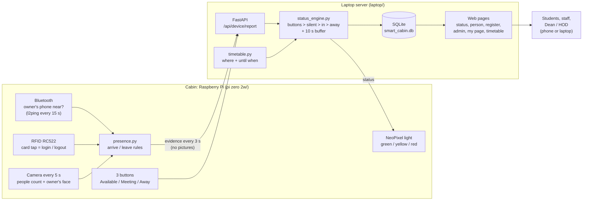
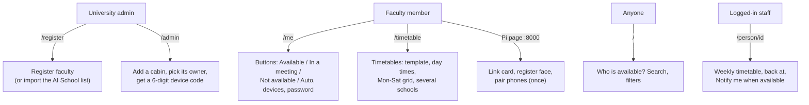

# Smart Cabin

**Is the faculty member in their cabin and free? A Raspberry Pi in the cabin senses it, a laptop server decides it, and everyone sees it on one web page and on a light in the cabin.**

| | |
|---|---|
| What | IoT faculty availability system: presence, headcount, timetable, manual buttons → one status |
| Where it runs | **Laptop** (server, database, web pages) + **Raspberry Pi Zero 2W / Pi 4** in each cabin (camera, RFID, Bluetooth, buttons, light) |
| Status | Built and tested on 24 Oct 2026: server 80 / 80 automatic checks, Pi app tested in simulation. **Not yet run on the real Pi hardware.** See [BUILD_PLAN.md](BUILD_PLAN.md) for every step and check |
| Primary school | Presidency School of Artificial Intelligence and Advanced Computing (Dean: Dr. Shakkeera L) |

---

## The four statuses

| | Status | When |
|---|---|---|
| 🟢 | **Available** | The faculty member is in the cabin, alone |
| 🟡 | **In a meeting** | The faculty member is in the cabin with others (headcount 2 or more) |
| 🔴 | **Not available** | Not in the cabin. The page says where (e.g. *In class CSE301, J block, 4th floor, Room 3, back around 11:40*) |
| ⚪ | **Unknown** | The cabin device has been silent for 60 s. The page says so, rather than guess |

The public page shows only the name, position, department, cabin, status, where and until when. No pictures, no tap times and no history ever leave the cabin or appear on a page.

---

## How it works



1. **Bluetooth** usually notices first: the owner's paired phone answers a tiny ping.
2. **RFID:** a card tap at the door means *login* (or *logout* if already in).
3. **Camera**, every 5 s (every 1.5 s after anything changes):
   - counts the people (stillness check and ignore zones remove photos and posters)
   - checks whether one of them is the owner (face recognition, kept on the Pi only)
4. **presence.py** on the Pi decides *in / out*:
   - **Arrive:** the face in 2 pictures in a row, or a card tap. A card tap must be confirmed by the camera or phone within 120 s.
   - **Leave:** no face and no phone for 180 s, or a logout tap.
   - The phone keeps them "in" when the camera misses their face, but never brings them in on its own.
5. The Pi sends this **evidence** (in / out, headcount, phone near, events) to the laptop every 3 s.
6. The laptop's **status engine** applies the rules in order:
   - a manual button wins
   - a silent device turns grey
   - in the cabin → yellow if anyone else is there, otherwise green
   - not in the cabin → red, with where they are and when they're back, from the timetable
   - a new automatic status must hold for 10 s before it shows
7. The laptop sends the status back. The **light** in the cabin shows it, and every **page** updates within 10 s.

Detailed documents: [**adding cabin devices (no typing)**](docs/device-pairing.md) · [**ER diagram**](docs/er-diagram.md) · [server](docs/server.md) · [status rules](docs/status-rules.md) · [timetable](docs/timetable.md) · [cabin device](docs/edge-device.md) · [vision models and benchmarks](docs/vision.md) · [sensors](docs/sensors.md) · [technology choices and alternatives](docs/technology-choices.md) · [presentation](docs/presentation/README.md)

---

## Who uses what



| Page | File | Who |
|---|---|---|
| `/` Who is available? | `laptop/templates/status.html` | everyone |
| `/person/<id>` | `person.html` | everyone (staff see the timetable and **Notify me**) |
| `/login` (first start: create the admin) | `login.html` | staff |
| `/register` | `register.html` | admin |
| `/admin` cabins, devices, activity, CSV | `admin.html` | admin |
| `/me` my status, devices, password | `me.html` | faculty |
| `/timetable` editor | `timetable.html` | faculty (admin: `?person=ID`) |
| `http://<pi>:8000` cabin device setup | `pi zero 2w/page.html` | the cabin's owner |

On a laptop the sections of a page sit side by side. On a phone you **slide left / right**, using the tabs and ‹ › arrows at the top.

---

## Install and run (no technical knowledge needed)

Both sides install what they need the first time, which needs internet. No database software is needed: SQLite is part of Python.

### 1. The laptop (server)

1. Install **Python 3.12** from python.org (tick *Add Python to PATH*).
2. Turn on the Windows **Mobile hotspot** (Settings → Network → Mobile hotspot). The Pis and phones join it.
3. Open the folder `pi board codes/smart cabin system/laptop`, click the address bar, type `cmd`, press Enter, and run:

   ```bash
   python main.py
   ```

4. The first time, it installs FastAPI (about a minute), then opens the browser.
5. **Let the Pis reach the laptop (once).** Open PowerShell **as Administrator** and run:

   ```bash
   New-NetFirewallRule -DisplayName "Smart Cabin server 8080" -Direction Inbound -Protocol TCP -LocalPort 8080 -Action Allow -Profile Any
   ```

   Without this, Windows Firewall silently blocks the Pi, and Connect on the Pi page fails.
6. The first page asks you to **create the admin account**. It's shown only once.
7. **Register** → add the faculty, or press **Import AI School list** (it downloads a file with their usernames and temporary passwords).
8. **Cabins** → **Add a new device**. Once the Pi is switched on (part 2), it appears with a PIN. Pick *which cabin it is* (or **+ New cabin**) and *who sits there*, then press **Connect**. Nothing to type. You can also type a Pi's serial from its box label into a cabin's *Linked device* field in advance. See [device pairing](docs/device-pairing.md).

The window shows the addresses phones can use, e.g. `http://192.168.137.1:8080`.

### 2. The Raspberry Pi (in the cabin)

1. Wire the camera, RC522, NeoPixel and buttons as in [docs/sensors.md](docs/sensors.md#wiring).
2. Copy the `pi zero 2w` folder to the Pi (e.g. with WinSCP), then over SSH run:

   ```bash
   cd ~/"pi zero 2w" && sudo python3 main.py
   ```

3. The first time, it installs everything (10+ minutes on a Zero 2W) and turns SPI on. If it asks, run `sudo reboot` and start it again.
4. **Nothing to type on the Pi.** It finds the laptop by itself and waits for the admin (Cabins → Add a new device), showing its PIN on its page and in the terminal. A Pi whose ID is already linked to a cabin connects straight away.
   - **Fallback, the 6-digit code:** Cabins → **New code**, then the Pi's page → Setup → *Type a 6-digit code instead*.
   - **Or from the terminal**, without the page: `sudo python3 main.py --check` tests whether the Pi can reach the laptop, and `sudo python3 main.py --connect 123456` connects with the code.
   - **Keep it running after you close SSH:** use `--autostart` (step 6). A program started in an SSH window stops when that window closes.
5. The faculty member logs in there with their username and password, then presses:
   - **Link my card** and taps the card
   - **Register my face**, alone, facing the camera
   - **Add a device**, and pairs their phone (it's only identified, never used as a keyboard or speaker)
6. To start it at every boot:

   ```bash
   sudo python3 main.py --autostart
   ```

### 3. Try it without a Pi

On the laptop, run `python main.py` inside `pi zero 2w`. The hardware is simulated:
- the camera is the picture `data/sim_picture.jpg`
- the page has **Tap card** and **Phone near** buttons

---

## Folder

```
smart cabin system/
├── BUILD_PLAN.md          the plan: every step, why, expected outcome, checks (ticked only when verified)
├── README.md              this file
├── laptop/                the server: python main.py
│   ├── main.py            starts the status timer thread and the web server
│   ├── install.py         installs fastapi, uvicorn, jinja2 the first time
│   ├── config.py          every setting (times, buffers, templates, buildings A-T, ...)
│   ├── database.py        SQLite tables + 3 helpers
│   ├── security.py        password hashing, sessions, device tokens
│   ├── status_engine.py   the status rules
│   ├── timetable.py       templates, grid -> entries, now / next / back at
│   ├── api_*.py           account, admin, faculty, public, timetable, device APIs
│   ├── pages.py           one route per HTML page
│   ├── models.py          the shape of every request (checked by FastAPI)
│   ├── templates/         the HTML pages (Jinja2)
│   └── static/            style.css + one JS file per page
├── pi zero 2w/            the cabin device: sudo python3 main.py
│   ├── main.py            threads: camera, rfid, bluetooth, buttons, report, config + setup page
│   ├── install.py         apt + pip + SPI + model downloads
│   ├── presence.py        arrive / leave rules
│   ├── people.py faces.py rfid.py bluetooth.py leds.py buttons.py camera.py
│   ├── server_link.py     HTTP to the laptop (urllib only)
│   ├── actions.py web.py page.html   the setup page
│   └── config.py shared.py storage.py
└── docs/                  module documents, charts, presentation
```

## Known limits (honest list)

- **Not yet run on real Pi hardware.** Every hardware part was tested on its own with the hardware test scripts (camera, RC522, NeoPixel), but the combined app has only run in simulation.
- The prototype uses plain HTTP on a private hotspot. HTTPS, notifications with the page closed, MQTT and a wired backup link are planned for later (see [BUILD_PLAN.md](BUILD_PLAN.md#7-not-in-this-build-later)).
- A video of a person on a phone can still be counted. The stillness check catches photos and ignore zones catch fixed screens. The mmWave radar is the planned fix.
- One owner per cabin.
