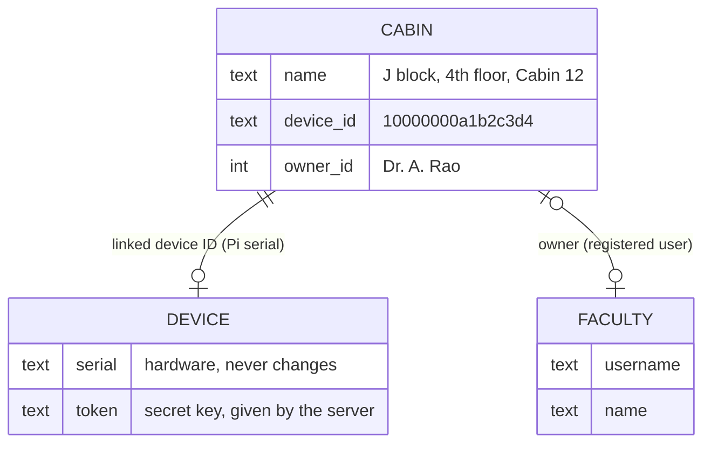
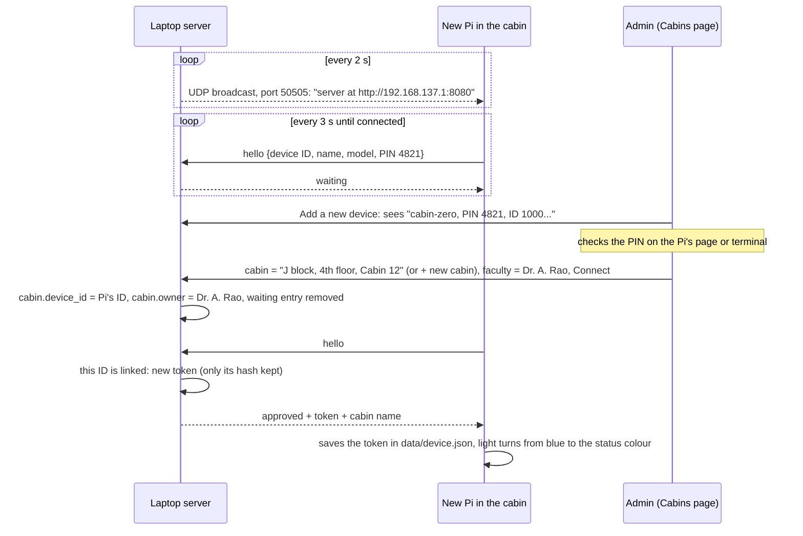
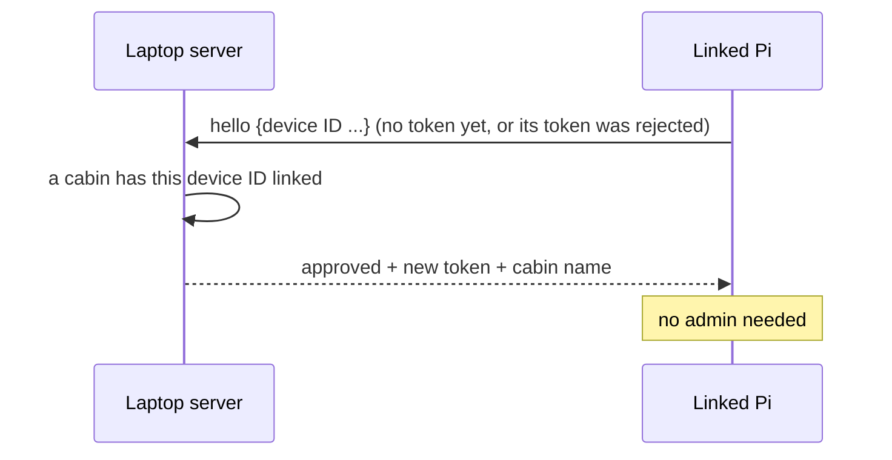

# Adding cabin devices: cabin ↔ device ID ↔ faculty

[← back to README](../README.md) · plan: [BUILD_PLAN.md step 9](../BUILD_PLAN.md#step-9--automatic-device-pairing-no-code-typing-requested-25-oct-2026)

## The idea in one line

**Whoever installs a Pi only puts it in the room and switches it on. The admin only decides *which cabin it is* and *who sits there*.** Behind the scenes, each cabin is linked to one device's unique ID, and that ID is all the server needs to recognise the Pi.

## Who does what

| Person | Does | Doesn't need to |
|---|---|---|
| **Technician / installer** | puts the Pi in the cabin, plugs in power (same Wi-Fi / hotspot as the laptop) | type anything, know any address or code |
| **Admin** | once per device: picks the cabin (or names a new one) and the registered faculty member, then presses **Connect** | type codes, edit settings on the Pi |
| **Faculty member** | logs in on the Pi's page once: links their card, registers their face, pairs their phone | set up the network |
| **The system** | finds the laptop, recognises the device, hands over its key, reconnects after a reset | – |

## The three links

- **Device ID = the Pi's hardware serial number** (from `/sys/firmware/devicetree/base/serial-number`). It survives a reinstall, a new SD card and power cuts. The Pi shows it on its page and in its terminal, and it can be written on a label on the box.
- **Cabin → device:** one cabin has at most one device, and one device belongs to one cabin. Linking a device to a new cabin unlinks it from the old one.
- **Cabin → faculty:** the owner, changeable at any time from the cabin card on the Cabins page. The device doesn't care who the owner is; the server decides whose status the device's evidence counts for.

## First time: a new Pi

## Every time after that: installed or reset

- **Prepared in advance:** the admin can type the serial from the box label into the cabin's *Linked device* field before the Pi is delivered. On first power-on it connects straight to that cabin.
- **Self-healing:** if the server answers **401** to a report (the key was replaced, the cabin was reset on the server, the database was restored), the Pi forgets its key and says hello again. If it's still linked, it's back within seconds.

## How the Pi finds the laptop

- Every 2 s the server sends a small UDP broadcast on **every network it is on**. Each one carries *that network's own address*, so the Pi on the hotspot hears `http://192.168.137.1:8080`, not the laptop's home Wi-Fi address.
- If nothing is heard (another network, or broadcasts blocked), the Pi tries `SERVER_URL` from `config.py`.
- **Firewall:** nothing new is needed. The broadcast goes *out* from the laptop, and the hellos come *in* on port 8080, which the install step already allows.

## The PIN

A 4-digit PIN is made at every start of the Pi. It's shown on the Pi's page, in its terminal, and next to the device in the admin's list. The admin checks that they match, so the wrong Pi can't be picked when two are being set up at the same time.

## Fallbacks

| If | Then |
|---|---|
| The Pi doesn't appear in the list | Cabins → **New code**, then type the 6-digit code on the Pi's page, or run `sudo python3 main.py --connect 123456` |
| Not sure the Pi can reach the laptop | `sudo python3 main.py --check` |
| A device should stop working | clear the cabin's *Linked device* field (Save). Its token stops working, and it can't reconnect on its own |

## Security

| Point | How |
|---|---|
| Only the admin links devices | approve / link calls need an admin login |
| The key | a 32-byte random token, made when a linked device says hello. The server keeps only its hash, and a new hello replaces the old key |
| Waiting devices | dropped from the list after 60 s without a hello |
| **Known limit** | a serial number is not a secret. A computer on the same network that claims a linked Pi's serial would get a token for that cabin. This is acceptable on the private hotspot prototype. A deployment would add a per-device secret or certificate set at installation, plus HTTPS |

## Tested (25 Oct 2026)

- **Automatic server test (102 / 102):** listing, approving (existing or new cabin + owner), linked auto-connect, a serial typed in advance, one cabin per serial, unlinking, 60 s expiry, admin only, older databases, and the 6-digit fallback.
- **Live run** (test server + a simulated Pi with real UDP broadcasts):
  - the Pi found the server from the broadcast alone
  - it appeared on the real admin page with PIN 7192
  - **+ New cabin** "A block, 3rd floor, Dean office" + Dr. Shakkeera L → **Connect** → the Pi was connected and reporting, with nothing typed
  - after the server's key was replaced, the Pi reconnected by itself in 7 s
- **Still to do on the real Pi:** reading the hardware serial, and hearing the broadcast over the hotspot.

## Where it is in the code

| Part | File |
|---|---|
| Broadcast thread | `laptop/main.py` → `beacon()` |
| `hello` (waiting / linked → token) | `laptop/api_device.py` → `hello()` |
| Waiting list, approve (cabin + owner + link), unlink | `laptop/api_admin.py` |
| Admin screen | `laptop/templates/admin.html`, `static/admin.js` → *Add a new device*, *Linked device* |
| Pi: serial, PIN, broadcast listener, hello loop | `pi zero 2w/pairing.py` |
| Pi: forget a rejected key | `pi zero 2w/main.py` → `report_loop()` |
| Tables | `cabins.device_id`, `cabins.device_name`, `device_requests` (`laptop/database.py`, added automatically to older databases) |
