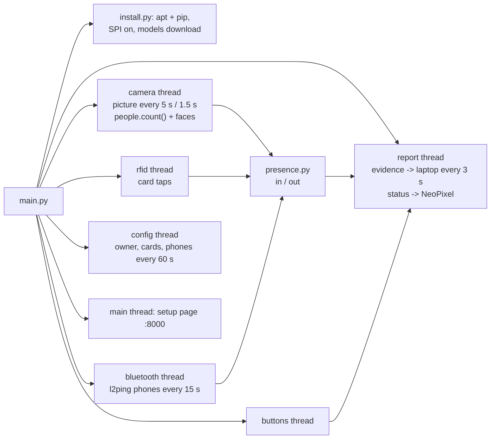

# The cabin device (`pi zero 2w/`)

[← back to README](../README.md)

`sudo python3 main.py` on a Raspberry Pi Zero 2W or Pi 4. The same code runs on a laptop in **simulation**.

## Threads



All threads share one dictionary, `shared.state`, always changed inside `with shared.lock:`.

## What each file does

| File | Job |
|---|---|
| `config.py` | every setting: laptop address, pins, picture times, presence rules, thresholds |
| `install.py` | installs apt packages (`python3-picamera2`, `python3-opencv`, `python3-rpi-lgpio`, `python3-spidev`, `bluez`, `bluez-tools`) and pip packages (`mfrc522`, `rpi_ws281x`), turns SPI on, downloads the 5 model files |
| `camera.py` | Pi Camera at **1296×972** (faces need the pixels) through picamera2. In simulation: `data/sim_picture.jpg` |
| `people.py` | MobileNet-SSD / YOLOv8n people count + stillness check + ignore zones + steady count ([vision](vision.md)) |
| `faces.py` | YuNet + SFace, **owner only**. Face data stays in `data/faces.json`, and is deleted when the cabin gets a new owner |
| `rfid.py` | RC522: health check every 5 s, full 4- and 7-byte card ids, one count per tap |
| `bluetooth.py` | pairing window (Pi-side or phone-side), **identity only** (untrusted, disconnected), l2ping, removes pairings deleted on `/me` |
| `presence.py` | the in / out rules ([status rules](status-rules.md)) |
| `server_link.py` | HTTP to the laptop with the device token (urllib only, no extra library) |
| `leds.py` | NeoPixel: green / yellow / red, **blue** = setup or not connected, white flash = card read, purple = unknown card |
| `buttons.py` | 3 buttons; the same one again = Auto |
| `actions.py`, `web.py`, `page.html` | the setup page: connect with the code, owner login, link card, register face, pair phones, ignore zones, buttons, sensors, simulation |
| `storage.py` | `data/device.json` (token), `faces.json`, `zones.json`, `cache.json`, `paired_by_us.json`, all written safely (temporary file, then swap) |

## The setup page (`http://<pi>:8000`)

1. **Connect:** the 6-digit code from the admin page and the laptop address → device token.
2. **Owner login** with their server username and password → setup open for 10 minutes. The camera picture is shown only now, and only to this browser (a page token).
3. **Link my card** → tap it. **Register my face** → 10 photos. **Add a device** → Pair. **Ignore what is seen now** (in an empty room) → posters become ignore zones.

## When the laptop is off

- The report fails, so `server_ok` becomes false.
- The light shows the device's **own guess**: owner in → green, or yellow if anyone else is there; owner out → red.
- The page says "Laptop not reachable".
- Events are kept (the newest 200) and sent once the laptop is back.
- Card taps still work, because the card list is cached.

## Start at boot

```bash
sudo python3 main.py --autostart
```

This writes the systemd service `smartcabin.service` (it restarts by itself if it ever stops). Status: `systemctl status smartcabin`. Stop: `sudo systemctl disable --now smartcabin`.

## Tested (24 Oct 2026, simulation on the laptop, with the real server)

- Connect with a code; owner login.
- Face registered (10 photos) → **arrive** → server **green** → light green.
- Picture with several people → headcount 2 → **yellow**.
- Card tap while in → **logout** → red. Unknown card → message, purple flash.
- Bluetooth pairing window → device list → Pair → saved on the server.
- After the 60 s logout pause, the face brings them back **in**.
- Laptop stopped → "Laptop not reachable", and the light keeps the device's own guess (**offline fallback**).
- The laptop's activity log shows the whole sequence.

**Not tested yet:**
- anything on real Pi hardware
- the 120 s card confirmation and the 180 s leave timer (written, not timed)
- `--autostart`
- the installer on Raspberry Pi OS
