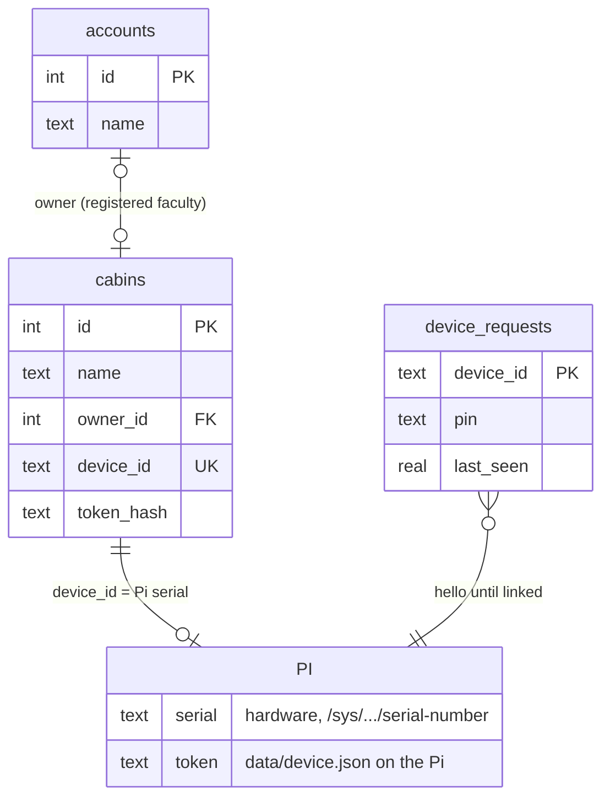

# ER diagram: the database (`laptop/smart_cabin.db`)

[← back to README](../README.md) · tables are created in [`laptop/database.py`](../laptop/database.py)

SQLite, 13 tables. **PK** = primary key, **FK** = points to another table, **UK** = unique.

## The whole database

```mermaid
erDiagram
    accounts ||--o{ sessions : "logs in (browser)"
    accounts |o--o| cabins : "owner of"
    cabins ||--o| cabin_state : "latest evidence"
    cabins |o--o{ device_requests : "approved into"
    accounts ||--o{ cards : "RFID cards (0..n)"
    accounts ||--o{ bt_devices : "phones / laptops (0..5)"
    accounts ||--o{ timetable_sheets : "timetables (one per school)"
    accounts ||--o{ timetable : "entries made from the sheets"
    accounts ||--o| overrides : "active manual button"
    accounts ||--o| status_now : "status shown"
    accounts ||--o{ watches : "watcher: notify me"
    accounts ||--o{ watches : "target: watched person"
    accounts |o--o{ events : "log about"
    cabins |o--o{ events : "log from"

    accounts {
        int id PK
        text username UK "lower case, no spaces"
        text password_hash "pbkdf2 sha256, salted"
        text role "admin / faculty"
        text name
        text position "Faculty / HOD / Dean"
        text designation
        text school
        text department
        text email
        int active "0 = blocked"
        real created
    }
    sessions {
        text token_hash PK "sha256 of the cookie"
        int account_id FK
        real expires "12 h"
    }
    cabins {
        int id PK
        text name "J block, 4th floor, Cabin 12"
        int owner_id FK, UK "the faculty member"
        text device_id UK "linked Pi serial"
        text device_name "Pi hostname"
        text token_hash "device key, hashed"
        text setup_code "6-digit fallback"
        real code_expires
        real enrol_until "owner logged in on the Pi"
        real last_report
        real created
    }
    device_requests {
        text device_id PK "Pi serial"
        text name
        text model
        text ip
        text pin "4 digits"
        real first_seen
        real last_seen "dropped after 60 s"
        int cabin_id FK "not used since step 9 refinement"
        text token "not used since step 9 refinement"
    }
    cabin_state {
        int cabin_id PK, FK
        int faculty_in
        int headcount
        int phone_near
        int face_photos
        text sensors "JSON"
        real updated
    }
    cards {
        text uid PK "A1B2C3D4 or 7-byte id"
        int account_id FK
        real added
    }
    bt_devices {
        text address PK "AA:BB:CC:DD:EE:FF"
        int account_id FK
        text name
        real added
    }
    timetable_sheets {
        int id PK
        int account_id FK
        text name "School of CS - BCA"
        text template "A / B"
        int saturday
        text slots "JSON day times"
        text cells "JSON grid"
        real updated
    }
    timetable {
        int id PK
        int account_id FK
        text sheet "which timetable"
        int day "0 Mon .. 5 Sat"
        text start "09:00"
        text end "09:50"
        text activity "Class / Lab / Meeting / Break / ..."
        text title "CSE301"
        text place "J block, 4th floor, Room 3"
    }
    overrides {
        int account_id PK, FK
        text status "green / yellow / red"
        text reason
        text source "web / button"
        real set_at
        real until
        int saw_in
        int saw_meeting
        real low_since
    }
    status_now {
        int account_id PK, FK
        text status "green / yellow / red / grey"
        text reason "where"
        text until_text "until / back around"
        int manual
        real since
        text pending_status "10 s buffer"
        real pending_since
    }
    events {
        int id PK
        real time
        int account_id FK
        int cabin_id FK
        text kind "arrive, leave, card_login, status, button, device ..."
        text detail
    }
    watches {
        int id PK
        int watcher_id FK
        int target_id FK
        real created
        real fired "turned green"
        int shown
    }
```

## The device-linking part (step 9) on its own

## How the tables are used

| Flow | Tables (in order) |
|---|---|
| Admin registers faculty | `accounts` |
| Login | `accounts` → `sessions` |
| New Pi switched on | `device_requests` (waiting) → admin links → `cabins.device_id`, `cabins.owner_id` → hello → `cabins.token_hash` |
| Pi reports every 3 s | `cabins.last_report`, `cabin_state`, `events` → status engine reads `overrides`, `timetable` → writes `status_now` (→ `watches.fired` when green) |
| Faculty fills a timetable | `timetable_sheets` → merged into `timetable` |
| Setup on the Pi | `cabins.enrol_until` → `cards`, `bt_devices` |
| Public page | `accounts` + `cabins` + `status_now` (only 12 fields go out) |
| Evaluation | `events` → CSV export |

## On the Pi (not in the database)

The cabin device keeps its own small JSON files in `pi zero 2w/data/`. They never go to the server, except what the reports send on purpose.

| File | Holds |
|---|---|
| `device.json` | server address, device key (token), cabin name |
| `device_id.json` | only in simulation (a real Pi uses its hardware serial) |
| `faces.json` | the owner's face: 128 numbers per photo, **never sent** |
| `zones.json` | ignore zones for the people counter |
| `cache.json` | copy of the owner, cards and phones (works while the laptop is off) |
| `paired_by_us.json` | Bluetooth pairings this program made (so only those are removed) |
