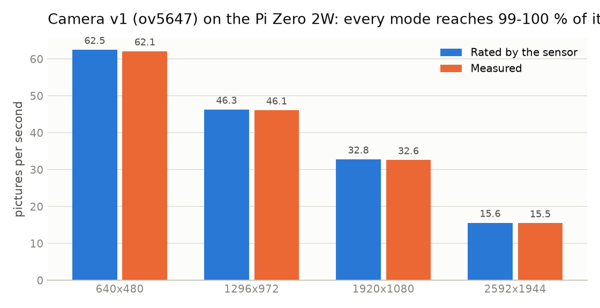
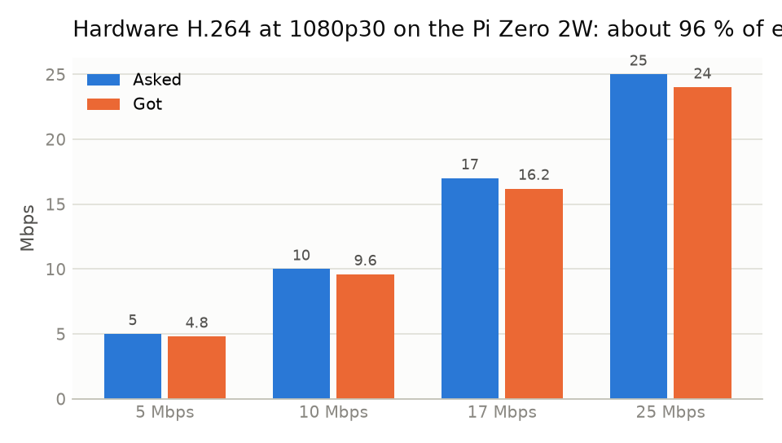

# Sensors: RFID, Bluetooth, buttons, light, camera

[← back to README](../README.md)

Each part was first tested on its own with the scripts in `pi board codes/hardware test code/` (results in `pi 02w results/`).

## Wiring

GPIO (BCM) numbers, with the physical pin in brackets. The same 40-pin header on the Zero 2W and the Pi 4.

| RC522 RFID | Pi | | NeoPixel | Pi | | Button | Pi |
|---|---|---|---|---|---|---|---|
| SDA | GPIO8 (24) | | DIN | GPIO18 (12) | | Available | GPIO5 (29) |
| SCK | GPIO11 (23) | | 5V | 5V (2) | | In a meeting | GPIO6 (31) |
| MOSI | GPIO10 (19) | | GND | GND (14) | | Not available | GPIO26 (37) |
| MISO | GPIO9 (21) | | | | | other legs | GND (39) |
| RST | GPIO25 (22) | | | | | | |
| 3.3V | 3.3V (1), **never 5 V** | | | | | | |
| GND | GND (6) | | | | | | |

Camera: ribbon cable in the CAMERA port.

## RFID (RC522, 13.56 MHz)

| Measured on the Zero 2W (23 Oct 2026) | Result |
|---|---|
| Chip | genuine NXP MFRC522 v2.0 (0x92) |
| SPI write / read back | 6 / 6 |
| Stability | 500 / 500 reads correct, 31 792 reads/s |
| RST pin, antenna | works, 33 dB gain |
| Chip self-test | 64 / 64 bytes match the datasheet |
| Cards | 4-byte cards and 7-byte NTAG / Ultralight tags (the app reads the full 7 bytes) |

**In the system:** a tap = login, or logout if already in. A login must be confirmed by the camera or phone within 120 s, because a card proves the card was there, not the person. UIDs can be cloned, so a tap is never trusted alone.

## Bluetooth (presence of the owner's phone)

- **Random addresses:** phones and laptops randomise their address only while advertising (BLE, about every 15 min). The classic address is fixed. **Pairing once** gives the Pi the real address and the IRK key, so nothing has to be typed.
- **Identity only:** the device is **not trusted** and is **disconnected** straight after pairing, so no keyboard, speaker or file service can attach. The pairing agent runs only during the 60 s window.
- **Check:** `l2ping` every 15 s. It works while Bluetooth is on, even with the screen locked.
- **Two ways to pair:** the Pi lists visible devices → **Pair** (works for iPhones, which often don't list a Pi), or the phone picks the Pi's name.
- 0 – 5 devices per person. Removing one on `/me` also removes the pairing on the Pi.
- **Tested:** the hardware script (`9_bluetooth_presence.py`) and the app, both with simulated BlueZ. Real iPhone / Android pairing and l2ping on a locked screen **are still to be tested**.
- **Limit:** the range goes through walls (about 10 m), which is why the phone can only keep presence, never create it.

## NeoPixel (WS2812)

| Colour | Meaning |
|---|---|
| green / yellow / red | the status from the server (or the device's own guess when the laptop is off) |
| blue | setup going on, or not connected to a cabin yet |
| short white flash | card read |
| purple flash | unknown card |

Tested: the single LED cycled all 8 colours on the Zero 2W (`3_test_neopixel.py`). GPIO18 shares its PWM with analogue audio on boards with a 3.5 mm jack (not the Zero).

## Buttons

Three push buttons to GND, using the Pi's internal pull-up. Pressing the active one again = **Auto**. They do the same as the buttons on `/me`.

## Camera

 

The Zero 2W's camera is an **ov5647 (Camera v1, 5 MP)**. Every mode reaches 99–100 % of its rated speed, and hardware H.264 gives about 96 % of the asked bitrate. The app needs only one picture every 5 s at 1296×972.

## Sensors not used, and why

| Sensor | Verdict |
|---|---|
| **PIR** | rejected: misses people sitting still (the worst failure here), fires on sunlight, air and passers-by. Useful only as a wake-up trigger |
| **mmWave radar (HLK-LD2410)** | **favoured for later**: senses breathing, ignores the doorway by distance, can't be fooled by photos or screens |
| Thermal array (AMG8833 / MLX90640) | alternative to radar, more expensive |
