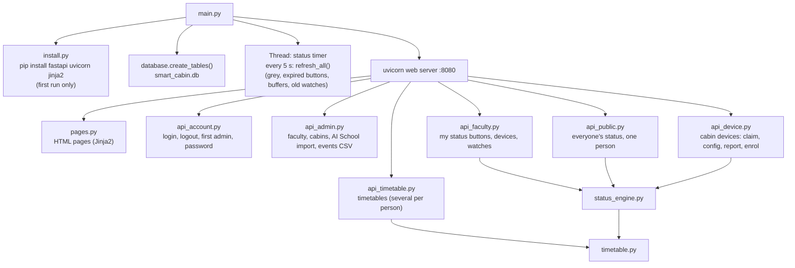
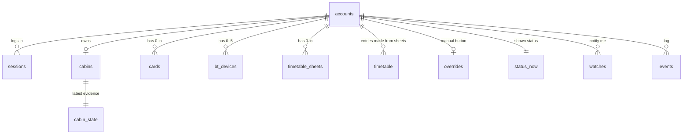

# The laptop server (`laptop/`)

[← back to README](../README.md)

One Python program, `python main.py`. It is the single place where statuses are decided and data is kept.

## Database (SQLite, `smart_cabin.db`)

| Table | Holds |
|---|---|
| `accounts` | admin and faculty: username, **password hash**, role, name, position (Faculty / HOD / Dean), designation, school, department, e-mail, active |
| `sessions` | browser logins (only the **hash** of the cookie token), expire after 12 h |
| `cabins` | name, owner, **device token hash**, 6-digit code + expiry, setup window, last report |
| `cards`, `bt_devices` | RFID card ids and Bluetooth addresses per faculty member |
| `timetable_sheets` | each timetable a person has (template, day times, Saturday, grid as JSON) |
| `timetable` | entries merged from all sheets (day, start, end, activity, class, place) |
| `overrides` | the active manual button, with its end-rule flags |
| `cabin_state` | latest evidence from the cabin device (in, headcount, phone, face photos, sensors) |
| `status_now` | the shown status + the pending one (10 s buffer) |
| `events` | log of every change, exported as CSV for evaluation |
| `watches` | "notify me when available" requests |

Plain SQL with Python's `sqlite3`, three helpers (`rows`, `row`, `run`), a new connection per call (safe with the web server's threads), and WAL mode so pages can read while a report is being written.

## Security

| Thing | How |
|---|---|
| Passwords | `hashlib.pbkdf2_hmac` SHA-256, random salt, 200 000 rounds, compared in constant time. A wrong login waits 1 s (slows guessing) |
| Browser login | random 32-byte token in an **HttpOnly, SameSite=Lax** cookie. The database keeps only its SHA-256 |
| Roles | FastAPI dependencies `need_login`, `need_admin`, `need_faculty`, `need_device` on every route |
| Cabin devices | a 6-digit code (15 min, single use) → a long random token. Only its hash is stored. Re-claiming replaces it |
| Setup on the Pi | the owner (or the admin) must log in on the Pi page. It opens a 10-minute setup window |
| Input checking | every request body is a Pydantic model in `models.py`: wrong or missing fields are refused before our code runs |
| Public data | `/api/people` returns only 12 allowed fields (checked by the automatic test) |
| Not in the prototype | HTTPS, rate limiting, university single sign-on (listed for deployment) |

## The API for cabin devices

All calls are listed, and can be tried, at **`http://<laptop>:8080/docs`** (made by FastAPI).

| Call | What |
|---|---|
| `POST /api/device/claim {code}` | 6-digit code → `{token, cabin}` |
| `GET /api/device/config` | owner, card ids, phones (the Pi keeps a copy for when the laptop is off) |
| `POST /api/device/report {faculty_in, headcount, phone_near, face_photos, sensors, button, events[]}` | → `{status, led, reason, until, manual, owner}` |
| `POST /api/device/enrol {username, password}` | opens setup for 10 min (owner or admin only) |
| `POST /api/device/enrol/card {uid}` · `/enrol/phone {address, name}` · `/enrol/end` | link a card, add a phone (max 5), close setup |

## Tests (24 Oct 2026)

An automatic test (FastAPI `TestClient`, a fresh database) runs **80 checks, 80 pass**:
- first admin, logins and hashing
- roles, registration, cabins and device claim
- setup on the Pi
- timetables: templates, labs, lunch hour, several timetables, clashes
- every status rule with fake times, the 10 s buffer and grey
- notify-me watches, the manual buttons and their end rules, card login ending "away", hardware buttons
- public fields only, every page, CSV export
- the AI School import (136 people, Dean Dr. Shakkeera L, no duplicates on a second import)

Not covered by a test: the 15-minute code expiry, removing a card or phone from `/me`, and changing a password.
