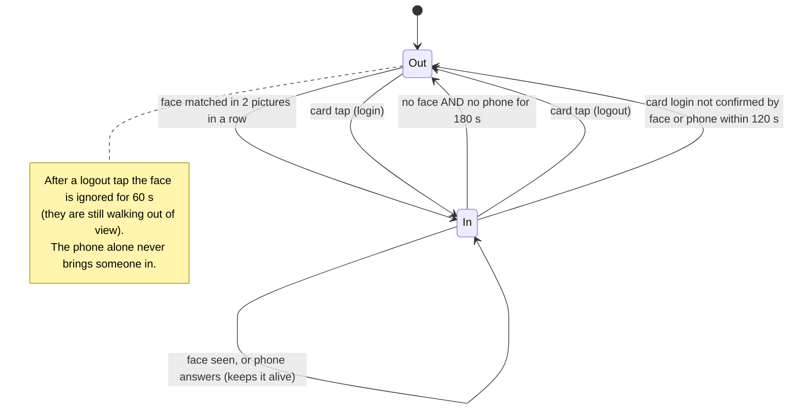
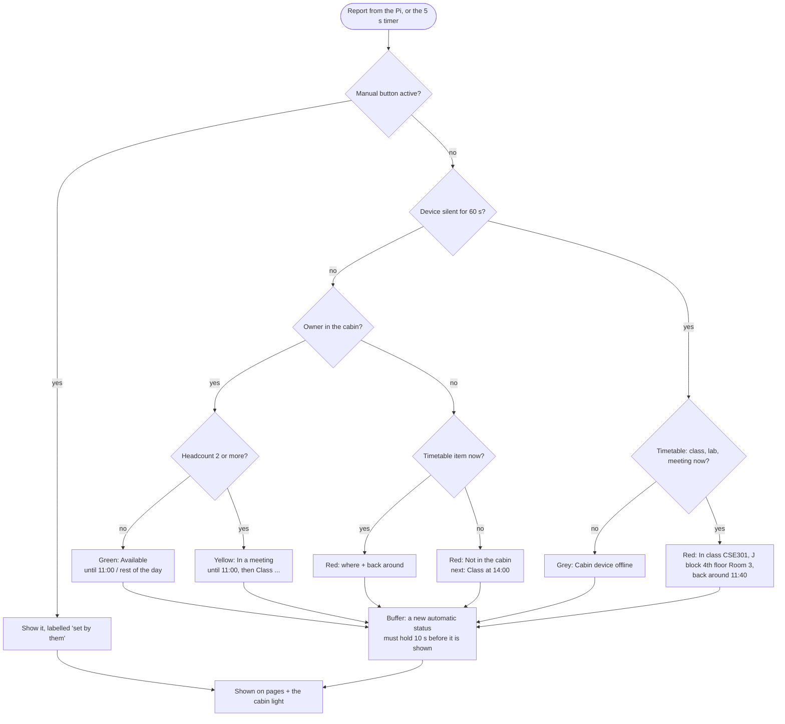
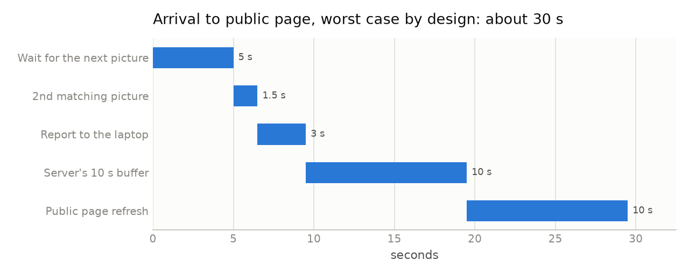

# Status rules

[← back to README](../README.md)

Two places, each with one job:
- **The Pi** (`presence.py`) turns raw sensor readings into evidence: *is the owner in?* and *how many people?*
- **The laptop** (`status_engine.py`) turns that evidence, the timetable and the manual buttons into the **one status** everyone sees.

## 1. In or out? (on the Pi)

| Rule | Value | Why |
|---|---|---|
| Picture every | 5 s, or 1.5 s for 30 s after a change | saves CPU on the Zero 2W, reacts fast when something happens |
| Arrive by face | 2 pictures in a row | one wrong match can't flip the status |
| Card confirm | 120 s | a card proves the card was there, not the person |
| Leave | 180 s without face and phone | looking down or turning away must not flip to red. Leaving waits longer than arriving on purpose |
| Phone | keeps "in", never makes "in" | phones reach through walls ("evidence, not trust") |
| Headcount | steady after 3 pictures agree; photos and posters removed | a visitor passing the door doesn't flip it |
| Headcount sent | `max(count, 1 if in)` | if the camera misses the owner but the card or phone says in, they still count |

## 2. The status (on the laptop)

### Manual buttons and how they end

| Button | Ends when |
|---|---|
| **Available** (green) | the device saw them *in* and then *out*, or after 60 min |
| **In a meeting** (yellow) | the headcount was 2 or more and then drops to 1 or less for 20 s, or they leave, or after 60 min. *If the camera never saw 2 people (the reason it was pressed), only leaving or the 60 min end it* |
| **Not available** (red) + reason (busy / break / meeting outside / leave) + time | at that time, on a card **login** tap, or on **Auto** |
| **Auto** | clears the button: sensors and timetable decide again |

The hardware buttons work the same way. Pressing the active one again = Auto.

### Why grey during a break

When the device is silent:
- during a **class, lab or meeting** the page can still say where they are, because the timetable knows.
- during a **break or office hours** they may well be in the cabin, so the honest answer is *unknown*.

This was found by the automatic test on 24 Oct 2026 and fixed.

## Timing (worst case, by design)

Most of the 30 s is the 10 s buffer and the 10 s page refresh. Both are settings in `laptop/config.py` and `static/status.js`, and can be shortened once the real hardware has been measured.
