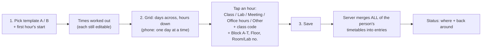
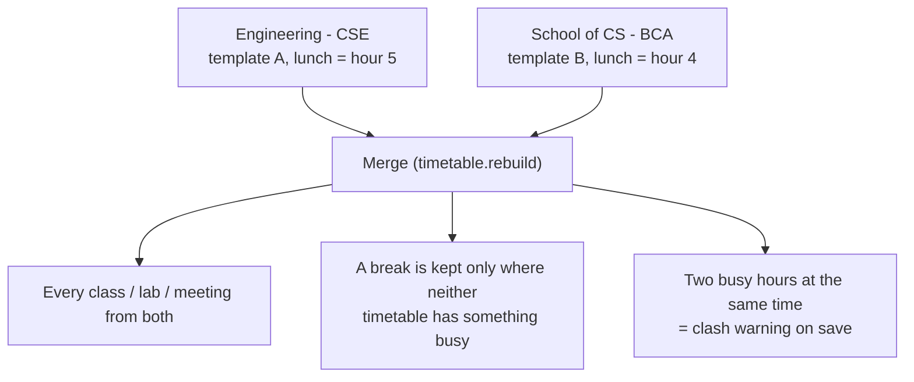

# Timetables

[← back to README](../README.md)

The timetable gives the status its **where** and **until when**: *"In class CSE301, J block, 4th floor, Room 3, back around 11:40"*. Free hours mean the faculty member is expected in their cabin.

## The university's day

8 numbered hours. **The lunch hour is one of them.** There are two tea breaks, Monday to Friday, with Saturday for some.

| Template | Order |
|---|---|
| **A** | 1, 2, *tea*, 3, 4, **5 = lunch**, 6, *tea*, 7, 8 |
| **B** | 1, 2, *tea*, 3, **4 = lunch**, 5, 6, *tea*, 7, 8 |

Each hour is 50 min (the lunch hour too), and tea is 10 min. All of these can be changed. From a 09:00 start, template A gives: 09:00, 09:50, tea 10:40, 10:50, 11:40, lunch 12:30, 13:20, tea 14:10, 14:20, 15:10.

## Filling it in (`/timetable`)

- **Free** = in the cabin. The lunch hour starts as **Lunch**, but can hold a class.
- **Lab = 2 hours in a row by number** (1–2, 3–4, 4–5, 6–7, …). Tea isn't counted, but the lunch hour is. The second hour shows "(2nd hour)". A tea break inside a lab is left out, because the lab goes on.
- **Locations** from drop-downs: Block **A – T**, Floor (Ground – 10th), Room or Lab number (1 – 30) → "J block, 4th floor, Room 3" or "D block, 3rd floor, Lab 2".
- The **admin** can fill it in for anyone (Register page → Timetable).

## Several timetables (one per school or branch)

A faculty member teaching for two schools adds a second timetable (**+ Add timetable**). Each has its own template, so the lunch hours can differ.

In each grid, hours already used by another timetable show greyed as *"busy: Class BCA101 (School of CS – BCA)"*, so clashes are visible while filling in.

## How "back around" is worked out

`back_at()` takes the end of the current entry, and joins entries that follow within 10 min. For example, Class 09:00–09:50 then a Lab until 11:40 gives **back around 11:40**. Breaks are not joined.

## Tested (24 Oct 2026, automatic test)

- Template A times
- 8 numbered hours
- a lab across tea, and a lab into the lunch hour
- no lunch break when a lab takes the lunch hour
- several timetables, the clash warning, a class beating the other timetable's lunch
- busy hours greyed
- deleting a timetable
- the place text

## Later

- **Reading a photo of a printed timetable:** OCR (Tesseract or a vision AI service) → pre-filled grid → the person checks and saves.
- **Student timetables** (subject, faculty, room) are a separate module.
