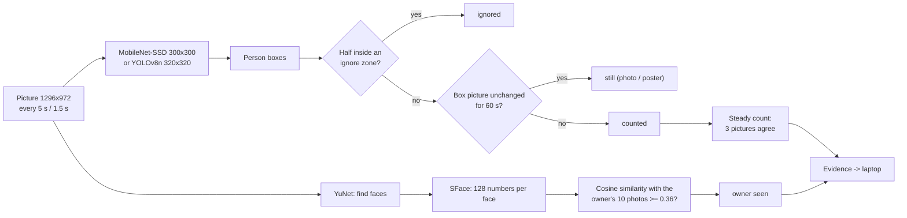
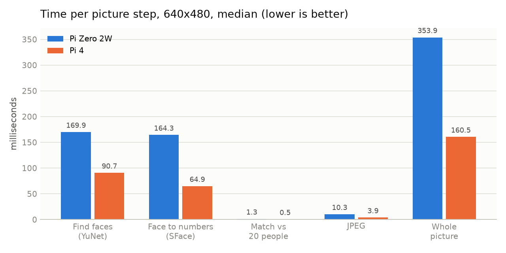
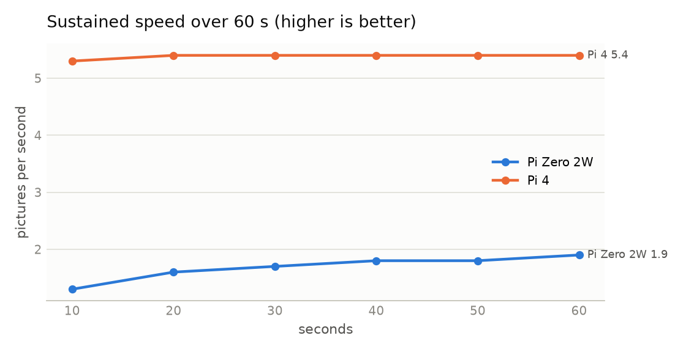
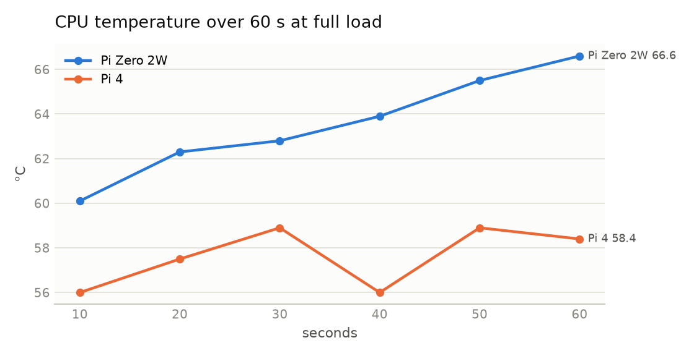
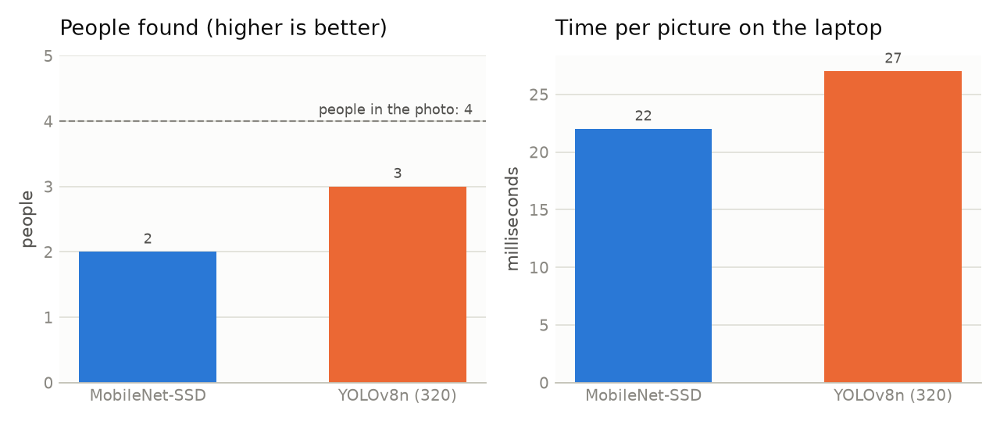
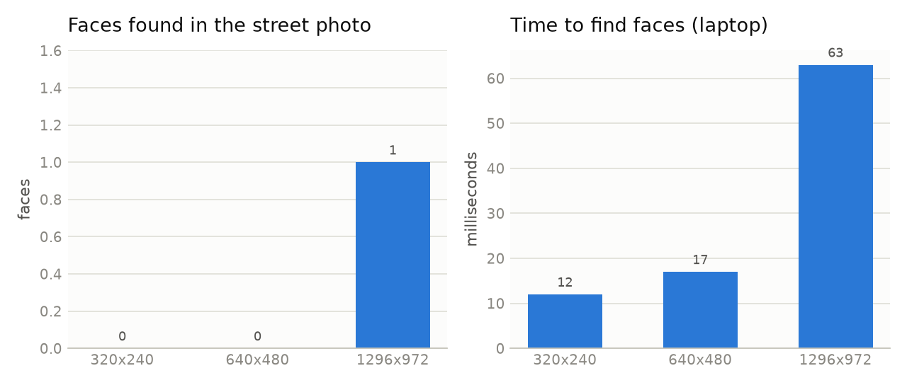

# Vision: counting people and recognising the owner

[← back to README](../README.md)

Everything runs **on the Pi** with OpenCV's DNN module, with no PyTorch and no cloud. A picture is taken, used and thrown away. Only the numbers (headcount, owner seen) leave the device.

## Models

| Job | Model | Size | Input | Why this one | Alternatives |
|---|---|---|---|---|---|
| People count (default) | **MobileNet-SSD** (Caffe, VOC classes) | 23 MB | 300×300 | Fast on a Zero 2W, runs in OpenCV with no extra library | YOLOv8n (more accurate), MediaPipe, HOG (old) |
| People count (accurate) | **YOLOv8n** (Ultralytics, exported to ONNX, `imgsz=320`, opset 12) | 12 MB | 320×320 | The same model as the laptop's headcount; found 3 of 4 people vs 2 for MobileNet | YOLOv8s (slower), RT-DETR, NanoDet |
| Find faces | **YuNet** (OpenCV Zoo, 2023mar; 2022mar on older OpenCV) | 0.2 MB | any | Tiny and fast, gives 5 landmarks for alignment | RetinaFace, MTCNN (laptop prototype), Haar (paper 7, outdated) |
| Recognise a face | **SFace** (OpenCV Zoo, 2021dec) | 37 MB | 112×112 aligned crop | 128-number embeddings, runs in OpenCV | ArcFace / InsightFace (more accurate, heavier), FaceNet (laptop prototype, PyTorch) |

## Algorithms

| Step | Algorithm | Detail |
|---|---|---|
| Person detection | single-shot detector (SSD) / YOLO with **non-maximum suppression** | keep boxes ≥ 0.5 confidence; NMS at IoU 0.45 removes duplicate boxes |
| Steady count | **majority-of-window** (3 in a row must agree) | stops flicker from one bad picture |
| Photo / poster check | **frame differencing per box**: grey 32×64 crop vs the crop when the box last moved, mean absolute difference > 4 | a real person always moves a little. Box tracking by **IoU ≥ 0.4** |
| Ignore zones | **overlap fraction**: half the box inside a zone → ignored | fixed posters, a wall TV |
| Face embedding | SFace on a YuNet-aligned crop, **L2-normalised** | so dot product = cosine similarity |
| Matching | **cosine similarity**, best of the owner's 10 photos, threshold 0.36 | owner only; others are counted, never identified |
| Arrival | **2 consecutive matches** | one false match can't flip the status |

## Benchmarks (measured)

### Pi Zero 2W vs Pi 4 (face pipeline, `pi_benchmark.py`, 22 Oct 2026)

 

| Measure | Pi Zero 2W | Pi 4 |
|---|---|---|
| Whole picture, 1 face, 640×480 | 354 ms | 161 ms |
| Sustained (60 s) | 1.9 pictures/s | 5.4 pictures/s |
| Temperature after 60 s | 67 °C, still rising | 59 °C, steady |
| Throttling | none | none |
| Models in RAM | 43 MB | 50 MB |

### People detectors and face size (laptop, OpenCV 4.10, 24 Oct 2026)

- **Bodies vs faces:** both people detectors shrink the picture to 300 or 320 px, so 640×480 is plenty for counting. Faces are much smaller: in the test photo, YuNet found no face at 640×480 but one at 1296×972 (59 px wide). That's why the camera takes **1296×972**.
- **Recognition:** the registered man was recognised in the full street photo with similarity **0.60** (threshold 0.36). The man in sunglasses wasn't detected as a face.

## Performance grade

Grades: **A** = meets the need with room to spare · **B** = meets it · **C** = meets it with limits · **D** = not yet shown.

| Area | Grade | Evidence | What would raise it |
|---|---|---|---|
| Speed on Pi 4 | **A** | 161 ms per picture vs a 5 s budget | – |
| Speed on Pi Zero 2W | **B** | 354 ms at 640×480; 1296×972 is slower, but a picture every 5 s leaves lots of room | measure at 1296×972 on the Zero |
| Heat | **B** | no throttling; the Zero still rising after 60 s | heatsink + 10-minute run |
| People counting | **C** | 2 / 4 (MobileNet) and 3 / 4 (YOLO) on one hard street photo; cabin scenes are easier (2–5 m, people facing the camera) | count accuracy over many cabin pictures (planned evaluation) |
| Owner recognition | **C** | correct match at 0.60 in tests; one person | true / false match rates on consented photos of several staff |
| Photo / poster rejection | **B** | still → not counted after 60 s; ignore zones tested | tune the threshold with a real person sitting still |
| Video of a person | **D** | a moving screen is still counted | screen check (YOLO "tv / laptop / phone"), or mmWave radar |
| Privacy | **A** | pictures never leave the Pi; face data only on the Pi; public page has 12 fields | – |

## Choosing the board for vision

| Board | Fits | Notes |
|---|---|---|
| **Pi Zero 2W** (512 MB) | ✅ snapshot mode | cheapest, small; 1 picture every 5 s is fine; no desktop, heatsink |
| **Pi 4** (4 GB) | ✅✅ recommended for the demo | 2–3× faster, runs cool, room for YOLOv8n |
| **Pi 5** | ✅✅✅ | another ~2× over the Pi 4; the NeoPixel library (`rpi_ws281x`) does **not** support it, so use an SPI-driven LED library |
| **Jetson Orin Nano** | overkill | GPU: real-time YOLO / ArcFace, but 5–10× the price |
| **ESP32-S3 / ESP32-CAM** | ❌ for faces | can send pictures, but can't run SFace / YOLO at useful accuracy |
| **Laptop only** | ✅ | ~10× a Pi 4; fine for the lab demo, not a product |
