# Smart Cabin v2 – diagrams

[← back to the v2 README](../README.md)

All diagrams are Mermaid: GitHub draws them as pictures; in VS Code use a Mermaid preview extension.

1. [The whole system](#1-the-whole-system)
2. [The laptop server: files and how they are linked](#2-the-laptop-server-files-and-how-they-are-linked)
3. [The cabin device: files and how they are linked](#3-the-cabin-device-files-and-how-they-are-linked)
4. [The cabin device: start-up and threads](#4-the-cabin-device-start-up-and-threads)
5. [The vision loop](#5-the-vision-loop)
6. [In or out (presence rules)](#6-in-or-out-presence-rules)
7. [How the server decides what the pages show](#7-how-the-server-decides-what-the-pages-show)
8. [A device finds the server and reports](#8-a-device-finds-the-server-and-reports)
9. [Registration at the cabin](#9-registration-at-the-cabin)
10. [Adding / deleting face sets and cards](#10-adding--deleting-face-sets-and-cards)
11. [Pages and the calls they use](#11-pages-and-the-calls-they-use)
12. [Data files](#12-data-files)

---

## 1. The whole system

```mermaid
flowchart LR
    subgraph CABIN["Cabin (one per faculty member)"]
        CAM["Pi Camera"] --> PI
        RFID["RC522 card reader"] --> PI
        PI["Raspberry Pi<br/>pi_edge/main.py<br/>decides: in / out, headcount,<br/>confidence, status"]
        PI --> LED["NeoPixel at the door<br/>green / yellow / red"]
    end
    PI -- "HTTPS + device key<br/>status, confidence, headcount,<br/>health (no pictures)<br/>every 2 s" --> SV
    SV -- "UDP broadcast every 2 s<br/>'SMARTCABIN https://…:8080'" -.-> PI
    subgraph LAPTOP["Laptop (server)"]
        SV["laptop_server/main.py<br/>CSV files, timetable rules"]
    end
    SV --> PUB["Main / Search pages<br/>anyone, no login"]
    SV --> ADM["Devices page<br/>admin login"]
    PI --> DP["Device page :8000<br/>status, live view,<br/>registration"]
```

## 2. The laptop server: files and how they are linked

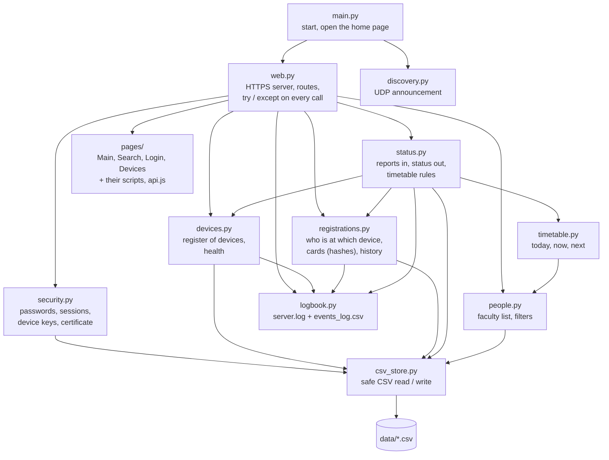

## 3. The cabin device: files and how they are linked

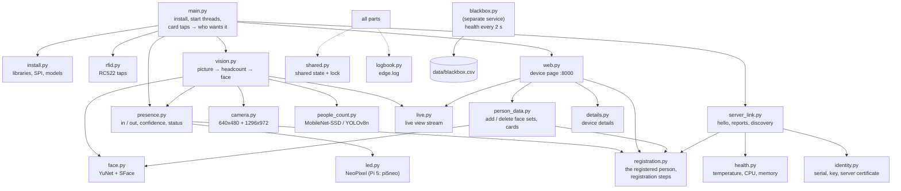

## 4. The cabin device: start-up and threads

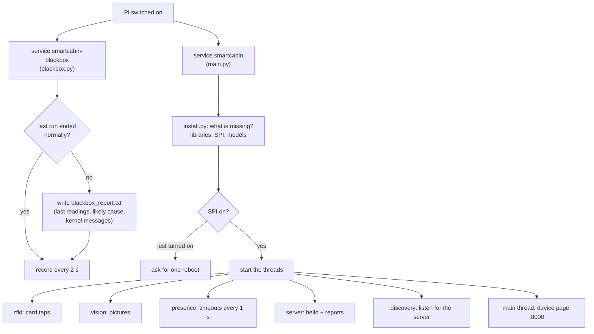

## 5. The vision loop

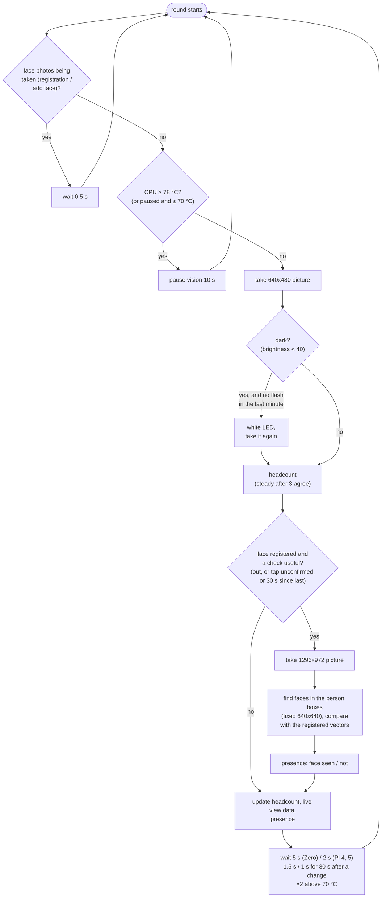

## 6. In or out (presence rules)

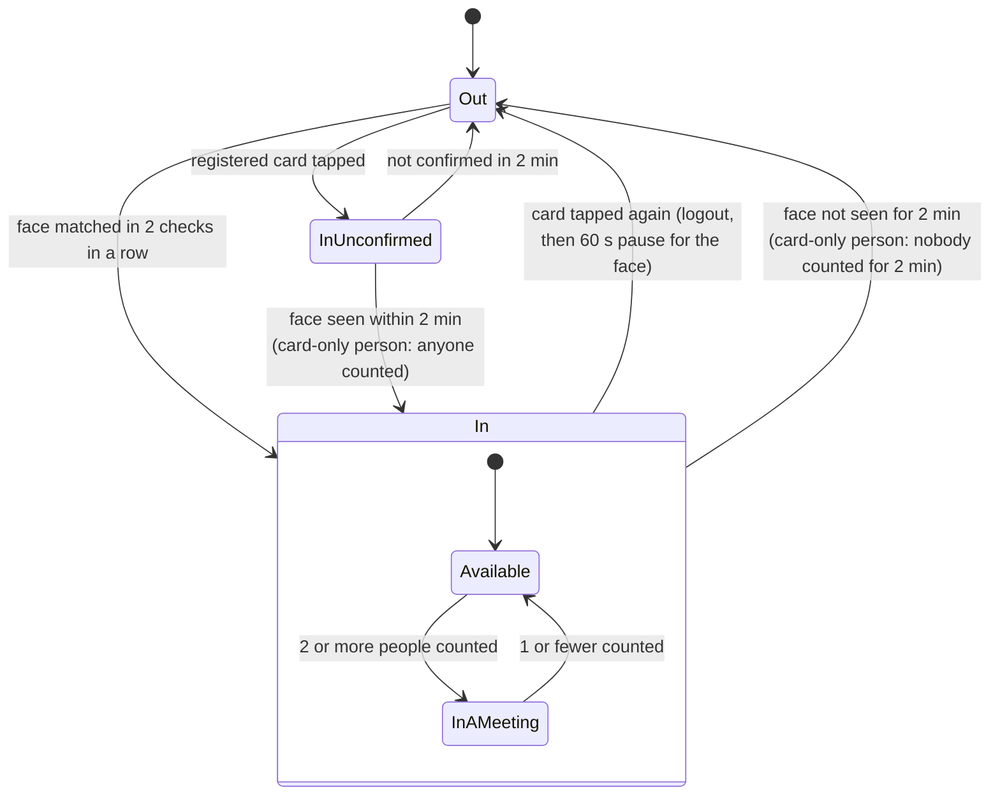

Confidence = face (seen in the last 2 min) × card (tapped in): none 2 %, card 35 %, face 70 %, both 90 %;
+10 % while someone is counted (max 95 %).

## 7. How the server decides what the pages show

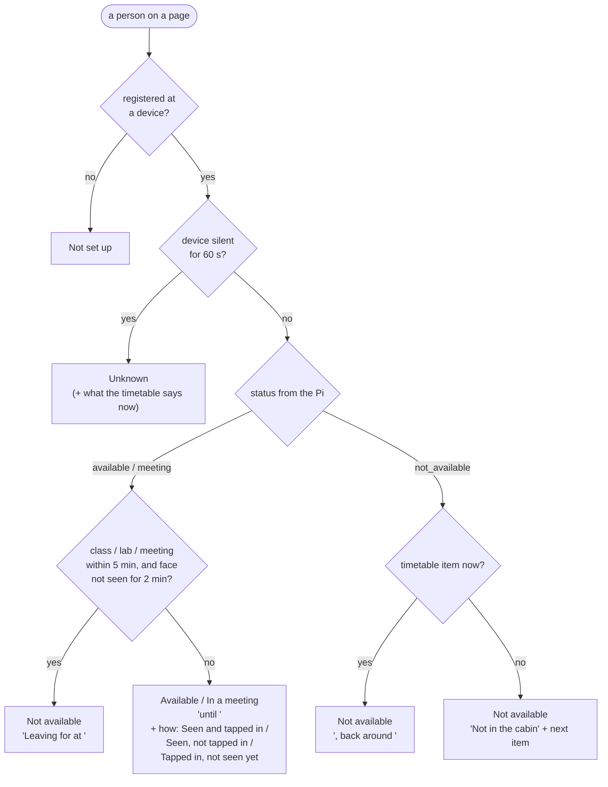

## 8. A device finds the server and reports

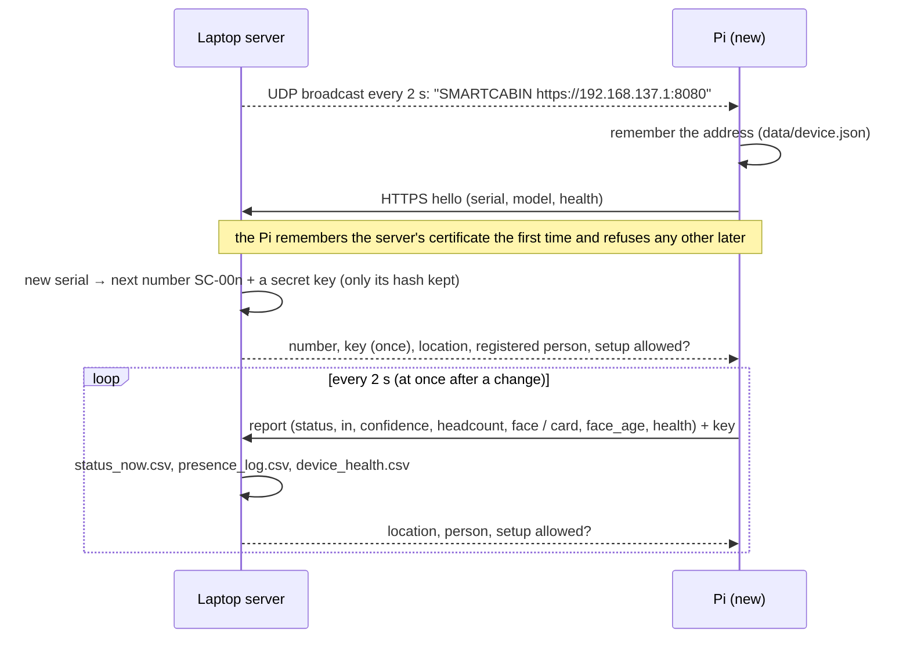

## 9. Registration at the cabin

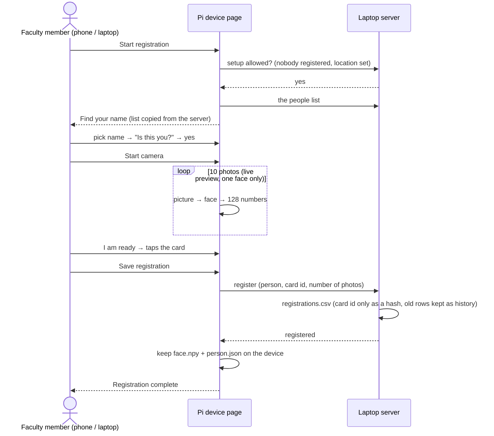

## 10. Adding / deleting face sets and cards

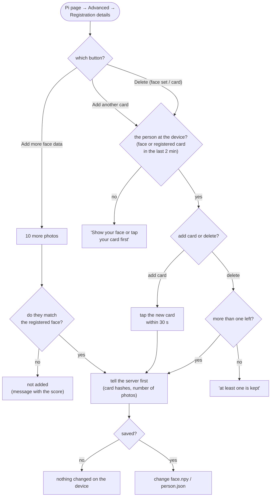

## 11. Pages and the calls they use

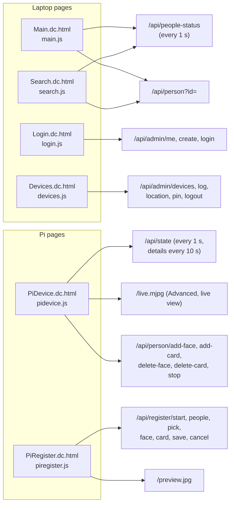

## 12. Data files

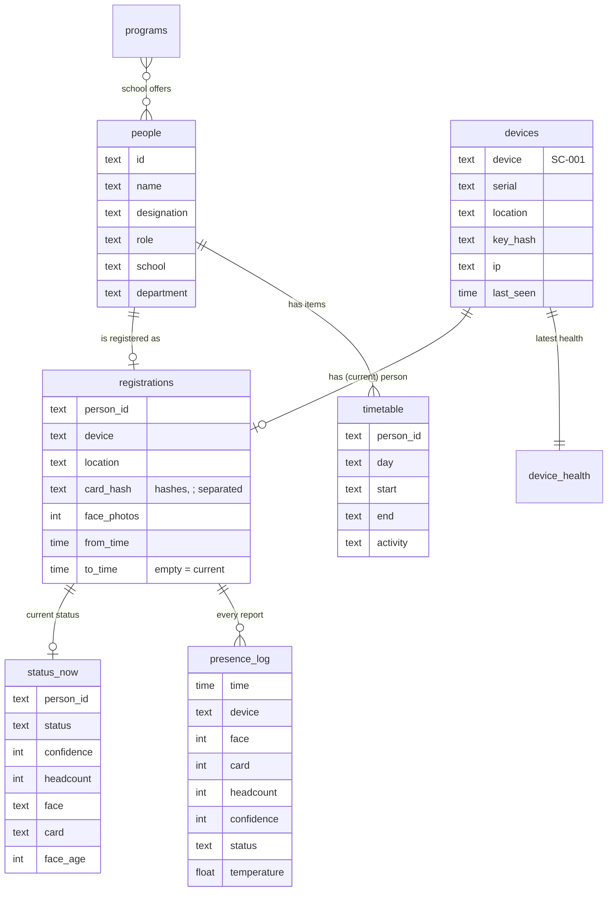

On the Pi (`pi_edge/data/`): `device.json` (number, key, server address and certificate), `person.json` (person,
face sets, cards), `face.npy` (128 numbers per face photo), `people_copy.csv`, `blackbox.csv`, `blackbox_report.txt`.
