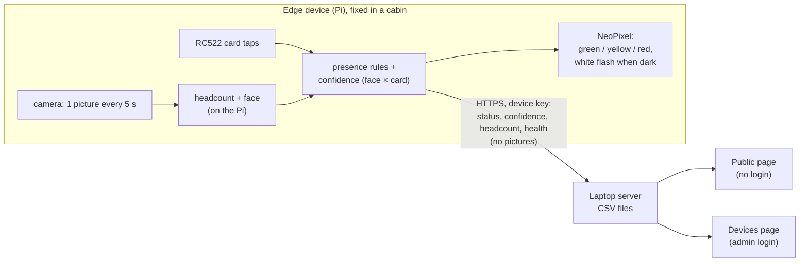

# Smart Cabin v3 – plan

**v3 started 26 Oct 2026 as a copy of v2** (v2 works and is frozen in `../v2/`, git tag `v2-final`). New requests are
written in the *Change log* below first, then built here. Everything below up to the change log is v2's plan, which
v3 starts from.

Written 24 Oct 2026, before the code. Ticked only after checking. Changes go in the *Change log*.

**Primary goal:** is the person **in their cabin or not** (and alone or with others), shown correctly on a public page.

A research prototype: every part must work and be easy to troubleshoot. The laptop is the server.

---

## 1. How it works



- **Identity like a roll number:** each Pi has a hardware serial. The first time it says hello, the server gives it a device number (`SC-001`, `SC-002`, …) and a secret key. The **location** of each device is set once by the admin on the Devices page. Nothing about the location is written on the Pi.
- **Registration at the device:** the person opens the Pi's page on their phone, enters a **setup PIN** (from the admin), picks their name from the university list, registers their face (10 photos) and taps their card. When registration starts, the Pi fetches a copy of the list from the server (id, name, designation, school, department only, about 120 KB) into `data/people_copy.csv`; the page offers **School → Department drop-downs and type-to-search**, filtered on the phone. The location comes from the device. Moving cabin = registering at the new cabin's device; the old registration is kept as history.
- **The Pi decides** in / out, headcount, confidence and the status. The server receives, saves, adds the timetable ("In class until 10:00"), shows the public page, and marks a device **Unknown** after 60 s of silence.
- **Not in this build:** Bluetooth, hardware buttons, manual status, an OLED display, machine learning (planned in section 8).

## 2. Statuses and LED

| LED | Status | Rule |
|---|---|---|
| 🟢 | Available | person in, headcount ≤ 1 |
| 🟡 | In a meeting | person in, headcount ≥ 2 |
| 🔴 | Not available | person not in (the timetable says where, if known) |
| ⚪ (page only) | Unknown | the device has sent nothing for 60 s |
| 🔵 | – | registration going on at the device |
| short white | – | the room is dark: light for the camera, then back to the status colour |

## 3. Presence rules and confidence (on the Pi)

| Rule | Value |
|---|---|
| Arrive | the person's face matched in **2 face checks in a row**, or a **card tap** |
| Card tap while in | out at once (logout). For 60 s after it, the face can't bring them back in |
| Card tap must be confirmed | by the face within **120 s**, or they are out again. A person registered **with a card only** (no face) is confirmed when the camera counts anyone in the cabin within 120 s |
| Stay in | while the face is seen, or anyone is still counted in the cabin |
| Leave | no face **and** headcount 0 for **180 s** |
| Confidence | face × card table from test 10 (Bluetooth column dropped): none **2 %**, card only **35 %**, face only **70 %**, both **90 %**. Someone counted in the cabin while in adds **+10 %** (max 95 %) |

## 4. Keeping the Pi cool

- **Snapshots, never video.** One picture every **5 s**, every **1.5 s for 30 s** after a change (tap, headcount change, face found).
- **Headcount on every picture** (MobileNet-SSD at 300 px on the Zero 2W, YOLOv8n at 320 px on the Pi 4 if its model file is there).
- **Face check only when useful:** someone is in the picture, and the person is not confirmed yet, or 30 s have passed since the last check. Faces are searched only in the top half of each person box (from the full 1296x972 picture). If no person is found, a face check on the whole picture runs at most every 15 s (a person close to the camera can be missed by the body detector).
- OpenCV limited to **2 threads**. Above **70 °C** the pictures come half as often, above **78 °C** vision pauses until it is back under 70 °C.
- **Dark room:** if a picture is too dark (average brightness under 40 / 255), the LED shines white for 0.6 s and one picture is taken, **at most once every 2 minutes** (or right after a card tap). A dark room with no face counts as headcount 0.

## 5. Security

| Risk | What v2 does |
|---|---|
| Watching the camera | **No video feed exists.** Pictures are used and dropped on the Pi. The only picture ever shown is a small preview during registration, only after the setup PIN, only to that phone (a secret page key), and only until the registration ends (max 5 min) |
| Listening on the Wi-Fi | **HTTPS** for the server and the Pi's page (self-signed certificates made at first start; a phone shows a warning the first time, accept it once). The Pi **remembers the server's certificate** the first time and refuses a different one later |
| A fake device | the server gives each device a secret key on its first hello (only the key's hash is stored). Reports without the right key are refused. A device can be reset only by the admin |
| Changing settings | the Devices page (locations, setup PINs, removing registrations, logs) needs the **admin login**. The admin account is made on the first visit; the password is stored as a salted PBKDF2 hash. A wrong login waits 1 s |
| Registering as someone else | registration needs a **6-digit setup PIN** that the admin makes for that device (valid 15 min, one use) |
| Card ids | the server keeps only a hash of the card id ("card registered: yes"). The card id itself is only on the Pi |
| Face data | only on the Pi: 10 × 128 numbers (no photos), file readable only by root |
| What the public sees | only name, designation, school, department, status, location, until / where, today's timetable. No confidence, no card, no device data |
| Bad requests | every request is size-limited and checked; errors answer with a message, never a crash |

Prototype limits (written in the paper): self-signed certificates, one admin account, everything on the laptop's hotspot.

## 6. Troubleshooting

- Every file starts with a comment saying what it does.
- Every button: **Working…** → green message or red message with the reason. Every request has a **10 s** limit.
- Every server route and every Pi part is in try / except. Answers are always `{ok, message, ...}`.
- Page errors show in a **red bar** at the top.
- Each Pi part (camera, people model, face model, RFID, LED, server link) shows **OK / PROBLEM + the reason** on the Pi page and on the Devices page; the rest keeps running.
- Logs: `laptop_server/logs/server.log`, `pi_edge/logs/edge.log`. The Devices page shows the newest server log lines and every device's last error.
- `python main.py --sim` runs the Pi app on a laptop with no hardware (a picture file as the camera, a "tap card" box on the page).

## 7. Files

**CSV files on the laptop** (`laptop_server/data/`):

| File | Holds |
|---|---|
| `people.csv` | the university faculty list (839 people, from the website). Existing |
| `programs.csv` | schools and their programmes (B.Tech, M.Tech, …). Existing, used for the programme filter |
| `timetable.csv` | person, day, start, end, activity. Existing demo data, replaced as real timetables come |
| `admin_account.csv` | the admin's username and password hash |
| `admin_sessions.csv` | admin logins (hash of the cookie, expiry) |
| `devices.csv` | device number, serial, model, location, key hash, IP, first seen, last seen |
| `device_health.csv` | latest health per device: temperature, CPU, memory, throttling, each part's state, last error |
| `setup_pins.csv` | setup PINs (hash, device, expiry, used) |
| `registrations.csv` | person, device, location, card hash, face photos, from, to (empty = current). Old rows stay as history |
| `status_now.csv` | latest status per registered person: status, confidence, headcount, in cabin, updated |
| `presence_log.csv` | every report: time, device, person, face, card, headcount, dark, confidence, in cabin, status, temperature. **The data for the paper and the machine learning** |
| `events_log.csv` | arrive, leave, tap, registration, location change, errors, in words |

**On the Pi** (`pi_edge/data/`): `device.json` (device number, key, server certificate fingerprint), `person.json` (who is registered here and their card id), `face.npy` (10 × 128 numbers), `people_copy.csv` (the list for registration), `page_cert.pem` / `page_key.pem` (the page's certificate).

**Code:**

```
v2/
├─ PLAN.md, README.md, deploy_to_pi.ps1
├─ laptop_server/   main.py, settings.py, logbook.py, csv_store.py, security.py, people.py,
│                   timetable.py, devices.py, registrations.py, status.py, web.py
│                   pages/ (the user's design, one folder):
│                     Main.dc.html + main.js        home: choose a school, search, filters, person details (served at /)
│                     Search.dc.html + search.js    search page with school / department / programme filters
│                     Login.dc.html + login.js      admin login / first admin account
│                     Devices.dc.html + devices.js  the admin's Devices page
│                     api.js                        shared: requests with a time limit, error bar
│                     canvas.json                   the design tool's file (not used by the server)
└─ pi_edge/         main.py, settings.py, logbook.py, shared.py, install.py, identity.py, health.py,
                    server_link.py, camera.py, people_count.py, face.py, rfid.py, led.py,
                    presence.py, vision.py, registration.py, web.py
                    details.py                                  device details for the Advanced view
                    pages/ (the user's design): PiDevice.dc.html + pidevice.js (device page, at /),
                           PiRegister.dc.html + piregister.js (registration), api.js (shared)
laptop_server/discovery.py                                      announces the server so the Pis find it
```

Server: Python's own web server (no FastAPI, nothing to install except `cryptography` for the certificate). Pi: picamera2, OpenCV, mfrc522, rpi_ws281x, all already tested.

## 8. Later (after Review 1)

- Machine learning on `presence_log.csv`: learned confidence (Naive Bayes / logistic regression), steady status (hysteresis, then a Hidden Markov Model), predictions ("usually back around 11:40").
- Edge vs offload experiment (pictures processed on the laptop) for the paper.
- Bluetooth, manual status, an OLED display, the stillness check and ignore zones against posters.

## 9. Checks

Tested 24–25 Oct 2026 on the laptop: server test 33 / 33, end-to-end with a simulated Pi 29 / 29, plus the pages in the browser.

- [x] server starts, makes its certificate, admin account on the first visit (only from the laptop)
- [x] wrong admin password refused; pages without login refuse changes with a message
- [x] a simulated Pi says hello → gets SC-001 and a key; a report without the key is refused
- [x] location set on the Devices page reaches the Pi
- [x] registration with a setup PIN: name from the list (copied to the device), face (10 photos), card, saved on both sides
- [x] wrong / used PIN refused *(expiry after 15 min written, not timed)*
- [x] public page: search, school / department / programme filters, only allowed fields, today's timetable *(timetable shown; the demo data had nothing for the test day)*
- [x] arrive (face) → green, 3 people → yellow, leave → red after 180 s, device off → Unknown after 60 s
- [x] card tap in / out, unknown card ignored, unconfirmed tap → out after 120 s, 60 s logout pause
- [x] every button gives a message; page errors in the red bar *(server-stopped message written, not tried in the browser)*
- [ ] on the real Pi: camera, RC522, LED OK; dark flash; 30-minute temperature run *(the hotspot was off)*

## Change log

- 31 Oct 2026 – found on SC-003: the device page froze (it accepted connections but never answered, even from the Pi itself). Cause: the secure handshake ran in the server's main thread with no time limit, so one connection that opened and then said nothing (a second copy of the app started by hand, or a browser stopped at the certificate warning) blocked everyone after it. The laptop server had the same pattern, where it would freeze the reports of every Pi. Fixed in both `pi_edge/web.py` and `laptop_server/web.py`: each connection does its handshake in its own thread with a 10 s limit. Note: the app already runs as a service; `sudo python3 main.py` by hand starts a second copy, which finds the camera, GPIO and port 8000 busy. Also found: the **v2 and v3 laptop servers were both running on port 8080** (Windows lets two programs share a port, so each connection went to either one). The v3 server now refuses to start on Windows when the port is taken ("Is the server already running in another window?"). While both ran, SC-003 took a new key from the v2 server (v2's data now lists it as SC-002), so v3 refused it; v2 stopped (user's OK) and SC-003's key reset in v3, which gave it a fresh one. A browser that leaves before the answer is sent is no longer logged as a server error. Checked on both servers: with 3 silent connections open they answer at once (0.03–0.08 s) and drop the silent ones after 10 s.
- 31 Oct 2026 – user added a **5 V buzzer**: signal on **GPIO23 (pin 16)**, GND pin 20 (VCC pin 4 for a 3-pin module; a bare buzzer needs an NPN transistor). New `pi_edge/buzzer.py` (`BUZZER_PIN`, `BUZZER_PASSIVE` in `settings.py`: active = beeps by itself, passive = needs a 2 kHz tone). Sounds, played in the background so nothing waits for them: **one short beep** = card accepted (tap in / out, card taken by registration or Add another card); **two short beeps** = card refused (unknown, or already linked); **a tick** = each face photo taken; **short + long** = 10 face photos done; **two long beeps** = a card left on the reader. Shown in Parts ("Buzzer") and Device details › Sensors. Not on a Pi: Not present. **Checked** on a second Pi 4 (serial …d762a3df, fresh card, 192.168.137.6, joined as **SC-003**): buzzer, RC522 (0x92), LED, camera, server all OK at 50 °C; an unknown card gave two short beeps (user heard them).
- 31 Oct 2026 – user: "push to the Pi, check it works, tell which files run, test the laptop too". Deployed v3 to the **Pi 4** (the SD card moved from the Zero): `~/smartcabin_v3`, a fresh data folder, so it joined as **SC-002** (SC-001 stays the Zero's); `~/smartcabin_v2` left untouched. Fixed `deploy_to_pi.ps1`: the boot services still pointed at `~/smartcabin_v2`, so the script restarted v2; it now re-points them to v3 (`--autostart`) and restarts the black box too. Checked: laptop pages and public calls answer, admin / faculty calls refuse without a login; Pi page, state, details, live picture and stream, server connection, camera (OV5647, both streams), YOLOv8n. Found: the **RC522 does not answer** on the Pi 4 (wiring), and the **Pi 4 runs at 77–79 °C** at ~10 % CPU, so vision pauses at 78 °C (needs a heatsink / fan or an open case).
- 31 Oct 2026 – user: "merge these into my actual code". The canvas design (26–31 Oct entries below) is built into v3. What is built:
  - **Server, new files:** `faculty.py` (faculty logins: usernames, ID card numbers, default password, sessions, password changes) and `timetables.py` (named timetables per person, periods, the one in use). New CSV files: `faculty_accounts.csv` (person_id, username, id_card_number, password_hash, must_change, default_until, created), `faculty_sessions.csv`, `timetables.csv` (person_id, timetable, day, kind, period_from, period_to, course, room, section, batch), `timetable_in_use.csv` (person_id, timetable), `device_details.csv` (device, time, details, person_data — JSON the Pi sends with each hello, every 60 s).
  - **Server, calls:** `POST /api/login` (one box: admin, username, server id or ID card number, told apart by form), `POST /api/logout`, `GET /api/me`; faculty: `/api/faculty/home`, `/api/faculty/first-password`, `/api/faculty/change-password`, `/api/faculty/timetable/save|use|delete`; admin: `/api/admin/person`, `/api/admin/person/ids`, `/api/admin/person/reset-password`, `/api/admin/logins`, `/api/admin/logins/create`. The timetable the status rules use (`timetable.py`) reads the person's timetable in use, with times from the periods (lunch / free never counts as busy); people without one still use `timetable.csv`.
  - **Pi:** each hello also sends `details.collect()` and the face sets / cards view, so the admin and faculty pages can show the device's full details.
  - **Pages (plain HTML + one script each, as before):** `Login` (one box, first-login "Set your password"), `Devices` (count tiles as filters, Newest device, Faculty browser, events and log side by side, Faculty logins link), new `AdminPerson` (`?id=`), new `AdminLogins`, new `Faculty` (My cabin: Simple / Advanced, status + colour key, cabin, period timetable with edit and several timetables, account details + change password, registration, device details, maintenance).
  - **Not possible yet, so left out or simplified:** the live camera picture and add face / card from the laptop pages (the server cannot ask the Pi to do something; they stay on the device's own page, which the admin / faculty page links to); the 2-minute charts on the admin page come from `presence_log.csv`; maintenance buttons only say "not available yet" (as on the Pi page).
- 31 Oct 2026 – user: "I don't want those two (the tabs and the example text); it should identify automatically". Login page: no tabs, no placeholder; one box **Username** and the password. The server tells what was typed by its form: only digits = ID card number, `f` + digits = server id, anything else = username; then checks the password for that person. The answer stays "Wrong username or password." whichever it was.
- 31 Oct 2026 – user shared the university's timetable for section **1MTDSC01** (aSc Timetables print) as the sample. My timetable (canvas) now follows its layout: the university's periods across the top (1 08:55–09:45, 2 09:45–10:40, Break 10:40–10:50, 3 10:50–11:45, 4 11:45–12:35, Lunch break 12:35–13:25, 6 13:25–14:20, Break 14:20–14:30, 7 14:30–15:25, 8 15:25–16:15), Mon–Fri down the side, breaks as full-height columns, each class showing teacher, course code and room, labs (`_P`) over two periods, split into batches B1 / B2 with their own teacher and room. User: "it's a student timetable; this is how a faculty timetable will look; for some the lunch break is period 4, for others period 5". So in a faculty timetable each class shows **section** (e.g. 1MTDSC01), course and room (not the teacher); the short breaks after periods 2 and 6 are fixed, but **lunch is an entry** in each person's timetable (any one period, one a day). A slot holds kind (class / lunch), first and last period, course, room, section and batch; a class may not run across a break; two classes may share periods only as batches (B1 / B2) of the same lab. Canvas sample "Odd semester 2026" = Karthik N R's DSC4002 classes from the 1MTDSC01 photo, lunch in period 5. `timetable.csv` later: `kind`, `period_from`, `period_to`, `course`, `room`, `section`, `batch` columns (times come from the periods).
- 27 Oct 2026 – user: the "My account" heading on the My cabin page becomes **Account details** (canvas).
- 27 Oct 2026 – user: "f805 is our server's id, not the university's". The label **Staff id** becomes **Server id** on every page (Login tab "Username or server id", My account, the admin pages, Faculty logins, the Pi page and registration). The later faculty-login entries mean this server id where they say "staff id".
- 27 Oct 2026 – user: "send My account to the advanced menu". My cabin page: **My account** (username, staff id, ID card number, Change password) moves to the Advanced view; Simple = My status, My cabin, My timetable.
- 27 Oct 2026 – user asked about adding an LDR / light sensor; decided: **no, stick to the camera**. Room light keeps coming from each picture's average brightness (`DARK_LEVEL` 40 / 255). A BH1750 (I2C lux sensor, GPIO2 / GPIO3) stays an idea for later if light level is wanted as data.
- 27 Oct 2026 – user: "the dark-room white light: change it to once every two minutes, so we are just verifying if the person is in the room or not". `FLASH_EVERY_SECONDS` 60 → **120** (`pi_edge/settings.py`); right after a card tap it still lights at once. Colour key text on the canvas updated. Section 4 now reads "at most once every 2 minutes".
- 27 Oct 2026 – user: "the admin types the username and password for all at once; the password is a default for all, then the user needs to change it". Replaces the per-person one-time password. New admin page **Faculty logins** (from Devices): every faculty member in one table (staff id, name, school, **username** suggested by the rule and editable, **ID card number**, login state), search; one **default password** typed twice (8+ characters) and **valid for** 1 / 3 / 7 / 14 days; **Create logins for all** (or Update). Checks before saving: every username matches the rule and is unique, ID card numbers are digits and unique. Everyone's first login must set a new password; after the default expires it no longer works (the admin resets that person). Faculty member page › Faculty login: username, ID card number, **Reset to the default password**. Username rule (corrected): title dropped, lower case, first name of 3+ letters, then "." and the initials of the other words (`pravinthraja`, `shakkeera.l`, `duraipandian.n`, `sampath.ak`, `robin.rv`); a number added if taken. Security: the default is stored only as a salted hash, logins with it are logged, and the Devices page counts who still has not changed it.
- 27 Oct 2026 – user: "a better username per user", and "they should be able to log in either with f805 or the id number on their ID card, and their password; and a place to change the old password: old first, then the new one twice". Faculty logins:
  - **Three ways to name yourself, one password:** a **username** made from the name (title dropped, lower case, main name + "." + initial of the rest, e.g. `pravinthraja`, `shakkeera.l`, `duraipandian.n`; a number added if taken; `a–z 0–9 .`, 3–30 characters; suggested on the admin page, the admin can change it), the **staff id** (`f805`), or the **ID card number** printed on their university ID card (entered by the admin; not the RFID card's chip id).
  - **Login page:** two tabs, like university sites: *Username or staff id* | *ID card number*; then the password. Wrong answers all say "Wrong username or password." after 1 s.
  - **Admin page › Faculty login:** username and ID card number (edit / save, both unique), the login state, Make one-time password.
  - **My cabin › My account:** username, staff id, ID card number (read only) and **Change password**: current password, new password, new password again (8+ characters, the two the same, not the current one).
  - Server later: `faculty_accounts.csv` gets `username` and `id_card_number` columns.
- 27 Oct 2026 – user: "you forgot to add maintenance at the end". My cabin page, Advanced view: a **Maintenance** section at the end, as on the Pi page (Restart program, Reboot device, Shut down, Factory reset), each with its confirm dialog; Factory reset needs the device code typed. For now they only say "Not available yet in this prototype. Nothing was changed." (same as the Pi page). This replaces "no maintenance" for faculty in the earlier entries.
- 27 Oct 2026 – user: "shift My registration and My cabin device · SC-xxxx to an advanced view, and show all the colours and what they represent". My cabin page gets a **Simple / Advanced** switch (like the Pi page): Simple = My status, My cabin, My timetable; Advanced adds My registration and My cabin device (its code from the server, not fixed). Under My status a **colour key** (section 2): green Available, yellow In a meeting, red Not available, grey Unknown (no report for 60 s), blue registration going on, short white flash room is dark; the current one is marked.
- 27 Oct 2026 – user: "make it a complete week timetable view, with an option to edit it". My cabin page: **My timetable** shows Monday–Saturday side by side (today marked) from `timetable.csv`. **Edit timetable**: change a slot's start, end and activity, delete it, or add one to a day; **Save** checks each slot (end after start, no overlap on the same day) and answers in words; **Cancel** drops the changes. On the server later: a faculty member may change only their own rows in `timetable.csv`, logged in `events_log.csv`. Canvas first.
  User, same day: "days on the left and hours at the top": the view is a grid, Monday–Saturday down the side, 08:00–18:00 across, each slot drawn from its start to its end; each timetable shows its own heading (its name, In use). Edit mode lists each day's slots as editable cards. User: "I want complete device stats": My cabin also shows the cabin device's full details (meters, board, network, system, power, sensors, parts), read only, no maintenance.
  User, same day: "there can be more than one timetable per faculty". Each person can have several named timetables (tabs); exactly one is **In use** (the one the status rules and the public page read). **New timetable** (starts empty, opens in edit mode, a name is needed), **Use this timetable**, rename while editing, **Delete** (only one that is not in use, confirm first). `timetable.csv` gets a `timetable` column (its name) and the people's in-use choice is kept in `timetable_in_use.csv` (person, timetable).
- 27 Oct 2026 – user: "clicking Add more face data should show a preview of the person's face". My cabin page: Add more face data opens the cabin camera's preview (face frame, 10 photo dots, the device's "Photo n of 10" messages, Cancel); when the 10 photos are taken the new face set is listed. Security as for registration: the preview exists only while adding, only for the logged-in owner of that cabin, at most 5 minutes, nothing saved; the new photos must match the registered face. Canvas first (there it shows a placeholder, no camera).
- 27 Oct 2026 – user decided how faculty get a password: "the admin makes a one-time password on the faculty member's admin page, and they change it at first login". AdminPerson page: a **Faculty login** box (state: no login / one-time password waiting / active) with **Make one-time password** (8 characters, valid 24 h, one use; shown once to the admin). Login page: a staff id with its one-time password opens **Set your password** (new password twice, 8+ characters, not the one-time one), then My cabin. On the server later: `faculty_accounts.csv` (staff id, salted PBKDF2 hash like the admin's, must-change flag, one-time hash and expiry); only registered people can have a login. Canvas first.
- 27 Oct 2026 – user: "like admin, now I want a faculty login page". New page **Faculty** (canvas first), opened after a registered faculty member logs in with their staff id: header (Smart Cabin · Faculty, signed in as, Log out); their name, designation, staff id and status now (with how: seen / tapped in); their cabin (device, location, last report, people counted); today's timetable; their face sets and RFID cards with Add more face data / Add another RFID card (done at the device). No admin controls, device details, parts or maintenance. On the canvas the Login page sends `f805` (Dr. Pravinthraja) here and `admin` to Devices. Still open: how faculty get their password (see the Login entry).
- 27 Oct 2026 – user: "make them selectable, so online and offline devices can be found". Devices page: the four counts (Devices, Online, Not reporting, Need a location) are buttons. Picking one lists those devices in place of Newest device ("No device here." if none); picking it again goes back to Newest device. Canvas first.
- 27 Oct 2026 – user: "it's not door light, it's indication light; the board can be changed to any board, I hope that part is dynamic". "Door light" → **Indication light** on the Pi page (status line, Parts, Device details › Sensors) and on the canvas. Board details are already read from the board (`/proc/device-tree/model`, `/proc/cpuinfo`, `/proc/meminfo`, power table for Zero 2 / Pi 4 / Pi 5); the one fixed value, the light's pin, now follows the board (GPIO 18, or GPIO 20 on SPI1 on a Pi 5).
- 26 Oct 2026 – user: "the admin does the setup (assigning the cabin and the rest) on a whole new page, not a popup; it also shows the device details that the device's Advanced page shows". New admin page **AdminPerson** (canvas first): opened from a person card on the Devices page; Back to Devices; the person (name, designation, status, staff id, school, department); **Cabin setup**: cabin device, location (edit / save), Make setup PIN, Remove registration (confirm first); then the same sections as the Pi's Advanced view, read from that person's device: Status, Live view and charts, Registration details (face sets, cards), Device details, Parts, Maintenance (confirm dialogs). Someone with no device sees only Cabin setup with "No cabin device" and a device to assign. On the canvas the page shows Dr. Pravinthraja (the canvas cannot pass the picked person between pages). The popup on the Devices page is removed.
- 26 Oct 2026 – user: "instead of showing only one device, the admin should open a page like Find a faculty member, but with administration controls; this place shows the most recently added device". Devices page (design on the canvas first): the device card becomes **Newest device** (the one with the latest first-seen time); below it the admin's faculty browser (choose a school, search, people cards — no status filter here, user with their cabin device). Opening a person shows admin-only details (device, location, confidence, people counted, card / face) and controls: Make setup PIN and Edit location for their device, Remove registration (confirm first). Someone without a cabin shows "No cabin device". Into v3 after the user approves the design (needs `/api/admin/devices` to also send first-seen and per-person details).
- 26 Oct 2026 – user: "put server log and event log side by side". Devices page: Recent events and Server log share one row (each half; they stack on a narrow screen). Canvas and `v3/laptop_server/pages/Devices.dc.html`.
- 26 Oct 2026 – user: remove the help paragraph under "Edge devices" on the Devices page ("A new Pi appears here by itself…"). Removed on the canvas and in `v3/laptop_server/pages/Devices.dc.html`.
- 26 Oct 2026 – user: "I want the pages acting more accurately, like the actual environment". The canvas artboards now behave like the real pages, following the same rules as `main.js`, `login.js`, `devices.js`, `pidevice.js` and `piregister.js`, with the real server's messages: a live clock; search over all 839 people from `people.csv`, with role / status filters and their counts; today's timetable; "Working…" on every button press; setup PIN (6 digits, valid 15 min), edit / save location; wrong-login message after 1 s; the Pi page's confirm dialogs (reset needs the device code typed); registration with a 5-minute countdown, name search (2+ letters), 10 face photos, a 30 s card wait, and the save steps. The people list is one data file on the canvas, made from v3's CSV files. The canvas has no server, so login and device actions are simulated there.
- 26 Oct 2026 – user, on the Search artboard: "it's not my design". Removed from the canvas (the user's design is Main, Login, Devices, PiDevice, PiRegister; Main already does the search). `v3/laptop_server/pages/Search.dc.html` and `/search` are still in v3, not linked from any page; removing them waits for the user.
- 26 Oct 2026 – user: "it's not admin login only any more, registered users can also log in; also add a go back button". Login page: a **Go back** button (to the home page) above the form, and the first box is "Username or staff id" (user: no explanatory line under the title). Both on the canvas; in `v3/laptop_server/pages/Login.dc.html` only the Go back button for now. **Faculty login itself is not built yet** (the server has only the admin account): still to decide how a registered person gets a password and what they see after logging in.
- 26 Oct 2026 – user: "add login in the header beside the time, which goes to the login page". Main page header: a **Login** link next to the live time, to `Login.dc.html` (the server's `/login`). On the canvas and in `v3/laptop_server/pages/Main.dc.html`; a plain link, no script change.
- 26 Oct 2026 – user: "these pages need to be close to actual data, or the actual view". The canvas artboards now show what the real pages show, from v3's own files: device SC-001 (Pi Zero 2 W, LSC02, 192.168.137.207), Dr. Pravinthraja registered there (last report: Not available, 70 %, headcount 0, 58 °C, CPU 83 %), the device's real parts list, the real events, the real faculty list and Monday's timetable; everyone else "Not set up". Only values the files don't hold stay as `[…]` (card's last 4 digits, storage, uptime).
- 26 Oct 2026 – user: "copy these pages into v3 and use canvas … I want to add more elements, buttons, text boxes and other stuff", using a **design canvas**. The 6 pages (`Main`, `Search`, `Login`, `Devices`, `PiDevice`, `PiRegister` `.dc.html`) are already in v3, the same as v2. They go onto a Claude design canvas (one artboard per page, same look) for the user to add and move elements. When the design is done, the new elements are copied back into the v3 `.dc.html` files and wired to the scripts (`main.js`, `devices.js`, …) and the server / Pi routes. Same rules as before: scripts only from the server, every button gives a message.
- 26 Oct 2026 – user asked whether a Pi 5 can be the server: yes (plain Python, no Windows-only parts), but **postponed** ("not now"). What it needs is in `docs/decisions-and-ideas.md`.
- 26 Oct 2026 – user: "from the next iteration we don't work in v2, because it works; make a v3 folder". **v2 is frozen here.** Further work (tests, new features) happens in `v3/`, which starts as a copy of v2. This file stays as v2's record.
- 26 Oct 2026 – user: "flow diagrams, build diagrams, flowcharts, pictures of the programs and how they are linked". New `docs/diagrams.md` (Mermaid, GitHub draws them): the whole system, the server's and the device's files and how they call each other, start-up and threads, the vision loop, the in / out rules, how the server decides what the pages show, discovery and reports, registration, adding / deleting face sets and cards, pages and their calls, the data files.
- 25 Oct 2026 – user: "add back the options to add / remove face data and add more tags". Now working on the Pi page (Advanced → Registration details): **Add more face data** (10 more photos, which must match the registered face, so nobody else can add their face), **Add another RFID card**, and **Delete** for each face set and card (at least one of each is kept). Adding a card and deleting need the registered person in front of the device (face seen in the last 2 minutes or a registered card tapped). The Pi keeps the face sets (`face.npy` + the list in `person.json`) and the cards; the server is updated (card ids only as hashes, `card_hash` may hold several, separated by `;`).
- 25 Oct 2026 – after the first real test (user: card tap updates at once, face → Available works; but leaving did not switch back, the live view stutters, CPU and memory are high):
  - **Leave (user's rule):** the face decides. Face not seen for **2 minutes** → not in the cabin, even if other people are counted (the headcount then only tells empty from occupied by others). Someone registered with a card only (no face): nobody counted for 2 minutes → out. The face is checked every 30 s while in, every picture while out. "Seen" on the pages = face seen in the last 2 minutes.
  - **Timetable (user's rule, on the server):** a class / lab / meeting starting within **5 minutes** and the face not seen for 2 minutes → **Not available, "Leaving for <class> at <time>"**. Seen in the cabin → stays Available (being there wins). Coming back in a free hour → Available as soon as the face is seen. The Pi sends how long ago the face was seen (`face_age`). The door LED follows the Pi's own in / out (it has no timetable).
  - The pages show **how** someone is in: "Seen and tapped in", "Seen, not tapped in", "Tapped in, not seen yet" (from the face and card signals the Pi already sends; new columns `face`, `card` in `status_now.csv`).
  - **Camera:** one camera setup with two streams: **640x480** (the user's middle resolution) for the headcount and the live view, **1296x972** taken only when a face check is needed. Lighter for the board.
  - **Live view** becomes a continuous stream (`/live.mjpg`, 5 pictures a second on a Zero 2W, 10 on a Pi 4 / 5), only while someone watches, with the latest person boxes drawn on it.
  - **Board-aware timings:** on a Pi 4 / 5 a picture every 2 s (1 s after a change), on a Zero 2W every 5 s (1.5 s).
  - Board choice (user): **Raspberry Pi 5, 4 GB**, also for future projects. The code supports Zero 2W, Pi 4 and Pi 5. On a Pi 5 the NeoPixel library `rpi_ws281x` does not work, so the LED uses `pi5neo` on the second SPI bus: **DIN → GPIO20 (pin 38)**; the installer turns SPI1 on (`dtoverlay=spi1-1cs`, one reboot). Pi 5 also needs its camera cable (22-pin → 15-pin) and a 5 V 5 A supply. Recorded in `docs/boards.md`.
- 25 Oct 2026 – user: "the connection gets closed and the board turns off or reboots; record what happened". New `pi_edge/blackbox.py`, a separate program (runs at boot as its own service, even if the app crashes): every 2 s one line in `data/blackbox.csv` (temperature, the Pi's under-voltage / throttling flags, CPU, free memory, swap, Wi-Fi signal, app running + its memory), written straight to the SD card so the last seconds survive a power cut. At each start it checks whether the previous run ended cleanly; if not, `data/blackbox_report.txt` gets the last readings, the likely cause, and the kernel's messages of the previous boot about under-voltage, out-of-memory or heat. `sudo python3 blackbox.py --install` makes it start at every boot (and keeps the system log across reboots); `python3 blackbox.py --report` shows the report.
- 25 Oct 2026 – user: "all web pages update every second, and live visuals in the advanced view of the Pi site". All pages (Main, Search, Devices, PiDevice, PiRegister) now refresh every 1 s. The Pi's Advanced view gets a **Live view**: the latest picture the vision loop used (480x360, person boxes, headcount, time), plus live charts of people counted, confidence, CPU temperature and CPU use over the last 2 minutes. The picture changes as often as the vision loop takes one (every 1.5–5 s). Note: anyone on the network who opens the device page can see this picture (no login on the device page; accepted for the prototype by the user).
- 25 Oct 2026 – user: registration for now is done by starting the Pi app over SSH and opening its page from the laptop; "the Raspberry Pi should find the server by itself". **Server discovery:** the server sends a small UDP broadcast every 2 s on port 50505 (`SMARTCABIN https://<its address>:<port>`) on each network it is on; the Pi listens, uses the address it hears, and remembers it in `data/device.json`. `SERVER_URL` in `settings.py` stays as the fallback. The certificate pinning still refuses a fake server. Works for any number of devices on the same network.
- 25 Oct 2026 – **focus for now (user):** availability by face + card + headcount + timetable, people count, RFID. Wi-Fi setup, hotspots, pairing codes, OLED and portal logins for faculty are **later**. The user's Pi designs are the device's front end: `PiDevice.dc.html` (status, Simple / Advanced view, device details, parts) and `PiRegister.dc.html` (name → face → card → save). Registration no longer needs a PIN: the server allows it while nobody is registered at that device (and the device has a location); a registered device needs the admin to remove the person first. Maintenance buttons and adding / deleting extra face sets and cards are shown but not active yet.
- 25 Oct 2026 – user replaced the laptop pages with their own design (`pages/Main.dc.html` = home + find a faculty member, `Login.dc.html`, `Devices.dc.html`, `Search.dc.html`, `canvas.json` from the design tool): "don't change the front end, link them to actual code". The design-tool template tags (`x-dc`, `sc-if`, `sc-for`, `{{…}}`, `DCLogic`) need the tool's `support.js`, which is not available, so they become plain HTML with one script per page (`main.js`, `login.js`, `devices.js`, `search.js`, shared `api.js`) that fills in the real data. Look, styles, text and file names are kept; placeholders (`[time]`, `[n]`, `[PIN]`, sample people / timetable) show live values. `/` = `Main.dc.html`; `/search`, `/devices`, `/login` lead to the others. New public call `/api/people-status` (all people, public fields + role + status, for the client-side grouping the design does). The page security rule now allows inline styles and Google Fonts (scripts still only from the server).
- 25 Oct 2026 – user moved `home.html` to `pages/home.html` (no `home/` folder). Its links now point to `common/`, `public/`, `login/`; the other pages link back to `../home.html`; the server serves `/` and `/home.html` from it directly.
- 25 Oct 2026 – user: "when the server is launched, make the home page launch itself". `python main.py` now opens the welcome page in the laptop's default browser a second after the server starts. `--no-browser` turns it off.
- 25 Oct 2026 – user: "I don't want who is available" → the landing page (`pages/home/`) is now a **welcome page**: the Smart Cabin name, a short line on what it does, how it works in three steps, what the colours mean, and two buttons: **Find a faculty member** (the search page) and **Admin** (login). No status list on it; `/api/board` removed.
- 25 Oct 2026 – found while testing the landing page: someone registered with a card only could never be confirmed (no face to see), so every tap-in ended after 120 s. Now a card-only person is confirmed when anyone is counted in the cabin.
- 25 Oct 2026 – user: "laptop end I want a landing page first, directly start showing people are available or not". New `pages/home/` at `/`: counts (Available / In a meeting / Not available / Unknown) and a card for every person who has a cabin device, available first, refreshed every 10 s, no typing needed. A card opens the person's details on the search page; "Search all faculty" leads to the search page, now at `/search`. Data from a new public call `/api/board` (same public fields only).
- 25 Oct 2026 – user: "check if it's a Windows system or not a Pi board, let the code execute as usual; only the physical hardware is missing". The Pi app now detects the computer (`settings.COMPUTER`) and runs normally without `--sim`. Missing parts show **NOT PRESENT** (grey, not an error). Camera on a non-Pi: `--picture` file if given, else the computer's webcam (`--no-webcam` turns it off), else none (vision waits). RC522 → the "Tap card" box on the page; NeoPixel → the colour on the page.
- 25 Oct 2026 – user: "all the htmls separate in their own folders". Each page now has its own folder with its HTML and its script (`pages/public/`, `pages/devices/`, `pages/login/` on the laptop, `pages/device/` on the Pi); the shared `app.js` and `style.css` are in `pages/common/`. User: "html codes should be able to open individually": all links are relative (`../common/style.css`), the servers serve each file at `/<folder>/<file>` (same layout as on disk; `/`, `/devices`, `/login` redirect there), and a page opened as a plain file shows its layout with a note that live data needs the server.
- 25 Oct 2026 – built and tested in simulation. Found and fixed: OpenCV 5 can't read MobileNet-SSD (→ YOLOv8n there); simulated devices need their own data folders (`--serial` → `data/<serial>/`); a page refresh race lost the registration key. Added `--http` / `--port` for troubleshooting.
- 24 Oct 2026 – plan written (v2, from scratch): CSV files, devices numbered by the server, location set on the server, registration at the device with names from the server, edge processing, no Bluetooth for now, LED status + dark flash, F × R confidence, security (HTTPS, device keys, admin login, setup PIN, no video feed).
