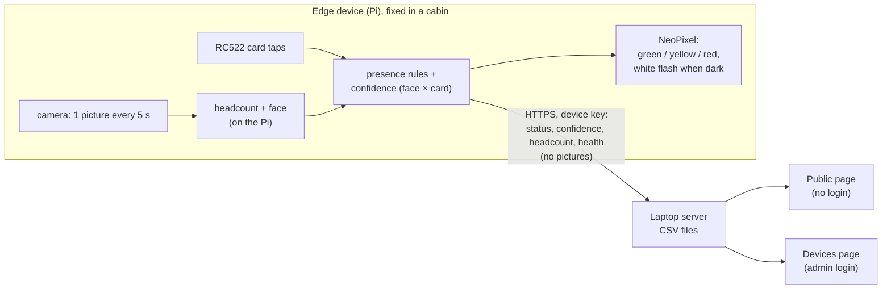

# Smart Cabin v3 – plan

**v3 started 26 Oct 2026 as a copy of v2** (v2 works and is frozen in `../v2/`, git tag `v2-final`). New requests are
written in the *Change log* below first, then built here. Everything below up to the change log is v2's plan, which
v3 starts from.

Written 24 Oct 2026, before the code. Ticked only after checking. Changes go in the *Change log*.

**Primary goal:** is the person **in their cabin or not** (and alone or with others), shown correctly on a public page.

A research prototype: every part must work and be easy to troubleshoot. The laptop is the server.

---

## 1. How it works



- **Identity like a roll number:** each Pi has a hardware serial. The first time it says hello, the server gives it a device number (`SC-001`, `SC-002`, …) and a secret key. The **location** of each device is set once by the admin on the Devices page. Nothing about the location is written on the Pi.
- **Registration at the device:** the person opens the Pi's page on their phone, enters a **setup PIN** (from the admin), picks their name from the university list, registers their face (10 photos) and taps their card. When registration starts, the Pi fetches a copy of the list from the server (id, name, designation, school, department only, about 120 KB) into `data/people_copy.csv`; the page offers **School → Department drop-downs and type-to-search**, filtered on the phone. The location comes from the device. Moving cabin = registering at the new cabin's device; the old registration is kept as history.
- **The Pi decides** in / out, headcount, confidence and the status. The server receives, saves, adds the timetable ("In class until 10:00"), shows the public page, and marks a device **Unknown** after 60 s of silence.
- **Not in this build:** Bluetooth, hardware buttons, manual status, an OLED display, machine learning (planned in section 8).

## 2. Statuses and LED

| LED | Status | Rule |
|---|---|---|
| 🟢 | Available | person in, headcount ≤ 1 |
| 🟡 | In a meeting | person in, headcount ≥ 2 |
| 🔴 | Not available | person not in (the timetable says where, if known) |
| ⚪ (page only) | Unknown | the device has sent nothing for 60 s |
| 🔵 | – | registration going on at the device |
| short white | – | the room is dark: light for the camera, then back to the status colour |

## 3. Presence rules and confidence (on the Pi)

| Rule | Value |
|---|---|
| Arrive | the person's face matched in **2 face checks in a row**, or a **card tap** |
| Card tap while in | out at once (logout). For 60 s after it, the face can't bring them back in |
| Card tap must be confirmed | by the face within **120 s**, or they are out again. A person registered **with a card only** (no face) is confirmed when the camera counts anyone in the cabin within 120 s |
| Stay in | while the face is seen, or anyone is still counted in the cabin |
| Leave | no face **and** headcount 0 for **180 s** |
| Confidence | face × card table from test 10 (Bluetooth column dropped): none **2 %**, card only **35 %**, face only **70 %**, both **90 %**. Someone counted in the cabin while in adds **+10 %** (max 95 %) |

## 4. Keeping the Pi cool

- **Snapshots, never video.** One picture every **5 s**, every **1.5 s for 30 s** after a change (tap, headcount change, face found).
- **Headcount on every picture** (MobileNet-SSD at 300 px on the Zero 2W, YOLOv8n at 320 px on the Pi 4 if its model file is there).
- **Face check only when useful:** someone is in the picture, and the person is not confirmed yet, or 30 s have passed since the last check. Faces are searched only in the top half of each person box (from the full 1296x972 picture). If no person is found, a face check on the whole picture runs at most every 15 s (a person close to the camera can be missed by the body detector).
- OpenCV limited to **2 threads**. Above **70 °C** the pictures come half as often, above **78 °C** vision pauses until it is back under 70 °C.
- **Dark room:** if a picture is too dark (average brightness under 40 / 255), the LED shines white for 0.6 s and one picture is taken, **at most once a minute** (or right after a card tap). A dark room with no face counts as headcount 0.

## 5. Security

| Risk | What v2 does |
|---|---|
| Watching the camera | **No video feed exists.** Pictures are used and dropped on the Pi. The only picture ever shown is a small preview during registration, only after the setup PIN, only to that phone (a secret page key), and only until the registration ends (max 5 min) |
| Listening on the Wi-Fi | **HTTPS** for the server and the Pi's page (self-signed certificates made at first start; a phone shows a warning the first time, accept it once). The Pi **remembers the server's certificate** the first time and refuses a different one later |
| A fake device | the server gives each device a secret key on its first hello (only the key's hash is stored). Reports without the right key are refused. A device can be reset only by the admin |
| Changing settings | the Devices page (locations, setup PINs, removing registrations, logs) needs the **admin login**. The admin account is made on the first visit; the password is stored as a salted PBKDF2 hash. A wrong login waits 1 s |
| Registering as someone else | registration needs a **6-digit setup PIN** that the admin makes for that device (valid 15 min, one use) |
| Card ids | the server keeps only a hash of the card id ("card registered: yes"). The card id itself is only on the Pi |
| Face data | only on the Pi: 10 × 128 numbers (no photos), file readable only by root |
| What the public sees | only name, designation, school, department, status, location, until / where, today's timetable. No confidence, no card, no device data |
| Bad requests | every request is size-limited and checked; errors answer with a message, never a crash |

Prototype limits (written in the paper): self-signed certificates, one admin account, everything on the laptop's hotspot.

## 6. Troubleshooting

- Every file starts with a comment saying what it does.
- Every button: **Working…** → green message or red message with the reason. Every request has a **10 s** limit.
- Every server route and every Pi part is in try / except. Answers are always `{ok, message, ...}`.
- Page errors show in a **red bar** at the top.
- Each Pi part (camera, people model, face model, RFID, LED, server link) shows **OK / PROBLEM + the reason** on the Pi page and on the Devices page; the rest keeps running.
- Logs: `laptop_server/logs/server.log`, `pi_edge/logs/edge.log`. The Devices page shows the newest server log lines and every device's last error.
- `python main.py --sim` runs the Pi app on a laptop with no hardware (a picture file as the camera, a "tap card" box on the page).

## 7. Files

**CSV files on the laptop** (`laptop_server/data/`):

| File | Holds |
|---|---|
| `people.csv` | the university faculty list (839 people, from the website). Existing |
| `programs.csv` | schools and their programmes (B.Tech, M.Tech, …). Existing, used for the programme filter |
| `timetable.csv` | person, day, start, end, activity. Existing demo data, replaced as real timetables come |
| `admin_account.csv` | the admin's username and password hash |
| `admin_sessions.csv` | admin logins (hash of the cookie, expiry) |
| `devices.csv` | device number, serial, model, location, key hash, IP, first seen, last seen |
| `device_health.csv` | latest health per device: temperature, CPU, memory, throttling, each part's state, last error |
| `setup_pins.csv` | setup PINs (hash, device, expiry, used) |
| `registrations.csv` | person, device, location, card hash, face photos, from, to (empty = current). Old rows stay as history |
| `status_now.csv` | latest status per registered person: status, confidence, headcount, in cabin, updated |
| `presence_log.csv` | every report: time, device, person, face, card, headcount, dark, confidence, in cabin, status, temperature. **The data for the paper and the machine learning** |
| `events_log.csv` | arrive, leave, tap, registration, location change, errors, in words |

**On the Pi** (`pi_edge/data/`): `device.json` (device number, key, server certificate fingerprint), `person.json` (who is registered here and their card id), `face.npy` (10 × 128 numbers), `people_copy.csv` (the list for registration), `page_cert.pem` / `page_key.pem` (the page's certificate).

**Code:**

```
v2/
├─ PLAN.md, README.md, deploy_to_pi.ps1
├─ laptop_server/   main.py, settings.py, logbook.py, csv_store.py, security.py, people.py,
│                   timetable.py, devices.py, registrations.py, status.py, web.py
│                   pages/ (the user's design, one folder):
│                     Main.dc.html + main.js        home: choose a school, search, filters, person details (served at /)
│                     Search.dc.html + search.js    search page with school / department / programme filters
│                     Login.dc.html + login.js      admin login / first admin account
│                     Devices.dc.html + devices.js  the admin's Devices page
│                     api.js                        shared: requests with a time limit, error bar
│                     canvas.json                   the design tool's file (not used by the server)
└─ pi_edge/         main.py, settings.py, logbook.py, shared.py, install.py, identity.py, health.py,
                    server_link.py, camera.py, people_count.py, face.py, rfid.py, led.py,
                    presence.py, vision.py, registration.py, web.py
                    details.py                                  device details for the Advanced view
                    pages/ (the user's design): PiDevice.dc.html + pidevice.js (device page, at /),
                           PiRegister.dc.html + piregister.js (registration), api.js (shared)
laptop_server/discovery.py                                      announces the server so the Pis find it
```

Server: Python's own web server (no FastAPI, nothing to install except `cryptography` for the certificate). Pi: picamera2, OpenCV, mfrc522, rpi_ws281x, all already tested.

## 8. Later (after Review 1)

- Machine learning on `presence_log.csv`: learned confidence (Naive Bayes / logistic regression), steady status (hysteresis, then a Hidden Markov Model), predictions ("usually back around 11:40").
- Edge vs offload experiment (pictures processed on the laptop) for the paper.
- Bluetooth, manual status, an OLED display, the stillness check and ignore zones against posters.

## 9. Checks

Tested 24–25 Oct 2026 on the laptop: server test 33 / 33, end-to-end with a simulated Pi 29 / 29, plus the pages in the browser.

- [x] server starts, makes its certificate, admin account on the first visit (only from the laptop)
- [x] wrong admin password refused; pages without login refuse changes with a message
- [x] a simulated Pi says hello → gets SC-001 and a key; a report without the key is refused
- [x] location set on the Devices page reaches the Pi
- [x] registration with a setup PIN: name from the list (copied to the device), face (10 photos), card, saved on both sides
- [x] wrong / used PIN refused *(expiry after 15 min written, not timed)*
- [x] public page: search, school / department / programme filters, only allowed fields, today's timetable *(timetable shown; the demo data had nothing for the test day)*
- [x] arrive (face) → green, 3 people → yellow, leave → red after 180 s, device off → Unknown after 60 s
- [x] card tap in / out, unknown card ignored, unconfirmed tap → out after 120 s, 60 s logout pause
- [x] every button gives a message; page errors in the red bar *(server-stopped message written, not tried in the browser)*
- [ ] on the real Pi: camera, RC522, LED OK; dark flash; 30-minute temperature run *(the hotspot was off)*

## Change log

- 26 Oct 2026 – user: "from the next iteration we don't work in v2, because it works; make a v3 folder". **v2 is frozen here.** Further work (tests, new features) happens in `v3/`, which starts as a copy of v2. This file stays as v2's record.
- 26 Oct 2026 – user: "flow diagrams, build diagrams, flowcharts, pictures of the programs and how they are linked". New `docs/diagrams.md` (Mermaid, GitHub draws them): the whole system, the server's and the device's files and how they call each other, start-up and threads, the vision loop, the in / out rules, how the server decides what the pages show, discovery and reports, registration, adding / deleting face sets and cards, pages and their calls, the data files.
- 25 Oct 2026 – user: "add back the options to add / remove face data and add more tags". Now working on the Pi page (Advanced → Registration details): **Add more face data** (10 more photos, which must match the registered face, so nobody else can add their face), **Add another RFID card**, and **Delete** for each face set and card (at least one of each is kept). Adding a card and deleting need the registered person in front of the device (face seen in the last 2 minutes or a registered card tapped). The Pi keeps the face sets (`face.npy` + the list in `person.json`) and the cards; the server is updated (card ids only as hashes, `card_hash` may hold several, separated by `;`).
- 25 Oct 2026 – after the first real test (user: card tap updates at once, face → Available works; but leaving did not switch back, the live view stutters, CPU and memory are high):
  - **Leave (user's rule):** the face decides. Face not seen for **2 minutes** → not in the cabin, even if other people are counted (the headcount then only tells empty from occupied by others). Someone registered with a card only (no face): nobody counted for 2 minutes → out. The face is checked every 30 s while in, every picture while out. "Seen" on the pages = face seen in the last 2 minutes.
  - **Timetable (user's rule, on the server):** a class / lab / meeting starting within **5 minutes** and the face not seen for 2 minutes → **Not available, "Leaving for <class> at <time>"**. Seen in the cabin → stays Available (being there wins). Coming back in a free hour → Available as soon as the face is seen. The Pi sends how long ago the face was seen (`face_age`). The door LED follows the Pi's own in / out (it has no timetable).
  - The pages show **how** someone is in: "Seen and tapped in", "Seen, not tapped in", "Tapped in, not seen yet" (from the face and card signals the Pi already sends; new columns `face`, `card` in `status_now.csv`).
  - **Camera:** one camera setup with two streams: **640x480** (the user's middle resolution) for the headcount and the live view, **1296x972** taken only when a face check is needed. Lighter for the board.
  - **Live view** becomes a continuous stream (`/live.mjpg`, 5 pictures a second on a Zero 2W, 10 on a Pi 4 / 5), only while someone watches, with the latest person boxes drawn on it.
  - **Board-aware timings:** on a Pi 4 / 5 a picture every 2 s (1 s after a change), on a Zero 2W every 5 s (1.5 s).
  - Board choice (user): **Raspberry Pi 5, 4 GB**, also for future projects. The code supports Zero 2W, Pi 4 and Pi 5. On a Pi 5 the NeoPixel library `rpi_ws281x` does not work, so the LED uses `pi5neo` on the second SPI bus: **DIN → GPIO20 (pin 38)**; the installer turns SPI1 on (`dtoverlay=spi1-1cs`, one reboot). Pi 5 also needs its camera cable (22-pin → 15-pin) and a 5 V 5 A supply. Recorded in `docs/boards.md`.
- 25 Oct 2026 – user: "the connection gets closed and the board turns off or reboots; record what happened". New `pi_edge/blackbox.py`, a separate program (runs at boot as its own service, even if the app crashes): every 2 s one line in `data/blackbox.csv` (temperature, the Pi's under-voltage / throttling flags, CPU, free memory, swap, Wi-Fi signal, app running + its memory), written straight to the SD card so the last seconds survive a power cut. At each start it checks whether the previous run ended cleanly; if not, `data/blackbox_report.txt` gets the last readings, the likely cause, and the kernel's messages of the previous boot about under-voltage, out-of-memory or heat. `sudo python3 blackbox.py --install` makes it start at every boot (and keeps the system log across reboots); `python3 blackbox.py --report` shows the report.
- 25 Oct 2026 – user: "all web pages update every second, and live visuals in the advanced view of the Pi site". All pages (Main, Search, Devices, PiDevice, PiRegister) now refresh every 1 s. The Pi's Advanced view gets a **Live view**: the latest picture the vision loop used (480x360, person boxes, headcount, time), plus live charts of people counted, confidence, CPU temperature and CPU use over the last 2 minutes. The picture changes as often as the vision loop takes one (every 1.5–5 s). Note: anyone on the network who opens the device page can see this picture (no login on the device page; accepted for the prototype by the user).
- 25 Oct 2026 – user: registration for now is done by starting the Pi app over SSH and opening its page from the laptop; "the Raspberry Pi should find the server by itself". **Server discovery:** the server sends a small UDP broadcast every 2 s on port 50505 (`SMARTCABIN https://<its address>:<port>`) on each network it is on; the Pi listens, uses the address it hears, and remembers it in `data/device.json`. `SERVER_URL` in `settings.py` stays as the fallback. The certificate pinning still refuses a fake server. Works for any number of devices on the same network.
- 25 Oct 2026 – **focus for now (user):** availability by face + card + headcount + timetable, people count, RFID. Wi-Fi setup, hotspots, pairing codes, OLED and portal logins for faculty are **later**. The user's Pi designs are the device's front end: `PiDevice.dc.html` (status, Simple / Advanced view, device details, parts) and `PiRegister.dc.html` (name → face → card → save). Registration no longer needs a PIN: the server allows it while nobody is registered at that device (and the device has a location); a registered device needs the admin to remove the person first. Maintenance buttons and adding / deleting extra face sets and cards are shown but not active yet.
- 25 Oct 2026 – user replaced the laptop pages with their own design (`pages/Main.dc.html` = home + find a faculty member, `Login.dc.html`, `Devices.dc.html`, `Search.dc.html`, `canvas.json` from the design tool): "don't change the front end, link them to actual code". The design-tool template tags (`x-dc`, `sc-if`, `sc-for`, `{{…}}`, `DCLogic`) need the tool's `support.js`, which is not available, so they become plain HTML with one script per page (`main.js`, `login.js`, `devices.js`, `search.js`, shared `api.js`) that fills in the real data. Look, styles, text and file names are kept; placeholders (`[time]`, `[n]`, `[PIN]`, sample people / timetable) show live values. `/` = `Main.dc.html`; `/search`, `/devices`, `/login` lead to the others. New public call `/api/people-status` (all people, public fields + role + status, for the client-side grouping the design does). The page security rule now allows inline styles and Google Fonts (scripts still only from the server).
- 25 Oct 2026 – user moved `home.html` to `pages/home.html` (no `home/` folder). Its links now point to `common/`, `public/`, `login/`; the other pages link back to `../home.html`; the server serves `/` and `/home.html` from it directly.
- 25 Oct 2026 – user: "when the server is launched, make the home page launch itself". `python main.py` now opens the welcome page in the laptop's default browser a second after the server starts. `--no-browser` turns it off.
- 25 Oct 2026 – user: "I don't want who is available" → the landing page (`pages/home/`) is now a **welcome page**: the Smart Cabin name, a short line on what it does, how it works in three steps, what the colours mean, and two buttons: **Find a faculty member** (the search page) and **Admin** (login). No status list on it; `/api/board` removed.
- 25 Oct 2026 – found while testing the landing page: someone registered with a card only could never be confirmed (no face to see), so every tap-in ended after 120 s. Now a card-only person is confirmed when anyone is counted in the cabin.
- 25 Oct 2026 – user: "laptop end I want a landing page first, directly start showing people are available or not". New `pages/home/` at `/`: counts (Available / In a meeting / Not available / Unknown) and a card for every person who has a cabin device, available first, refreshed every 10 s, no typing needed. A card opens the person's details on the search page; "Search all faculty" leads to the search page, now at `/search`. Data from a new public call `/api/board` (same public fields only).
- 25 Oct 2026 – user: "check if it's a Windows system or not a Pi board, let the code execute as usual; only the physical hardware is missing". The Pi app now detects the computer (`settings.COMPUTER`) and runs normally without `--sim`. Missing parts show **NOT PRESENT** (grey, not an error). Camera on a non-Pi: `--picture` file if given, else the computer's webcam (`--no-webcam` turns it off), else none (vision waits). RC522 → the "Tap card" box on the page; NeoPixel → the colour on the page.
- 25 Oct 2026 – user: "all the htmls separate in their own folders". Each page now has its own folder with its HTML and its script (`pages/public/`, `pages/devices/`, `pages/login/` on the laptop, `pages/device/` on the Pi); the shared `app.js` and `style.css` are in `pages/common/`. User: "html codes should be able to open individually": all links are relative (`../common/style.css`), the servers serve each file at `/<folder>/<file>` (same layout as on disk; `/`, `/devices`, `/login` redirect there), and a page opened as a plain file shows its layout with a note that live data needs the server.
- 25 Oct 2026 – built and tested in simulation. Found and fixed: OpenCV 5 can't read MobileNet-SSD (→ YOLOv8n there); simulated devices need their own data folders (`--serial` → `data/<serial>/`); a page refresh race lost the registration key. Added `--http` / `--port` for troubleshooting.
- 24 Oct 2026 – plan written (v2, from scratch): CSV files, devices numbered by the server, location set on the server, registration at the device with names from the server, edge processing, no Bluetooth for now, LED status + dark flash, F × R confidence, security (HTTPS, device keys, admin login, setup PIN, no video feed).
