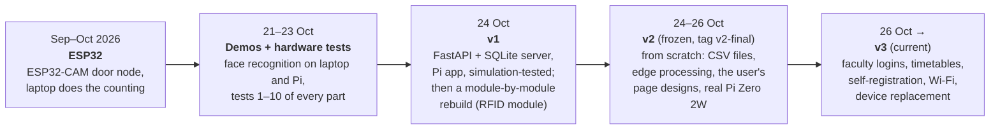
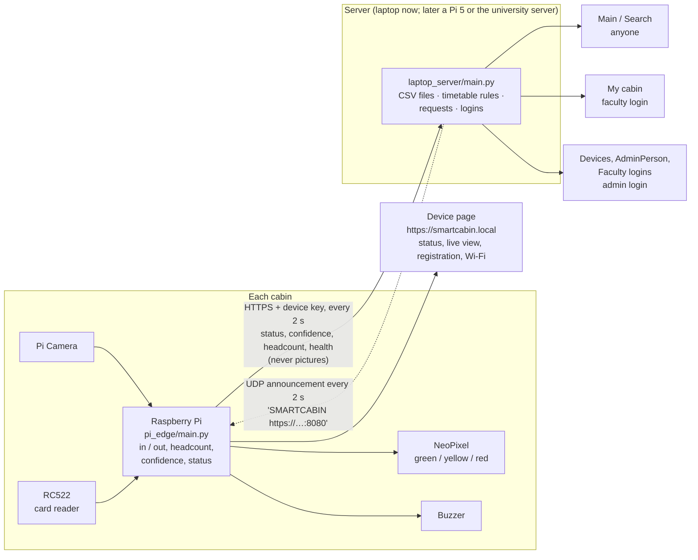
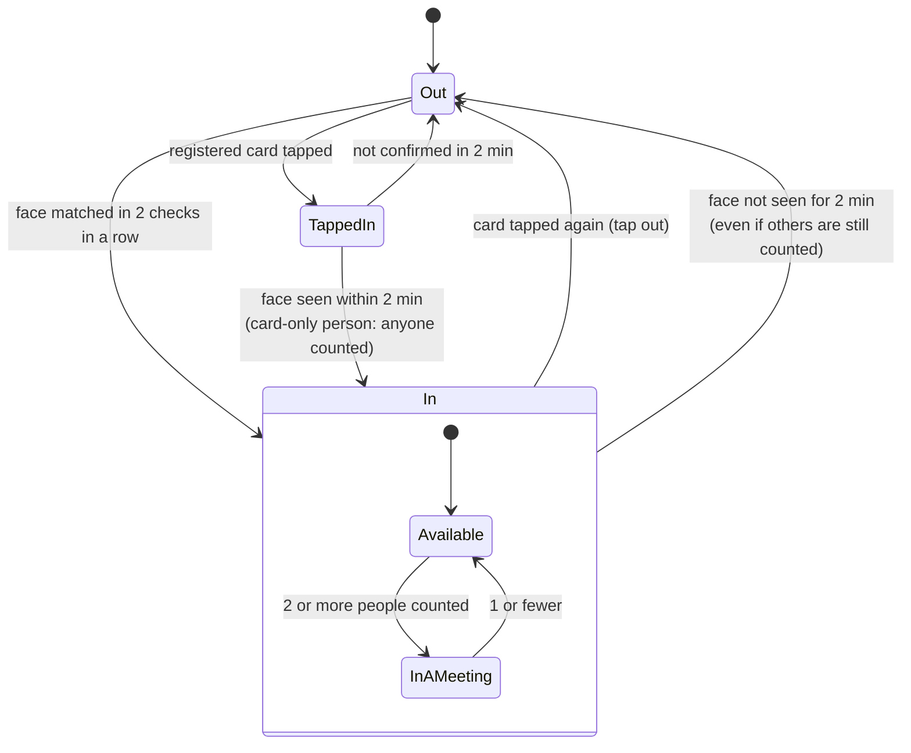
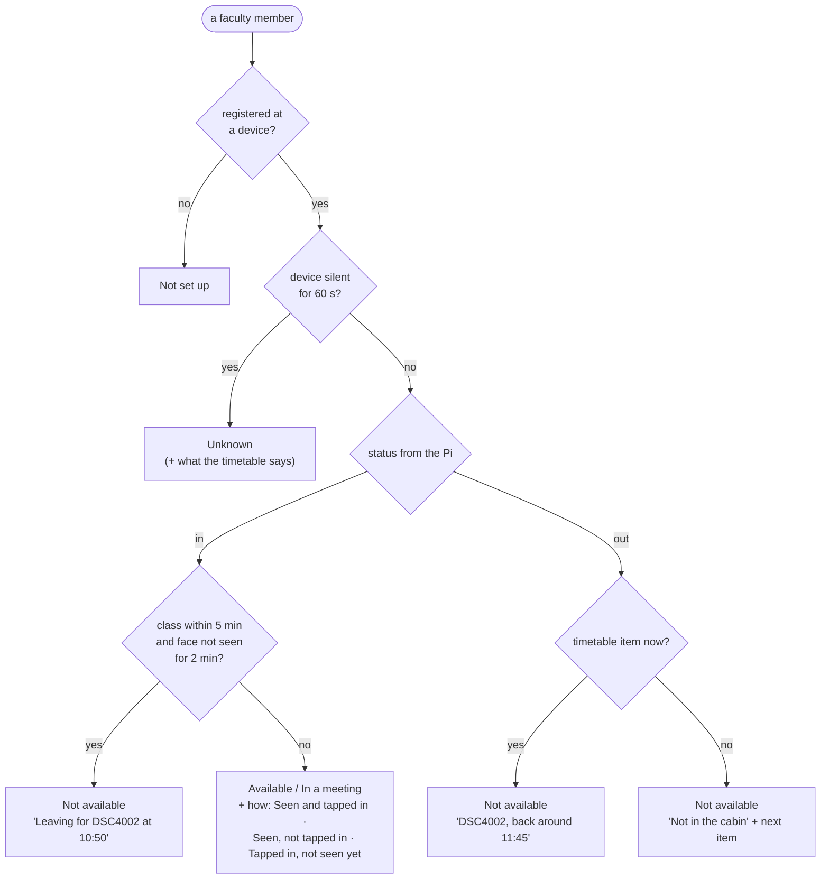
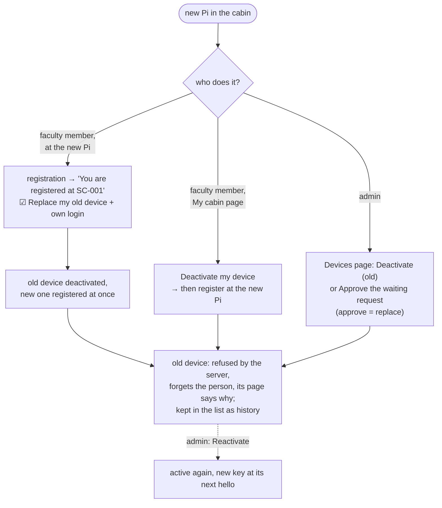

# Smart Cabin v3

**An IoT-based, real-time faculty availability monitoring system.** A small Raspberry Pi in each faculty cabin works
out by itself whether the faculty member is in (face recognition, RFID card taps, people count) and sends only the
result to a server, which adds the timetable and shows it on a web page anyone in the university can open.

M.Tech research prototype · edge processing · CSV files (no database) · HTTPS everywhere

| | |
|---|---|
| Plan and every change, with dates | [PLAN.md](PLAN.md) |
| Diagrams of the program internals (files, threads, vision loop) | [docs/diagrams.md](docs/diagrams.md) |
| Boards: Zero 2W, Pi 4, Pi 5 | [docs/boards.md](docs/boards.md) |
| Decisions, and ideas postponed or dropped | [docs/decisions-and-ideas.md](docs/decisions-and-ideas.md) |
| Day-by-day log | [../timeline.md](../timeline.md) |

## Contents

1. [The problem and the idea](#1-the-problem-and-the-idea)
2. [How we got here: v1 → v2 → v3](#2-how-we-got-here-v1--v2--v3)
3. [Tech stack](#3-tech-stack)
4. [The whole system](#4-the-whole-system)
5. [How the status is decided](#5-how-the-status-is-decided)
6. [Setting up a cabin (the faculty member does it)](#6-setting-up-a-cabin-the-faculty-member-does-it)
7. [Replacing a device](#7-replacing-a-device)
8. [Wi-Fi: laptop hotspot and campus Wi-Fi](#8-wi-fi-laptop-hotspot-and-campus-wi-fi)
9. [Run it](#9-run-it)
10. [The pages](#10-the-pages)
11. [Hardware and wiring](#11-hardware-and-wiring)
12. [The code: folders and files](#12-the-code-folders-and-files)
13. [Data files](#13-data-files)
14. [Security](#14-security)
15. [Troubleshooting](#15-troubleshooting)
16. [Future plans](#16-future-plans)

---

## 1. The problem and the idea

Students and staff walk to a faculty cabin only to find it empty, and timetables alone don't say whether someone is
actually in. Smart Cabin answers one question, live: **is the person in their cabin right now, alone or with others?**

- **At the cabin:** a Raspberry Pi with a camera, an RC522 card reader, a NeoPixel light and a buzzer.
- **On the Pi (edge processing):** pictures are analysed on the Pi itself; **no picture or video ever leaves the
  cabin**. Only the result (status, confidence, how many people) is sent, every 2 seconds.
- **On the server:** the status of every faculty member, their timetable and cabin, on public pages; logins for the
  admin and for each faculty member.

## 2. How we got here: v1 → v2 → v3



### Before v1: ESP32 and the tests
An ESP32-CAM at the door sent pictures to the laptop, which counted people with YOLO. It was dropped on 25 Oct: a
Raspberry Pi can do everything, including face recognition, on the spot. Hardware tests 1–10 checked each part
(camera, RC522, NeoPixel, face recognition, people counting, Bluetooth). Kept in `laptop codes/`, `pi board codes/`.

### v1 (24 Oct): first full system
A FastAPI + SQLite server and a Pi app, tested in simulation. Then a module-by-module rebuild started with the RFID
module (`v1/for pi board/RFID/`: physical connection test, sensor specs, integrity check, tag reading, PASS / FAIL
for each). Kept in `pi board codes/smart cabin system/archive/v1/` and `v1/`.

**Why it was replaced:** the user wanted no database (CSV files instead), simpler code, and the system run on the real
board rather than in simulation.

### v2 (24–26 Oct): the working base, now frozen
Built from scratch and run on the real Pi Zero 2W. **Frozen on 26 Oct** (`../v2/`, git tag `v2-final`) because it
works; v3 started as a copy.

- CSV files only; the device gets its number from the server (SC-001, SC-002, … from the hardware serial).
- The Pi finds the server by itself (UDP announcement); HTTPS with device keys; admin login.
- Edge processing: people count (MobileNet-SSD / YOLOv8n), faces (YuNet + SFace), RFID, presence rules on the Pi.
- The user's own page designs, linked to the code; pages refresh every second; live camera view on the Pi page.
- Black box crash recorder; start at boot; face sets and cards added / deleted at the device.
- Rules from the first real test: the face decides (not seen for 2 minutes = out); "Leaving for <class>" when a class
  starts within 5 minutes.

### v3 (26 Oct → now): what is new

| Area | v3 |
|---|---|
| **Logins** | One login box for admin and faculty (username, server id or ID card number). Faculty logins made in bulk with a default password, changed at the first login. |
| **Pages** | Devices page with count filters, newest device, faculty browser; new **AdminPerson**, **AdminLogins**, **Faculty (My cabin)** pages. |
| **Timetables** | Period-based, like the university's: several per person, one in use; the status rules read it. |
| **Self-registration** | At the device, **no admin needed first**: with their own faculty login it is registered at once; otherwise it waits for the admin (Approve / Reject). |
| **Device replacement** | Deactivate the old device and register the new one, by the faculty member or the admin. |
| **Wi-Fi** | Laptop hotspot first, campus Wi-Fi as well, managed on the Pi page. Address **`smartcabin.local`**. |
| **Hardware** | Buzzer (beeps for taps, photos, card left on the reader); Pi 4 and Pi 5 support. |
| **Reliability** | Servers no longer freeze on a stuck connection; a second server on the same port is refused; camera colours fixed; `main.py` starts everything (app + black box). |

## 3. Tech stack

| Part | What is used |
|---|---|
| Edge device | Raspberry Pi 4 (tested), Zero 2W (tested), Pi 5 (supported); Raspberry Pi OS trixie 64-bit; Python 3.13 |
| Camera | Pi Camera (OV5647 / IMX219) through **picamera2**: 1296x972 for faces, 640x480 for counting and the live view |
| People count | **OpenCV DNN**: YOLOv8n (Pi 4 / 5) or MobileNet-SSD (Zero 2W) |
| Face recognition | **YuNet** (find faces, fixed 640x640) + **SFace** (128 numbers per face, cosine similarity ≥ 0.36) |
| Card reader | **RC522** on SPI (`mfrc522`, `spidev`, `rpi-lgpio`) |
| Light / sound | **NeoPixel** (`rpi_ws281x`; `pi5neo` on a Pi 5), active buzzer on GPIO23 |
| Wi-Fi | **NetworkManager** (`nmcli`), mDNS name through **avahi** (`smartcabin.local`) |
| Server | Python standard library only (`http.server`, threads) + `cryptography` for the certificate |
| Storage | **CSV files** (written under a lock, swapped in whole) |
| Security | HTTPS (self-signed, pinned by the Pi), PBKDF2 passwords, device keys (only hashes stored), session cookies |
| Pages | Plain HTML + one JavaScript file per page (the user's designs), no frameworks |
| Start | systemd services `smartcabin` and `smartcabin-blackbox` |

## 4. The whole system



**What runs where**

| Where | Program | Started by |
|---|---|---|
| Laptop | `v3/laptop_server/main.py` | `python main.py` (opens the home page; `--no-browser` to stop that) |
| Pi | `~/smartcabin_v3/main.py` (app) | the `smartcabin` service at boot, or `sudo python3 main.py` (also starts the black box) |
| Pi | `~/smartcabin_v3/blackbox.py` (recorder) | the `smartcabin-blackbox` service at boot, or by `main.py` |

## 5. How the status is decided

### On the Pi: in or out



**Confidence** = face (seen in the last 2 min) × card (tapped in): none 2 %, card only 35 %, face only 70 %, both 90 %;
+10 % while someone is counted (at most 95 %).

### On the server: what the pages show



| Light | Status | Buzzer | When |
|---|---|---|---|
| green | Available | one short beep | card accepted (tap in / out) |
| yellow | In a meeting | two short beeps | card refused (unknown / already linked) |
| red | Not available | a tick | each face photo |
| blue | registration going on | short + long | 10 face photos done |
| white flash | dark room: light for one picture, at most every 2 min | two long beeps | card left on the reader |

**Camera timing:** a 640x480 picture every 5 s (Zero 2W) or 2 s (Pi 4 / 5), faster for 30 s after a change; the
1296x972 picture only when a face has to be checked. Above 70 °C half as many pictures; above 78 °C vision pauses.

## 6. Setting up a cabin (the faculty member does it)

The Pi is flashed with one setup Wi-Fi name and password. Nothing else is needed from the admin first.

1. Turn on a laptop **hotspot** with that Wi-Fi name and password, on **2.4 GHz**.
2. Power the Pi. It starts by itself and joins the hotspot.
3. Open **`smartcabin.local`** in the browser (accept the certificate warning once) → **Start registration**.
4. Pick your name → 10 face photos → tap your card → **Confirm and send** with your faculty login and cabin.

```mermaid
sequenceDiagram
    actor F as Faculty member
    participant P as Pi (smartcabin.local)
    participant S as Server
    F->>P: Start registration (no admin needed)
    P->>S: people list (or the last copy if the server is out of reach)
    F->>P: name → 10 face photos → card tap
    F->>P: Confirm and send: faculty login + password, cabin
    alt server reachable
        P->>S: register (card id → stored only as a hash, face count; faces stay on the Pi)
        alt own login, own password, not registered elsewhere
            S-->>P: registered
        else no login / default password / registered at another device
            S-->>P: waiting for the admin (with the reason)
            Note over S: Devices page → Registration requests → Approve / Reject
            S-->>P: approved → registered · rejected → the Pi deletes the face and card
        end
    else server out of reach
        P->>P: kept on the Pi as "waiting"
        P->>S: sent later, without the password → the admin decides
    end
```

## 7. Replacing a device

Example: SC-001 (Pi Zero 2W) is replaced by SC-003 (Pi 4, freshly flashed). Faces are never on the server, so the
face is always registered again at the new device (it is, with the new registration).



## 8. Wi-Fi: laptop hotspot and campus Wi-Fi

- The Wi-Fi from flashing (the laptop hotspot) is a **setup network**: always used first, can't be removed.
- **Pi page → Advanced → Wi-Fi networks:** add a network (name + password) or **campus Wi-Fi** (username + password,
  WPA2-Enterprise like eduroam); remove one (not the setup network, not the one in use).
- When the hotspot is off, the Pi uses campus Wi-Fi; when the hotspot is on again, it switches back within a minute.
- Changes need the registered person at the device (face or registered card in the last 2 minutes); before anyone is
  registered, anyone at the device page may set it up. Passwords stay on the Pi (root-only), never shown again or sent.

## 9. Run it

### The server (laptop)
1. Turn on the Windows **Mobile hotspot** (2.4 GHz); the laptop is `192.168.137.1` on it.
2. In `v3/laptop_server`: `python main.py`. The first start makes an HTTPS certificate (the browser warns once).
3. Admin: **https://localhost:8080/login** on the laptop; the first time, the same form creates the admin account.
4. **Faculty logins:** Devices → Faculty logins → usernames, ID card numbers, one default password → Create.
5. Pis can't reach it? Allow port 8080 once (admin PowerShell):
   `New-NetFirewallRule -DisplayName "Smart Cabin 8080" -Direction Inbound -Protocol TCP -LocalPort 8080 -Action Allow -Profile Any`

Only one server can run on port 8080; a second start says "Is the server already running in another window?".

### A Pi
1. Flash Raspberry Pi OS (trixie 64-bit; Lite on a Zero 2W) with the setup Wi-Fi and SSH in Raspberry Pi Imager.
2. From the laptop, once: key login and sudo without a password:
   `pi board codes\setup_pi_key.ps1 <pi address>` and `pi board codes\setup_pi_sudo.ps1 <pi address>`.
3. Copy and start: `v3\deploy_to_pi.ps1 -Pi <pi address>`. The first start installs what is missing, turns SPI on
   (one reboot), names the Pi `smartcabin` and installs the two boot services.
4. Start at boot off for testing: `sudo systemctl disable smartcabin smartcabin-blackbox`; then
   `cd ~/smartcabin_v3 && sudo python3 main.py` starts everything by hand.

**On a computer without Pi hardware** (Windows) the Pi app runs as usual: missing parts show *Not present*, the
camera is the webcam (or `--picture photo.jpg`, or `--no-webcam`), cards are typed on the page.

## 10. The pages

All pages refresh every second.

| Page | Who | Shows |
|---|---|---|
| `/` Main, `/search` | anyone | every faculty member's status, cabin and today's timetable; school / department / status filters |
| `/login` | admin, faculty | one box: username, server id or ID card number; first login sets your own password |
| `/devices` | admin | counts (filters), newest device, **registration requests**, faculty browser, events, server log; Deactivate / Reactivate |
| AdminPerson, Faculty logins | admin | one person: status, charts, registration, device details, login reset; logins for everyone |
| `/faculty` My cabin | faculty | status + colour key, cabin, timetables (several, one in use), account, device details, **Deactivate my device** |
| Pi `smartcabin.local` | anyone on the network | Simple: status. Advanced: live fields, live view, charts, registration details (add / delete face sets and cards), **Wi-Fi networks**, device details, parts |
| Pi registration | the person registering | name → face → card → confirm and send |

## 11. Hardware and wiring

Pi 4 / Zero 2W (Pi 5: NeoPixel on GPIO20, pin 38). Physical pin numbers:

| Part | Pin → Pi |
|---|---|
| RC522 | SDA → 24 (GPIO8), SCK → 23 (GPIO11), MOSI → 19 (GPIO10), MISO → 21 (GPIO9), RST → 22 (GPIO25), 3.3V → 1 (**never 5 V**), GND → 6 |
| NeoPixel | DIN → 12 (GPIO18), 5V → 2, GND → 14 |
| Buzzer (active) | signal → 16 (GPIO23), GND → 20, VCC → 4 (3-pin module; a bare buzzer needs an NPN transistor) |
| Camera | ribbon in the CAMERA port (Pi 5: 22-pin to 15-pin cable) |

Cooling: a Pi 4 in a closed case without a heatsink reached 78 °C at 10 % CPU (vision paused). Use a heatsink or fan.

## 12. The code: folders and files

```
v3/
├─ laptop_server/                 python main.py
│  ├─ main.py          start, open the home page        ├─ web.py            HTTPS server, every route
│  ├─ discovery.py     UDP announcement                 ├─ security.py       passwords, sessions, keys, certificate
│  ├─ devices.py       device register, deactivate      ├─ registrations.py  who is at which device (with history)
│  ├─ setup_requests.py  self-registration, approvals   ├─ status.py         reports in → status out (timetable rules)
│  ├─ faculty.py       faculty logins                   ├─ timetables.py     each person's timetables (periods)
│  ├─ timetable.py     today / now / next               ├─ people.py         faculty list
│  ├─ csv_store.py     safe CSV read / write            ├─ logbook.py        server.log + events_log.csv
│  ├─ settings.py      ports, times, periods
│  ├─ pages/           Main, Search, Login, Devices, AdminPerson, AdminLogins, Faculty (+ one .js each, api.js)
│  └─ data/            CSV files
├─ pi_edge/                       sudo python3 main.py
│  ├─ main.py          install, threads, card taps      ├─ install.py        libraries, SPI, models, network name
│  ├─ camera.py        two picture sizes                ├─ vision.py         picture → headcount → face
│  ├─ people_count.py  YOLOv8n / MobileNet-SSD          ├─ face.py           YuNet + SFace
│  ├─ presence.py      in / out, confidence             ├─ registration.py   registration, requests, approval
│  ├─ person_data.py   add / delete face sets, cards    ├─ rfid.py           RC522 taps
│  ├─ led.py · buzzer.py  light and sound               ├─ wifi.py           saved networks (nmcli)
│  ├─ server_link.py   hello, reports, discovery        ├─ web.py            device page (8000, 443, 80)
│  ├─ live.py · details.py · health.py · identity.py · shared.py · logbook.py · settings.py
│  ├─ blackbox.py      health recorder (own process)
│  └─ pages/           PiDevice, PiRegister (+ .js, api.js)
├─ docs/               diagrams, boards, decisions and ideas
└─ deploy_to_pi.ps1    copies pi_edge to a Pi and (re)starts it
```

## 13. Data files

**Server** (`laptop_server/data/`): `people.csv`, `programs.csv`, `timetable.csv` (the university lists) ·
`admin_account.csv`, `admin_sessions.csv`, `faculty_accounts.csv`, `faculty_sessions.csv` · `devices.csv` (with
`deactivated`), `device_health.csv`, `device_details.csv` · `registrations.csv` (with history) · `setup_requests.csv` ·
`status_now.csv` · `presence_log.csv` (every report: the data for the paper and machine learning) · `timetables.csv`,
`timetable_in_use.csv` · `events_log.csv`.

**Pi** (`pi_edge/data/`): `device.json` (number, key, server address and certificate), `person.json` (person, face
sets, cards, approval), `face.npy` (128 numbers per face photo, no photos), `people_copy.csv`, `page_cert.pem` /
`page_key.pem`, `blackbox.csv`, `blackbox_report.txt`.

## 14. Security

- HTTPS everywhere (self-signed). The Pi remembers the server's certificate and refuses any other.
- Each device has its own secret key (only its hash is stored); a deactivated device is refused.
- Passwords: PBKDF2 hashes; the default faculty password must be changed at the first login and expires.
- Self-registration is approved automatically only with the person's **own** password; otherwise the admin decides.
- Card ids are stored on the server only as hashes; faces (128 numbers each, never photos) stay on the Pi.
- Public pages show only name, designation, school, department, status, cabin and timetable.
- Known limits (prototype): self-signed certificates; the device page has no login (its live view can be seen on the
  network, accepted by the user); one admin.

## 15. Troubleshooting

| You see | Do this |
|---|---|
| A red bar on a page | The error in words; details in `laptop_server/logs/server.log` or `pi_edge/logs/edge.log` |
| "Is the server already running in another window?" | Another server holds port 8080 (e.g. v2): stop it first |
| Pi page: Server not connected | Read the reason; the Pi listens for the server's announcement |
| `smartcabin.local` not found | Use the Pi's address; on Windows the `.local` name needs the Pi on the same network |
| "already running as a service" on `sudo python3 main.py` | `sudo systemctl stop smartcabin` first, or watch it: `sudo journalctl -u smartcabin -f` |
| A part says Problem | The reason is next to it; the rest keeps working |
| The board stopped by itself | `python3 blackbox.py --report` on the Pi: last readings and the likely cause |
| SSH: "REMOTE HOST IDENTIFICATION HAS CHANGED" after reflashing | Compare the fingerprint, then `ssh-keygen -R <address>` |

## 16. Future plans

**Next (prototype)**
- Try the new flows end to end on the real Pis: a full self-registration, a device replacement, campus Wi-Fi switching.
- Find why the Pi takes minutes to switch from a saved server address to the hotspot announcement.
- Maintenance buttons (restart, reboot, shut down, factory reset) on the Pi and My cabin pages.
- Add face data and cards from the laptop pages (needs the server to send commands to the Pi).

**Hardware**
- OLED display (SSD1306) for a pairing code and the return time; Pi 5 (4 GB) as the main board; heatsinks / fans.
- A BH1750 light sensor only if light level is wanted as data (the camera brightness is used now).

**Scale and deployment**
- Server on a Pi 5 (Ethernet, SSD) for a pilot block, then on the **university server** for all 900+ cabins, with a
  real certificate and a fixed name.
- For 900 cabins: report on change + a heartbeat every 30 s, status kept in memory and saved every few seconds, only
  changes logged, one shared answer for all viewers, pages asking every 5 s. Today's code is built for a few devices
  (reports every 2 s, the status file rewritten on each report).
- More than one admin; faculty notifications.

**Research**
- Machine learning on `presence_log.csv`: learned confidence (Naive Bayes / logistic regression), steady status
  (hysteresis / HMM), predictions ("usually back around 11:40").
- Load tests (2 / 50 / 900 simulated cabins) on a laptop, a Pi 5 and the university server; edge vs server
  processing as a comparison for the paper.

Postponed and dropped ideas, with the reasons: [docs/decisions-and-ideas.md](docs/decisions-and-ideas.md).
